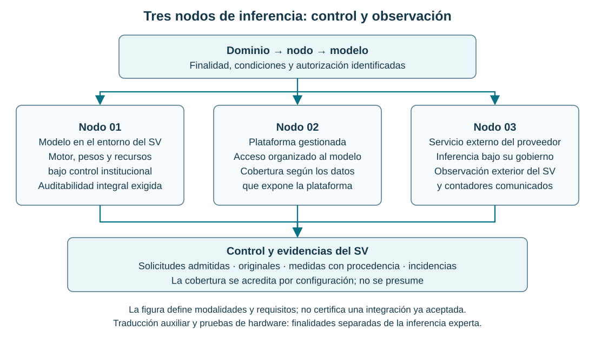
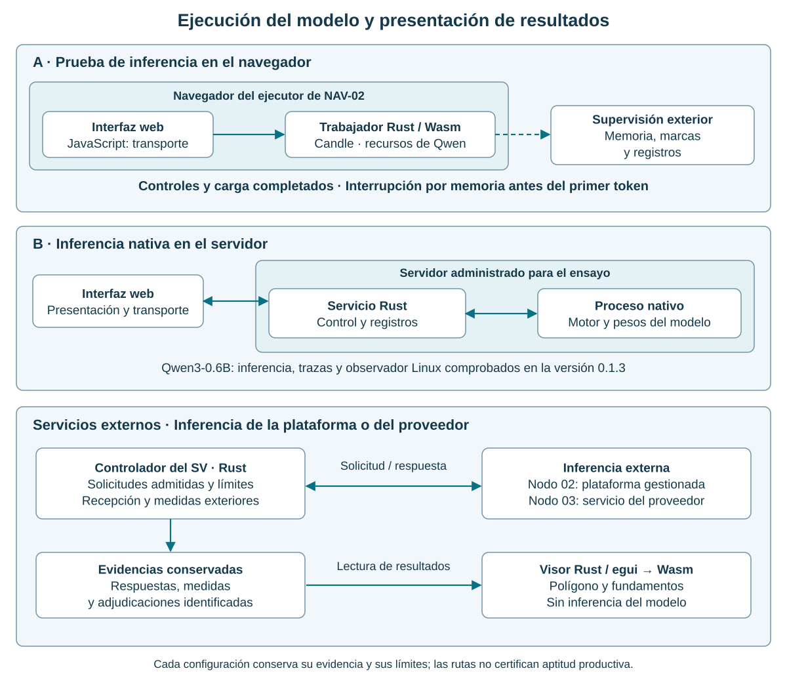
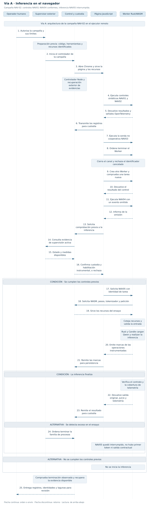
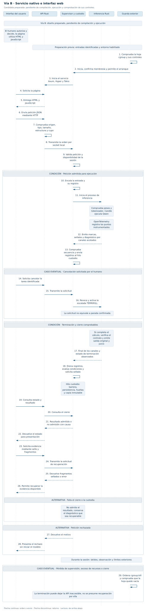
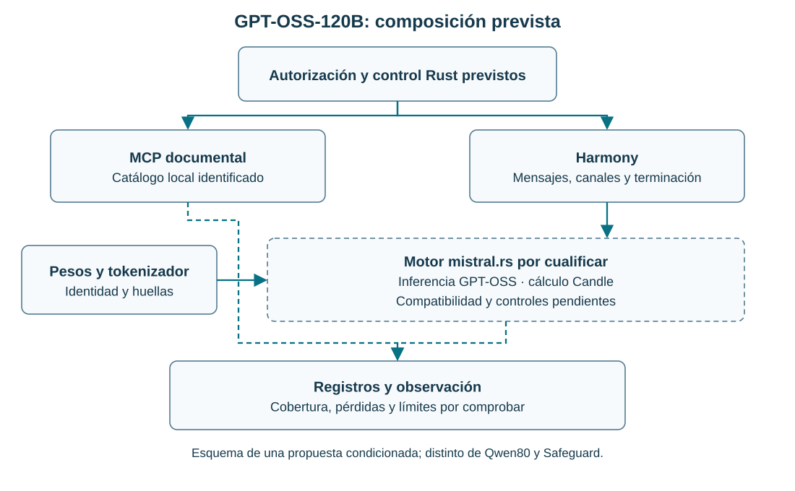
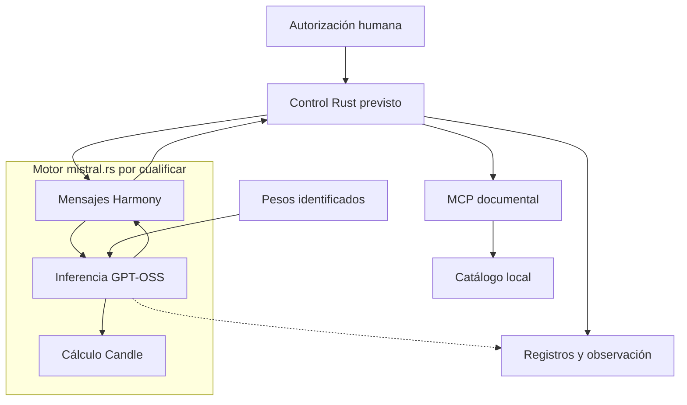
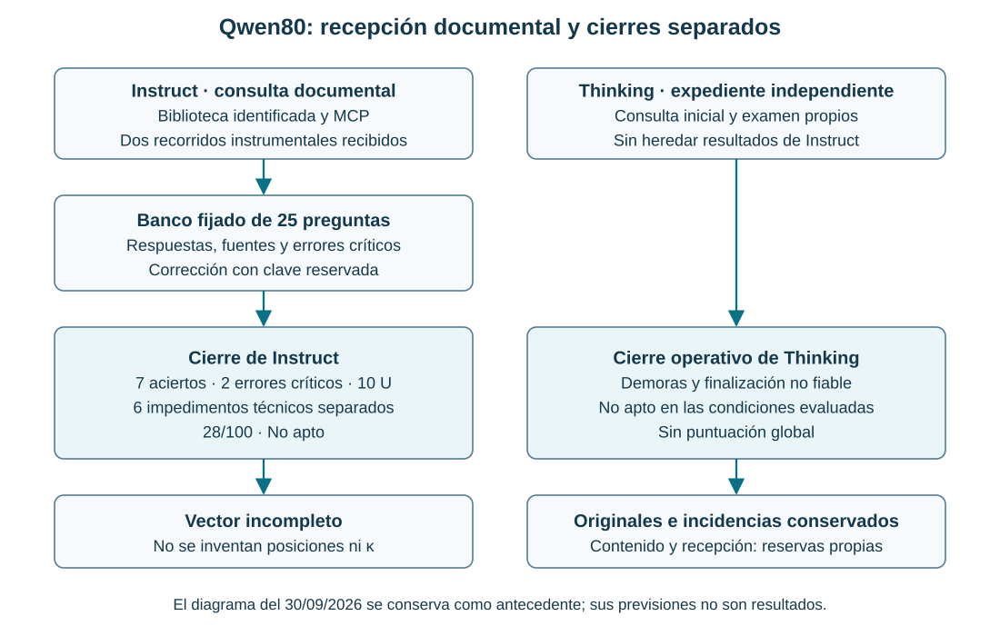
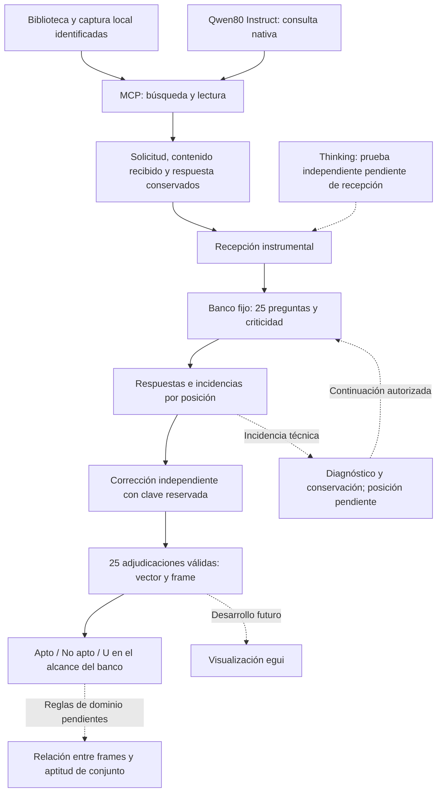
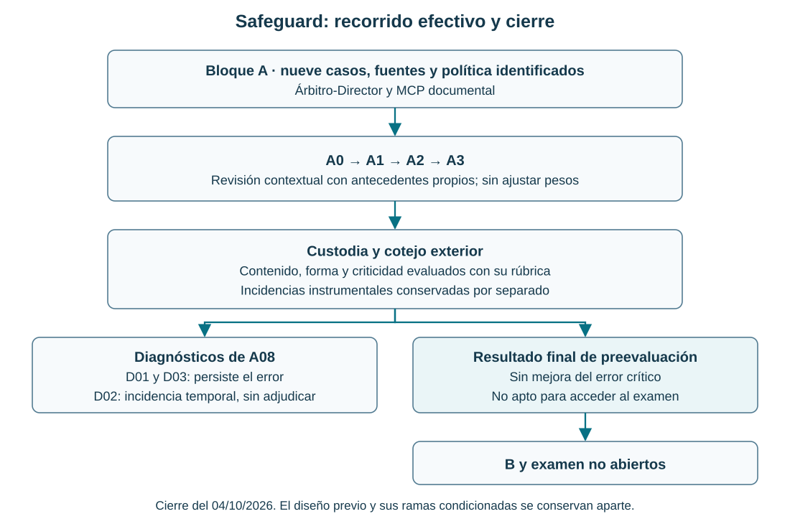
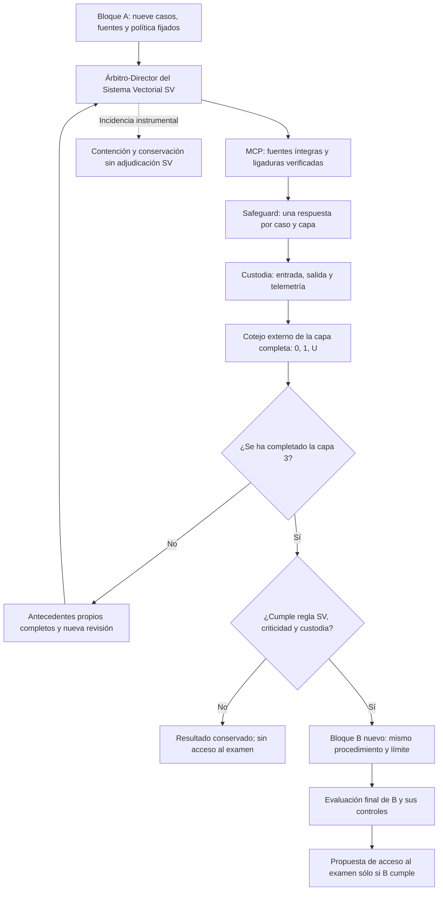

# Ensayo de inteligencia artificial y observabilidad

**Edición documental 2.37 · 22 de octubre de 2026.**

## Objeto y alcance

Este ensayo estudia cómo gobernar y observar la intervención de una IA en el Sistema Vectorial SV: qué conocimiento documental recibe, cómo se comprueba su respuesta, qué puede medirse de su ejecución y qué límites deben conservarse al emitir un dictamen. Forma parte de la investigación **(P1 + P3)-Bis** y mantiene alcances diferenciados para inmunología y ciberseguridad.

Las propuestas de una IA no tienen autoridad para modificar el conocimiento admitido, la semántica, la IR ni las decisiones del Núcleo. El Árbitro-Director organiza el recorrido bajo reglas y permisos identificados. El ensayo distingue diseño, implementación, ejecución y recepción: ninguna de estas etapas sustituye a las demás.

Esta página presenta el método, la arquitectura, los resultados resumidos y su historia. El [catálogo de modelos](modelos-de-ia/README.md) explica cada candidato y enlaza sus evidencias; [VERSIONES.json](VERSIONES.json) conserva las identidades estructuradas de componentes y entregas.

**Recorrido de lectura:** [nodos y observación](#tres-nodos-de-acoplamiento) · [evaluación](#evaluación-documental-y-resultado) · [resultados y candidatos](#estado-actual) · [componentes](#componentes-y-funciones-del-conjunto) · [diagramas](#vías-de-ejecución-y-diagramas) · [versiones](#versiones-de-los-componentes) · [publicaciones](#publicaciones-en-orden-cronológico) · [historia](#historia-completa-de-la-edición-documental) · [continuidad](#preparación-examen-y-continuidad).

## Tres nodos de acoplamiento

El nodo describe **quién ejecuta y controla la inferencia y hasta dónde puede observarla el SV**. No se determina por la marca del servidor ni por el mero uso de una interfaz web. En producción, cada dominio vincula una IA y un nodo; los ensayos pueden estudiar varios candidatos sin habilitar su uso productivo.

| Nodo | Control de la inferencia | Condición de observabilidad |
|---|---|---|
| [01 · Inferencia bajo control propio](modelos-de-ia/acoplamientos-con-el-sv/01-inferencia-bajo-control-propio/readme.md) | El modelo reside y se ejecuta en el entorno del SV, con motor, pesos y recursos bajo control institucional. Puede alojarse en infraestructura propia o administrada por la institución. | La inferencia debe ser auditable de extremo a extremo. Disponer de pesos o alquilar un servidor no acredita por sí solo ese requisito. Una llamada a un proveedor externo no constituye nodo 01. |
| [02 · Plataforma gestionada](modelos-de-ia/acoplamientos-con-el-sv/02-plataforma-gestionada/readme.md) | La plataforma organiza el acceso gestionado al servicio de inferencia. | El SV mide su recorrido y los datos que la plataforma expone; debe declarar las partes no observables. El antecedente de Kaggle conserva ese alcance. |
| [03 · Servicio externo del proveedor](modelos-de-ia/acoplamientos-con-el-sv/03-api-directa/readme.md) | El proveedor gobierna el modelo y ejecuta la inferencia mediante su servicio. | El SV controla la entrega autorizada, la recepción y sus mediciones exteriores; no inspecciona por ello el cálculo ni el razonamiento internos del proveedor. |

[Ampliar el diagrama](diagramas/nodos-y-observacion-20261019.svg). La figura expresa funciones y exigencias de cada modalidad; no certifica una integración general ya recibida. Los expedientes indican qué se implementó, ejecutó y comprobó en cada configuración. El [marco de acoplamientos](modelos-de-ia/acoplamientos-con-el-sv/readme.md) conserva sus antecedentes fechados.

Las [rutas de ejecución](#vías-de-ejecución-y-diagramas) identifican dónde se calcula la respuesta: navegador, proceso nativo bajo control institucional o servicio externo. Las denominaciones A y B corresponden a las dos primeras; el nodo expresa el control y la auditabilidad de la configuración, no su interfaz. Las herramientas auxiliares y las pruebas de aceleración se documentan [por su función](modelos-de-ia/README.md#herramientas-auxiliares-y-ensayos-instrumentales), sin incorporarlas a la inferencia experta.

## Qué se observa y qué no

Cada medida debe identificar su origen, cobertura y unidad. El texto que un modelo emite acerca de su razonamiento es una respuesta del modelo; no sustituye a la instrumentación de su ejecución.

| Procedencia | Información que puede acreditar | Límite |
|---|---|---|
| Control del SV | Fuentes admitidas, solicitud enviada, destino, tiempos exteriores, respuesta recibida, incidencias e integridad de los originales. | Sólo el recorrido efectivamente instrumentado. Un tiempo local no identifica el tiempo de cálculo remoto. |
| Motor y recursos bajo control institucional | Medidas de procesos, memoria y operaciones que sus instrumentos registren. | La cobertura y las pérdidas se demuestran por configuración; el nombre del motor no garantiza observación completa. |
| Plataforma o proveedor | Identidad declarada, contadores de uso, estado y canales que entregue el servicio. | Son datos comunicados por ese servicio. Su ausencia queda indicada; no se reemplaza por cero. |

Los [componentes](#componentes-y-funciones-del-conjunto) explican cómo se realizan estas funciones. La observabilidad técnica, la fidelidad documental y la aptitud para el contrato son comprobaciones distintas.

## Evaluación documental y resultado

La pregunta experimental es si una configuración puede **responder con fundamento verificable dentro de una biblioteca delimitada**. La ronda histórica PDQ25 utilizó una captura identificada del [PDQ profesional del NCI sobre leucemia de células pilosas](https://www.cancer.gov/espanol/tipos/leucemia/pro/tratamiento-celulas-pilosas-pdq), consultada desde el catálogo local. La página pública identifica la procedencia; no sustituye los bytes congelados del ensayo.

El [banco de preguntas](https://github.com/juantoniolloretegea/SVperitus-dataset/blob/6f1118a323bcefac9400d01274e4f8d1db3636ff/dominios/inmunologia/tes-examenes-conocimientos/ronda-01-pdq-tricoleucemia-20260929/PREGUNTAS.md) y el [protocolo de evaluación, revisión r1](https://github.com/juantoniolloretegea/SVperitus-dataset/blob/6f1118a323bcefac9400d01274e4f8d1db3636ff/dominios/inmunologia/tes-examenes-conocimientos/ronda-01-pdq-tricoleucemia-20260929/PROTOCOLO.md) fijan **25 posiciones, cinco niveles propuestos de dificultad, 20 preguntas críticas y cinco no críticas**. La clave de corrección queda fuera del alcance del candidato. Los casos son sintéticos y la graduación de dificultad aún no tiene calibración empírica.

| Resultado por posición | Significado |
|---|---|
| **0** | Respuesta correcta y sustentada conforme a la clave y a las evidencias. |
| **1** | Error demostrado conforme al criterio previo. |
| **U** | Indeterminación auténtica: no se acredita 0 y no hay falsedad relevante demostrada. |
| **Intento inválido o pendiente** | Fallo técnico, evidencia perdida o pregunta no ejecutada. Se registra fuera de la terna; no se rellena con U. |

La puntuación y la aptitud siguen el [criterio común](modelos-de-ia/CRITERIO-PUNTUACION-MODELOS-20261001.md). La **puntuación sobre 100 es 100 × (aciertos − errores no críticos) / N**, con N fijado antes del ensayo. U y blanco no suman ni restan; no se recortan saldos negativos ni se reduce el denominador por incidencias. Los errores críticos se contabilizan aparte y tienen efecto eliminatorio. Así, Instruct conserva 100 × (7 − 0) / 25 = **28/100**, junto a sus dos errores críticos.

La clasificación SV se calcula separadamente con **T(n)=⌊7n/9⌋**: primero N₁ ≥ T(n) determina No apto; después N₀ ≥ T(n) determina Apto; en otro caso corresponde Indeterminado. Requiere un vector completo de adjudicaciones válidas. Para 25 posiciones, T(25) = 19. El dictamen del instrumento incorpora además la criticidad: cualquier 1 crítico determina **No apto**; si no hay 1 crítico pero existe U crítica, corresponde **U (indeterminación honesta)**; las veinte críticas en 0 y la clasificación auxiliar favorable permiten **Apto**. Con esta distribución, las veinte respuestas críticas correctas ya superan el umbral. Los errores no críticos siguen siendo visibles.

Un error crítico acreditado permite declarar No apto en el alcance de la prueba aunque existan posiciones impedidas; no autoriza a completar un vector ni a atribuirle κ. En la edición de 25 preguntas, sólo tras **25 adjudicaciones válidas e independientes** se constituye el vector ordenado y su frame o polígono. Cada posición queda ligada a pregunta, fuente, respuesta, configuración y fundamento de corrección. Las comprobaciones sintéticas del evaluador Rust acreditan su cálculo en esos casos, no la validez médica de las respuestas.

La célula **(9,3)** contiene vectores de nueve componentes ternarios y un universo de **3⁹ = 19.683 vectores posibles**. Las capas experimentales son filas sucesivas de vectores, no una matriz de 3 × 3. El par vector–frame debe conservar identidad, posiciones, fuentes y revisión. Existe **un único polígono SV**, cuya dimensión corresponde al vector del suceso. Su expresión matemática y su representación visual conservan las mismas posiciones, valores y criticidad; el área no determina la aptitud ni el puesto de una clasificación. El expediente de Astra incorpora el visor Rust/egui 0.5.0 con el frame de 25 posiciones, valores y evidencias consultables. Su ejecución y pruebas se acreditan en aquel expediente; no se atribuyen retrospectivamente a los modelos anteriores. **Un frame Apto puede formar parte de un conjunto No apto**: la composición y la aptitud de dominio necesitan reglas aún no constituidas por esta ronda. Una U puede motivar nuevas preguntas con identidad propia, conservando los resultados anteriores.

Los expedientes de GPT-OSS y Astra conservan resultados independientes. El examen de Astra utiliza tres etapas de respuesta: respuesta inicial R0, autocrítica documental R1 y verificación final neutral R2. El banco y el criterio permiten comparación dentro de los límites documentados; no acreditan una réplica instrumental idéntica ni aptitud clínica.

La secuencia es: suficiencia instrumental → evaluación documental → dictamen limitado al banco → decisión sobre una eventual fase posterior. La vía A/WebAssembly conserva su dependencia de una selección favorable y de autorización propia. No se acredita aptitud clínica general, uso productivo ni integración en el núcleo del SV.

En estos expedientes, R0, R1 y R2 designan etapas de respuesta del candidato. No son las fases homónimas de desarrollo del Núcleo. La comparación exige identificar banco, edición, modalidad, condiciones y regla de adjudicación; resultados de bancos distintos no se suman en una clasificación global.

El [estándar comparativo](modelos-de-ia/estandar-comparativo-o-benchmark/readme.md) fija las reglas vigentes y el turno de examen: primero Claude, Gemini, GPT-6 Astra y Qwen; después DeepSeek, GLM, Grok y Kimi en la categoría adaptada al 33 %. Dentro de cada grupo el orden es alfabético. Las tablas del catálogo son índices de consulta, no clasificaciones por resultados.

## Estado actual

La convocatoria EET-CYB16 comprende **ocho candidatos**. Claude Opus 5.5, Gemini 4 Argon, GPT-6 Astra y Qwen3.8-Max-0902 han completado la edición general: cada uno conserva dieciséis aciertos y dictamen 0. DeepSeek y GLM han completado la edición adaptada al 33 %, también con dieciséis aciertos y dictamen 0; Grok y Kimi permanecen pendientes, sin dictamen. La rectificación formal de GLM está identificada en las evidencias y conserva su antecedente. Los [resultados, polígonos y evidencias](modelos-de-ia/estandar-comparativo-o-benchmark/readme.md#4-resultados-y-evidencias) identifican cada ejecución. La tabla siguiente conserva los antecedentes; no sustituye la clasificación de esta convocatoria. Las [preguntas, soluciones y fuentes](modelos-de-ia/estandar-comparativo-o-benchmark/readme.md) corresponden a las ediciones general y adaptada con reglas revisadas del 21 de octubre de 2026.

| Candidato | Antecedentes y alcance |
|---|---|
| [Claude Opus 5.5](modelos-de-ia/README.md#claude-opus-55) | Kaggle, nodo 02: MD09 favorable; CYB09 No apto asistido por un error crítico. |
| [DeepSeek-V4.1-Flash-1017](modelos-de-ia/README.md#deepseek-v41-flash-1017) | Categoría adaptada a Markdown: dieciséis aciertos y dictamen 0 en EET-CYB16; no acredita los formatos sustituidos. |
| [Gemini 4 Argon](modelos-de-ia/README.md#gemini-4-argon) | Sin examen anterior en este catálogo; resultado de la convocatoria actual disponible en el estándar comparativo. |
| [GLM-5.3](modelos-de-ia/README.md#glm-53) | CYB16: Apto documental, 16/16 finales y 14 críticas correctas. MD07 conserva su reserva. |
| [GPT-6 Astra](modelos-de-ia/README.md#gpt-6-astra) | PDQ25: 25/25 finales. CYB16: 16/16 en las tres etapas; Apto documental en cada contrato. |
| [Grok 4.7](modelos-de-ia/README.md#grok-47) | PDQ25: Apto documental en R2, 25/25 y 20 críticas correctas. MD01 parcial, sin R2. |
| [Kimi K3](modelos-de-ia/README.md#kimi-k3) | MD09: Apto documental, 8/9; MD04 no crítico incorrecto, seis críticas correctas. CYB16 sin iniciar. |
| [Qwen3.8-Max-0902](modelos-de-ia/README.md#qwen38-max-0902) | Recepción Apto documental con reservas en 16 preguntas; dictamen original y réplica P13 separados. |

La [continuación de la convocatoria](modelos-de-ia/README.md#ocho-candidatos-de-la-proxima-comparacion) requiere condiciones propias y vigentes. Una conexión registrada, un resultado anterior o la inclusión en el catálogo no autorizan el envío de documentos ni el lanzamiento. Las conexiones de otros modelos no amplían esta selección.

Resultados y cierres de las configuraciones anteriores

El [catálogo de configuraciones anteriores](modelos-de-ia/README.md#configuraciones-anteriores) reúne las cifras, reservas y fuentes de cada cierre.

| Configuración | Síntesis del estado |
|---|---|
| [Qwen3-0.6B · Q4_K_M](modelos-de-ia/qwen/qwen3-0.6b/README.md) | Campaña parcial cerrada; sin conformidad documental completa. |
| [GPT-OSS-20B · MXFP4](modelos-de-ia/openai/gpt-oss-20b/README.md) | Configuración excluida de la función médica prevista. |
| [Qwen3.8-27B](modelos-de-ia/qwen/qwen3.8-27b/README.md) | No apto en la selección examinada. |
| [GPT-OSS-120B](modelos-de-ia/openai/gpt-oss-120b/README.md) | Estudio nativo y demostración pública separados; sin examen completo recibido. |
| [Qwen3-Next-80B-A3B-Instruct](modelos-de-ia/qwen/qwen3-next-80b-a3B-instruct/REGISTRO-INSTALACION-20260929.md) | Examen terminado: 28/100 y No apto; seis impedimentos fuera de la terna. |
| [Qwen3-Next-80B-A3B-Thinking](modelos-de-ia/qwen/qwen3-next-80b-a3b-thinking) | Cierre por inviabilidad operativa; sin puntuación global. |
| [GPT-OSS-Safeguard-120B](modelos-de-ia/openai/gpt-oss-safeguard-120b/ensayos-reiterados-adversariales-y-aprendizaje/readme.md) | Preevaluación cerrada sin admisión al examen. |
| [Qwen3.5-122B-A10B · Q8_0](modelos-de-ia/qwen/qwen3.5-122b-a10b-q8-0/readme.md) | Fase cerrada con error crítico e impedimentos; instancia y disco retirados. |

Estudios de viabilidad y antecedentes instrumentales

### Familias en estudio de viabilidad

| Familia o candidato | Objeto del estudio | Situación y dependencia |
|---|---|---|
| [Kimi K3 · Nodo 01](modelos-de-ia/kimi/kimi-k3/ESTUDIO-VIABILIDAD-20261005.md) | Alternativa independiente para AMD; se conserva K3 como identidad de estudio. | Sin instalación o inferencia bajo control propio en este estudio. El antecedente API figura en el catálogo. Las representaciones examinadas exceden la configuración de una MI300X; falta una realización Rust completa admisible. |
| [GLM-5.3 de zai-org · Nodo 01](modelos-de-ia/zai-org/glm-5.3/ESTUDIO-VIABILIDAD-20261005.md) | Viabilidad de la arquitectura y representación concreta en AMD bajo control propio; distinta del servicio API del nodo 03. | Sin instalación o inferencia. Memoria distribuida y realización completa aún no acreditadas. |
| [GLM-5.3-Flash de zai-org](modelos-de-ia/zai-org/glm-5.3/ESTUDIO-VIABILIDAD-20261005.md) | Variante distinta, con arquitectura y resultados propios. | Algunas representaciones permiten estudiar el alojamiento de pesos; memoria total, motor Rust y recepción GPU pendientes. |

Los candidatos permanecen en estudio. El cierre de una búsqueda técnica delimitada no constituye un descarte definitivo ni una evaluación de respuestas. Tampoco se sustituyen por modelos menores ni se transfieren puntuaciones entre versiones. Su posible realización depende de los [componentes de cálculo](#cálculo-rust-para-amd), que tienen un objeto de prueba distinto.

Safeguard es un candidato distinto del GPT-OSS-120B ordinario. Su función declarada por OpenAI es la clasificación de seguridad conforme a políticas textuales; el contraste histórico estudió clasificación documental bajo una política explícita. No presupone capacidad médica general. La demostración pública, las instalaciones nativas, los contrastes asistidos y los exámenes conservan resultados separados.

<strong>Antecedente instrumental Qwen · corte del 30/09/2026, 08:42 UTC</strong>

La línea principal de aquel corte era Instruct en UQFF Q4K, vía B nativa CPU. Dos consultas documentales habían recibido conformidad instrumental; la ronda posterior de 25 preguntas aún no disponía de un resultado final recibido. Thinking tenía una prueba independiente preparada y su carpeta fue incorporada después de aquel corte.

La [recepción instrumental de Instruct](https://github.com/juantoniolloretegea/SV-sala-de-maquinas/blob/816a70bd6ff72c8d55f9bd599823a17e1fd57454/respuestas-ejecucion/QWEN80-Q4K-ONECLOUD-20260929/revision-entrega-08/RECEPCION.md) —original de acceso restringido— coteja dos recorridos completos: solicitud del modelo, búsqueda, lectura del catálogo local, incorporación de su resultado y respuesta final. Las citas coinciden con la fuente tras convertir exclusivamente los saltos LF/CRLF en espacios. Las duraciones fueron **1532,618 y 1535,382 segundos**; el máximo registrado del grupo alcanzó **59 GiB**, sin agotamiento de memoria registrado en esos intentos. Estos datos no acreditan holgura de memoria, rapidez interactiva ni capacidad general de cualquier configuración de 64 GB.

El aviso posterior de aquel corte comunicaba P01–P08 conservadas, P09 sin respuesta final y P10–P25 sin ejecutar. P09 propuso dos lecturas en un intercambio limitado a una; el rechazo se propagó al cierre de aquel segmento. La continuación correctiva estaba preparada para distinguir el fallo de un ítem de un fallo general de seguridad o conservación, pero aún no se acreditaba su ejecución. Ocho respuestas conservadas no equivalían a ocho respuestas correctas. El examen completo y su diagnóstico posteriores conservan ese antecedente.

Thinking mantiene tratamiento independiente de plantilla, razonamiento emitido, respuesta final y llamadas a herramientas. No recibe los resultados de Instruct por extensión. El [registro de modelos](modelos-de-ia/README.md) enlaza los expedientes; cada entrega y recepción fija el alcance de lo acreditado.

Preevaluación histórica con retroalimentación y cierre

## Preevaluación de Safeguard con retroalimentación

El recorrido efectivo fue A0–A3 y tres diagnósticos delimitados de A08. Los resultados de contenido y forma se informan separadamente; el error crítico persiste. El [informe final](modelos-de-ia/openai/gpt-oss-safeguard-120b/ensayos-reiterados-adversariales-y-aprendizaje/resultados/cierre-20261004/INFORME-FINAL.md) conserva condiciones, incidentes y reservas. Las ampliaciones previstas en la preparación no habilitan continuación tras el cierre.

Preparación histórica y situación del corte precedente

El [protocolo completo](modelos-de-ia/openai/gpt-oss-safeguard-120b/ensayos-reiterados-adversariales-y-aprendizaje/readme.md) fija un bloque A de nueve casos y un bloque B de nueve casos nuevos. Cada caso tiene respuesta inicial y **tres revisiones adversariales como máximo**; se recorre cada capa completa antes de preparar la siguiente. La admisión se decide sobre la capa 3, sin seleccionar retrospectivamente la mejor. B sólo comienza si A cumple; el máximo de ambos bloques es 72 generaciones.

El Árbitro-Director del Sistema Vectorial SV entrega las fuentes íntegras mediante MCP, comprueba sus ligaduras y bytes, conserva entradas, canales emitidos y telemetría, y organiza la revisión con los antecedentes completos del propio caso en `pensamiento-afinado`. La clave externa permanece reservada. El candidato explica qué mantiene o modifica; el cotejo externo adjudica **0, 1 o U**, y el Árbitro-Director aplica la continuación o el cierre fijados. No es otra IA ni certifica por sí mismo la verdad de la respuesta.

El **Aprendizaje por Retroalimentación del Sistema Vectorial SV** es aquí revisión contextual acumulativa, sin entrenamiento ni ajuste de pesos. Se conservan aciertos ganados y perdidos, transiciones de la terna, puntuaciones, criticidad, tiempos, tokens, memoria e incidencias. Para cada bloque, **T(9)=7**; la conformidad exige además nueve respuestas evaluables, todas las críticas en 0, custodia conforme y ausencia de incidencias pendientes. El bloque B debe cumplir las mismas condiciones antes de proponer acceso al examen de 25 preguntas.

La preparación acredita 41 comprobaciones Rust conformes e igualdad de las nueve entradas prefijadas. **A0 está en ejecución; A1–A3 y B no se han ejecutado al corte.** La fase posterior requiere conservar y evaluar la capa anterior. Un progreso favorable no autoriza una cuarta revisión. El Núcleo, la semántica V0.2 y la IR 0.3 permanecen intactos; las necesidades de representación se documentan para la recepción competente conforme al [sistema conjunto](../sistema-conjunto-lenguaje-computacion-ia-gobernada/README.md), sin correcciones silenciosas.

## Componentes y funciones del conjunto

En la línea GPT-OSS, **Harmony** es el formato requerido de conversación. Es el formato de mensajes, canales, llamadas y terminación; la biblioteca oficial `openai-harmony` proporciona su codificación y análisis. **Candle** aporta operaciones numéricas y tensores. En las bases de mistral.rs examinadas se utilizan ambas bibliotecas: sus funciones son complementarias. [Formato oficial](https://github.com/openai/harmony) · [Candle](https://github.com/huggingface/candle).

| Elemento | Función | Condición de interpretación |
|---|---|---|
| Modelo, pesos y tokenizador | Parámetros y representación de las entradas y salidas. | La identidad incluye revisión, formato y huellas. |
| mistral.rs | Carga, implementación del modelo y servicio de inferencia. | Motor Rust; su nombre no identifica un modelo comercial Mistral. |
| Harmony / openai-harmony | Estructura y análisis de la conversación GPT-OSS. | Es necesario comprobar plantilla, identificadores, canales y fin de turno conjuntamente. |
| Candle | Operaciones numéricas utilizadas por la implementación de inferencia. | No es un modelo auxiliar ni sustituye el formato Harmony. |
| MCP documental | Búsqueda textual y lectura del catálogo local. | El protocolo no verifica por sí mismo la verdad de las afirmaciones ni concede permisos. |
| Árbitro-Director del Sistema Vectorial SV | Suministro documental, admisión, custodia, límites y recorrido de retroalimentación. | Realización y comprobaciones en Rust identificadas por contraste; no constituye autoridad del Núcleo ni un verificador general de verdad. |
| OpenTelemetry Rust y observador | Trazas instrumentadas y medidas de procesos o cgroup, respectivamente. | Deben declararse cobertura, pérdidas y ámbito; no constituyen observación exhaustiva. |
| Axum, Hyper y Reqwest | Servicio y transporte HTTP. | Son componentes de comunicación; no son medidores de recursos. |

La base mistral.rs [0.9.3](https://github.com/EricLBuehler/mistral.rs/blob/24dbf5c256f232176ee5949485ba264049407fbe/Cargo.toml) fija Candle en `35d7ae7…`; la base [0.9.4](https://github.com/EricLBuehler/mistral.rs/blob/2370966bb91e2e3dafa0b1521b87c50fd5c01244/Cargo.toml), en `66a8cf1…`. Ambas declaran Candle 0.11.0 y `openai-harmony` 0.0.8. El número de versión común no hace equivalentes sus fuentes ni acredita el binario utilizado. Las modificaciones CPU del antecedente GPT-OSS-20B requieren cotejo específico antes de aplicarse al 120B.

**Antecedente GPT-OSS, separado de la campaña Qwen:** la compatibilidad conceptual entre Candle y Harmony está fundamentada; la cualificación del ensamblaje **GPT-OSS-120B ordinario** permanece pendiente; Safeguard tiene instalación, comprobaciones y resultados propios. Deben verificarse el tratamiento de errores y truncamientos de Harmony, el vocabulario local identificado, la ruta numérica MXFP4, las dependencias efectivamente compiladas y los controles de red y herramientas. El [adaptador examinado](https://github.com/EricLBuehler/mistral.rs/blob/24dbf5c256f232176ee5949485ba264049407fbe/mistralrs-core/src/reasoning_parsers/harmony.rs) descarta determinados errores de análisis; este hallazgo estático no constituye una explotación reproducida. La [biblioteca Harmony](https://github.com/openai/harmony/blob/ec7606df9e87e3d0a1fec9f50928c1e407f0c438/src/tiktoken_ext/public_encodings.rs) admite un vocabulario local verificado y contempla descarga si no se fija el directorio local y falta una caché válida. La cualificación de esta realización nativa debe acreditar inferencia sin acceso a Internet. Usar Rust o incluir una dependencia no constituye una certificación de seguridad.

### Cálculo Rust para AMD

El cuadro siguiente corresponde al estudio del 05/10/2026. Sus reservas se refieren a esa configuración y a esa revisión de las herramientas.

[CubeCL y rust-gpu](inferencia/cubecl-evaluacion-20261005/ESTUDIO.md) son posibles bases de cálculo GPU. CubeCL conserva prioridad provisional por su adecuación funcional y mantenimiento observado; rust-gpu es una alternativa. No son modelos ni incorporan automáticamente las arquitecturas Kimi o GLM a mistral.rs.

| Elemento | Función y límite constatado | Estado al corte |
|---|---|---|
| CubeCL / LLVM | Compilación de operaciones Rust para AMD; la revisión examinada excluye MFMA de CDNA en esta vía. | Evaluación documental concluida; adaptación y contraste MI300X/gfx942 pendientes. |
| CubeK / Burn | Operaciones reutilizables y composición de modelos. | Su existencia no acredita la arquitectura completa o la cuantización de un candidato. |
| rust-gpu / SPIR-V | Compilación de Rust a SPIR-V para cálculo GPU. | Compatibilidad efectiva de controlador y extensiones matriciales en MI300X pendiente. |
| SPIR-V | Representación intermedia externa al SV. | La revisión del estándar no acredita su implementación ni modifica la IR 0.3 del SV. |

El estudio del 05/10/2026 documenta una prueba instrumental delimitada en AMD MI300X: multiplicación matricial f16 con acumulación f32, vía LLVM/MFMA, referencia independiente Rust y medidas de tiempo y memoria. El [encargo de ejecución](https://github.com/juantoniolloretegea/SV-sala-de-maquinas/blob/main/encargos-ejecucion/AMD-CUBECL-MFMA-20261005/v1/ENCARGO.md), de acceso restringido, fija configuración, cotas, conservación y cierre. Ese antecedente registra su preparación y autorización; no acredita por sí mismo su ejecución ni concede una autorización vigente.

[TT-0020](https://github.com/juantoniolloretegea/SV-lenguaje-de-computacion/blob/main/docs/calidad/Inventario-sv/tiques-tecnicos/TT-0020.md) identifica las necesidades N-C01–N-C05. Una operación correcta no acredita un motor completo, un modelo o su acceso al examen. La prueba AMD y los expedientes de Qwen mantienen resultados y límites independientes.

## Vías de ejecución y diagramas

El lugar de ejecución del modelo y la presentación de sus resultados se identifican por separado. El ensayo comprende una prueba en navegador, ejecuciones nativas en servidores administrados para el ensayo y consultas a servicios externos. Los visores Rust/egui presentan las adjudicaciones y sus evidencias mediante WebAssembly en el navegador.

| Recorrido | Dónde se ejecuta el modelo | Realización documentada |
|---|---|---|
| **A · Navegador** | Trabajador del navegador: Rust compilado a WebAssembly, con Candle y los recursos del modelo. | NAV-02: controles sintéticos y carga del modelo completados; interrupción por memoria antes del primer token. |
| **B · Nativo** | Proceso nativo en el servidor administrado para el ensayo, con motor y pesos identificados. | Conversación Qwen3-0.6B y ejecuciones posteriores de GPT-OSS-20B, Qwen80 y Safeguard, con resultados y límites propios. |
| **Servicio externo** | Infraestructura de la plataforma o del proveedor. | Opus mediante Kaggle, nodo 02; expedientes API del nodo 03. Rust realiza el control y la observación exteriores del SV. |
| **Presentación de resultados** | El visor no ejecuta el modelo evaluado. | Rust/egui compilado a WebAssembly representa el polígono, las etapas y sus fundamentos a partir de datos identificados. |

[Ampliar el diagrama](diagramas/rutas-ejecucion-20261019.svg) · [Fuente Mermaid](diagramas/rutas-ejecucion-20261019.mmd).

Las flechas muestran los recorridos documentados de esas configuraciones. Cada expediente acredita sus propios controles, resultados y límites; el esquema no atribuye una implementación común íntegra a todos los modelos. Una interfaz web puede acompañar a la vía B o a un servicio externo: el uso de WebAssembly en el visor no traslada la inferencia al navegador. Las comparaciones conservan la identidad del modelo, motor, recursos y condiciones utilizados.

### Vía A: campaña de navegador

La [campaña NAV-02](resultados/navegador-02/README.md), del 20/09/2026, ejecutó los controles sintéticos y cargó los recursos de Qwen con Candle en un trabajador Rust/WebAssembly. El supervisor exterior detuvo la prueba al superar el umbral de memoria de 4 GiB. Se recibió la marca previa a la primera operación del modelo; no se recibió un primer token ni una respuesta completa. La medición corresponde al navegador del ejecutor remoto de esa campaña, no a una instalación local en un PC.

Campaña NAV-02 · secuencia y diagrama conservados

[Ampliar](diagramas/via-a.svg) · [Fuente Mermaid](diagramas/via-a.mmd) · [Resultados y mediciones](resultados/navegador-02/README.md) · [Edición de septiembre](README_2_3_2026_09_20.md).

### Vía B: inferencia nativa en el servidor

La aplicación de conversación utiliza una interfaz web y un servicio Rust. El modelo se carga en un proceso nativo del servidor, separado de la interfaz. La [verificación de la versión 0.1.3](conversacion-nativa/verificacion-0.1.3/INFORME.md) acredita una inferencia sintética de Qwen3-0.6B en CPU, su relación con las trazas y las muestras del observador Linux. Las instalaciones posteriores de [Qwen80](#recorrido-qwen-consulta-evaluación-y-retorno--30092026) y [Safeguard](#preevaluación-safeguard-recorrido-acotado-de-la-configuración-actual) conservan sus propios ensayos y cierres. El [catálogo](modelos-de-ia/README.md#configuraciones-anteriores) reúne los resultados de cada configuración.

HTML y CSS presentan la interfaz; JavaScript transporta entradas y muestra respuestas. Los controles de admisión y ejecución de la aplicación pertenecen a Rust. La comunicación local mediante HTTP entre componentes del ensayo no equivale a delegar la inferencia en un proveedor. La condición de nodo 01 exige además acreditar la auditabilidad de extremo a extremo; no se obtiene por el mero despliegue de un modelo en un servidor administrado.

Diseño nativo NAT02/NAT03 · arquitectura preparada el 20/09/2026

El [diseño NAT02](resultados/preparacion-nativa-02/DISENO.md) y la [revisión NAT03](resultados/preparacion-nativa-03/README.md) conservan una preparación en fuentes, sin compilación ni ejecución acreditadas en esos expedientes. Sus controles previstos no se atribuyen por extensión a la aplicación de conversación ni a las instalaciones posteriores.

[Ampliar](diagramas/via-b.svg) · [Fuente Mermaid](diagramas/via-b.mmd).

### Servicios externos y visores de resultados

En los nodos 02 y 03, el controlador Rust del SV compone las solicitudes admitidas, aplica los límites y conserva las respuestas y sus mediciones exteriores. El servicio gestionado ejecuta el modelo. El [antecedente de Opus en Kaggle](modelos-de-ia/README.md#claude-opus-55) pertenece al nodo 02; los [expedientes API](modelos-de-ia/README.md#ocho-candidatos-de-la-proxima-comparacion) identifican los antecedentes y la preparación del nodo 03. El cálculo interno del proveedor queda fuera de la instrumentación del SV.

El [visor Rust/egui de dieciséis posiciones](modelos-de-ia/acoplamientos-con-el-sv/visor-examen16-egui/src/lib.rs) incorpora datos identificados y los representa en el navegador mediante WebAssembly. El visor permite examinar el polígono, sus posiciones y los fundamentos de la adjudicación; no genera respuestas del candidato ni convierte la visualización en una inferencia de la vía A. Los visores de cada expediente conservan su versión y sus datos.

Ejecución local en PC · posibilidad de estudio

Una ejecución nativa en PC requiere un programa compilado para su sistema y recursos compatibles; no exige WASI ni Wasmtime. Para ejecutar una aplicación WebAssembly fuera del navegador puede estudiarse un entorno como [Wasmtime](https://docs.wasmtime.dev/), con las interfaces [WASI](https://wasi.dev/) que requiera el programa. WASI define interfaces con el entorno anfitrión; Wasmtime es uno de los entornos que pueden ejecutarlas. La adaptación, los permisos y la compatibilidad deben comprobarse para la aplicación concreta.

Esta extensión del ensayo a WebAssembly autónomo en PC **no está implementada ni ensayada**. Los resultados de NAV-02, de los visores y de los servidores nativos conservan su alcance propio.

### Antecedente de continuación de la vía B · GPT-OSS-120B

Este esquema conserva la propuesta del 27/09/2026 para el GPT-OSS-120B ordinario. Su ensamblaje sigue condicionado; la figura es distinta de las realizaciones posteriores de Qwen80 y Safeguard.

[Ampliar la figura](diagramas/gpt-oss-composicion-20261019.svg).

Consultar el diagrama Mermaid histórico y su secuencia original

**Alcance de la figura:** composición funcional prevista, pendiente de cualificación. Harmony representa la preparación y el análisis de mensajes; Candle proporciona cálculo numérico dentro del motor. Los pesos mantienen identidad separada. El control previsto pertenece a las funciones del Árbitro-Director del Sistema Vectorial SV; este esquema histórico no acredita una implementación integral.

El acceso documental previo por controlador y las llamadas autónomas del modelo son recorridos distintos. El cliente mínimo 0.1.2 no habilita estas últimas. La inferencia prevista deberá operar sin Internet; la adquisición administrativa de documentos y recursos precede al ensayo. Las líneas de observación señalan cobertura que debe acreditarse, no una captura exhaustiva ya conseguida.

Las figuras históricas A/B conservan sus archivos y alcance. El esquema previo del candidato continúa accesible dentro de la [edición 2.15](https://github.com/juantoniolloretegea/SV-motor/blob/63f5bd5e9b8ef147ba6a92d7beba6f94fb5ea3eb/laboratorio/ensayo-ia-y-observabilidad/README.md).

### Recorrido Qwen: consulta, evaluación y cierre

[Ampliar la figura](diagramas/qwen-recorrido-20261019.svg).

Consultar el diagrama Mermaid histórico y su secuencia original

**Alcance de la figura actualizada:** distingue el cierre de Instruct —28/100, No apto por errores críticos y vector incompleto por seis impedimentos— del cierre operativo independiente de Thinking. El desplegable conserva el diseño del 30/09/2026 y sus previsiones. La representación egui de un vector completo y su adjudicación no se atribuyen a una campaña que no lo completó. El diagnóstico conserva cada intento y no permite sustituirlo por el mejor resultado.

### Preevaluación Safeguard: recorrido histórico acotado

[Ampliar la figura](diagramas/safeguard-cierre-20261019.svg).

Consultar el diagrama Mermaid histórico y su secuencia original

**Alcance de la figura actualizada:** muestra A0–A3, la persistencia del error crítico y el cierre del 04/10/2026 sin apertura de B ni acceso al examen. Los diagnósticos permanecen separados. El desplegable conserva el diseño previo, condicionado y limitado a tres revisiones; no representa una campaña activa. El Árbitro-Director organiza también el **Aprendizaje por Retroalimentación del Sistema Vectorial SV**; el modelo mantiene sus pesos y capacidades nativas. Una mejora sólo se atribuye a la configuración ensayada. El [diseño del componente](modelos-de-ia/model-context-protocol/controlador-pictograma-algoritmo/DISENO.md) y el protocolo propio concretan sus fronteras con el Núcleo.

## Versiones de los componentes

La **edición documental 2.32**, las **aplicaciones 0.1.x/0.2.x**, el **MCP 0.1.x**, los **modelos** y los **archivos de recuperación v1** tienen identidades independientes. Una numeración no sustituye a las restantes. Los antecedentes identifican Rust 1.98.0; la preparación de retroalimentación identifica Rust 1.98.1. Cada expediente fija sus fuentes, dependencias, ejecutables y comprobaciones; una compilación no acredita utilización efectiva.

<strong>EIO conversación · Qwen3-0.6B · 0.1.0 → 0.1.4</strong>

La distribución publicada es 0.1.3-beta.1. La fuente candidata 0.1.4 conserva verificación propia y no sustituye esa distribución.

| Versión de fuentes | Fecha de incorporación | Cambio relevante | Acceso completo al corte inicial |
|---|---|---|---|
| 0.1.0 | 22/09/2026 | Conversación con Qwen y conservación por expediente. | [Fuentes 0.1.0](https://github.com/juantoniolloretegea/SV-motor/tree/5330c6c9d2c7d9d6a9cec6079a7118bf0f5567db/laboratorio/ensayo-ia-y-observabilidad/conversacion-nativa) |
| 0.1.1 | 22/09/2026 | Identificación de licencias y precisión de validación y observación. | [Fuentes 0.1.1](https://github.com/juantoniolloretegea/SV-motor/tree/eec0d87fd9e41a3341b799540bb4545c6dd686d9/laboratorio/ensayo-ia-y-observabilidad/conversacion-nativa) |
| 0.1.2 | 22/09/2026 | Recuperación de peticiones y medición; comparación acotada documentada. | [Fuentes 0.1.2](https://github.com/juantoniolloretegea/SV-motor/tree/feefbe68a4131c43c46673b841a0dd72b590e4f7/laboratorio/ensayo-ia-y-observabilidad/conversacion-nativa) |
| 0.1.3 | 22/09/2026 | Integración OpenTelemetry y observador Linux; distribuida como 0.1.3-beta.1. | [Fuentes 0.1.3](https://github.com/juantoniolloretegea/SV-motor/tree/7f1dd02f4b4960c7e989da7caca63d4c78c85690/laboratorio/ensayo-ia-y-observabilidad/conversacion-nativa) |
| 0.1.4 | 23/09/2026 | Correcciones de supervisión y conservación verificadas localmente; sin nueva inferencia. | [Fuentes 0.1.4](https://github.com/juantoniolloretegea/SV-motor/tree/8cddcc83359bf6733a360d5bba2cd72426f8b631/laboratorio/ensayo-ia-y-observabilidad/conversacion-nativa) |

[Comprobación 0.1.2](conversacion-nativa/verificacion-0.1.2/INFORME.md) · [Observación 0.1.3](conversacion-nativa/verificacion-0.1.3/INFORME.md) · [Correcciones 0.1.4](conversacion-nativa/verificacion-0.1.4/INFORME.md).

Las versiones de fuentes pueden abarcar varios commits; el enlace identifica el corte inicial de esa versión. Los informes y las distribuciones fijan sus propios cortes de comprobación.

<strong>EIO conversación · GPT-OSS-20B · 0.2.0 → 0.2.4</strong>

La adaptación parte de la aplicación Qwen 0.1.4, pero utiliza otra integración de inferencia. La distribución es 0.2.4-beta.1; el rótulo interno 0.2.2 se interpreta mediante su ficha y huellas.

| Versión de fuentes | Fecha de incorporación | Cambio relevante | Acceso completo al corte inicial |
|---|---|---|---|
| 0.2.0 | 24/09/2026 | Adaptación de la interfaz a motor residente GPT-OSS, contexto y cancelación. | [Fuentes 0.2.0](https://github.com/juantoniolloretegea/SV-motor/tree/d564ec3ed1702f2f185ccb152fe3d5a494bddba8/laboratorio/ensayo-ia-y-observabilidad/modelos-de-ia/openai/gpt-oss-20b/conversacion) |
| 0.2.1 | 24/09/2026 | Corrección del reconocimiento del fin de turno. | [Fuentes 0.2.1](https://github.com/juantoniolloretegea/SV-motor/tree/032ef13602ae9288cdd8467335c34198dda08871/laboratorio/ensayo-ia-y-observabilidad/modelos-de-ia/openai/gpt-oss-20b/conversacion) |
| 0.2.2 | 24/09/2026 | Corrección de identificadores de tokens y observación del motor residente. | [Fuentes 0.2.2](https://github.com/juantoniolloretegea/SV-motor/tree/dbaf4ed071388710e901b87c36842497893e10fb/laboratorio/ensayo-ia-y-observabilidad/modelos-de-ia/openai/gpt-oss-20b/conversacion) |
| 0.2.3 | 24/09/2026 | Acotación de trazas y preparación de la continuación comparativa. | [Fuentes 0.2.3](https://github.com/juantoniolloretegea/SV-motor/tree/e668d8e1efa18dd5462e9519eb9c5f73cd4e48a0/laboratorio/ensayo-ia-y-observabilidad/modelos-de-ia/openai/gpt-oss-20b/conversacion) |
| 0.2.4 | 25/09/2026 | Fuentes de la distribución 0.2.4-beta.1 y cierre experimental; conserva el rótulo interno 0.2.2. | [Fuentes 0.2.4](https://github.com/juantoniolloretegea/SV-motor/tree/ab713cdc73d6a55184d52c03b99745c99a1ced64/laboratorio/ensayo-ia-y-observabilidad/modelos-de-ia/openai/gpt-oss-20b/conversacion) |

[Ficha de la distribución 0.2.4-beta.1](modelos-de-ia/openai/gpt-oss-20b/distribucion/0.2.4-beta.1/FICHA_TECNICA.md) · [Resultados y límites](modelos-de-ia/openai/gpt-oss-20b/distribucion/0.2.4-beta.1/RESULTADOS.md).

Las versiones de fuentes pueden abarcar varios commits; el enlace identifica el corte inicial de esa versión. Los informes y las distribuciones fijan sus propios cortes de comprobación.

<strong>MCP documental · 0.1.0 → 0.1.1 → 0.1.2 → 0.1.3</strong>

| Versión | Cambio y resultado conservado | Acceso completo |
|---|---|---|
| 0.1.0 | Prototipo de búsqueda textual y lectura paginada; preparación incompleta y reparos conservados. | [Paquete y documentación](modelos-de-ia/model-context-protocol/0.1.0/README.md) |
| 0.1.1 | Rechazo de claves JSON duplicadas, paginación sobre la respuesta completa y custodia supervisada. Controles dirigidos documentados; recepción pendiente. | [Fuentes y uso](modelos-de-ia/model-context-protocol/0.1.1/LEAME.md) · [Ficha y alcance](modelos-de-ia/model-context-protocol/0.1.1/FICHA_TECNICA.md) |
| 0.1.2 | Añade el cliente mínimo con supervisión independiente y observador del conjunto. Ese cliente no ofrece herramientas al modelo. | [Fuentes, uso y límites](modelos-de-ia/model-context-protocol/0.1.2/LEAME.md) |
| 0.1.3 | Lectura íntegra y paginación verificadas; búsqueda acotada por caracteres, sin la restricción anterior de ocho palabras. Veinticinco comprobaciones Rust conservadas. | [Fuentes, uso y comprobaciones](modelos-de-ia/model-context-protocol/0.1.3/LEAME.md) |

Son versiones del componente documental. El corte del 27/09 no registraba una publicación Release específica; las conservaciones posteriores se identifican en los expedientes que las utilizan. TT-0014 conserva su recepción propia; la selección del modelo tiene criterios separados.

<strong>Qwen3-Next-80B-A3B · Instruct y Thinking</strong>

Instruct utiliza una realización CPU identificada del motor mistral.rs 0.9.4 y Candle, con correcciones de acceso a tensores y descompresión selectiva de expertos. La [identidad de fuentes, binarios, pesos y pruebas](modelos-de-ia/qwen/qwen3-next-80b-a3B-instruct/REGISTRO-INSTALACION-20260929.md) corresponde a ese ensamblaje; no se atribuye a la distribución estándar sin modificaciones. El ciclo instrumental recibido ejecuta las herramientas MCP mediante su controlador Rust; no procede del cliente mínimo 0.1.2.

El desarrollo experimental y sus controles se realizan en Rust. Las excepciones criptográficas nativas declaradas se identifican en el registro; no se presenta el conjunto de dependencias como íntegramente Rust.

La [carpeta de Thinking](modelos-de-ia/qwen/qwen3-next-80b-a3b-thinking) conserva la instalación y primera respuesta, con sus salvedades. El examen posterior tiene [cierre propio publicado](https://github.com/juantoniolloretegea/SV-motor/releases/tag/qwen3-next-80b-a3b-thinking-archivo-cierre-20261005-v1), por inviabilidad operativa, y [conservación cotejada](https://github.com/juantoniolloretegea/SV-sala-de-maquinas/releases/tag/thinking-imagen-cierre-20261005-v1). El contenido de nueve finales sigue pendiente de adjudicación. La [retirada administrativa posterior](https://github.com/juantoniolloretegea/SV-sala-de-maquinas/blob/2ddf814bb039b0c7876745023ea165baf38ed6f9/respuestas-ejecucion/QWEN80-THINKING-Q4K-ONECLOUD-20260930/entrega-03/retirada-20261005/ACTA-RETIRADA.md) acredita eliminación de la instancia y su almacenamiento asociado; no se ha ensayado arranque restaurado.

<strong>Qwen3.5-122B-A10B · GGUF Q8_0</strong>

Modelo de 122 mil millones de parámetros totales y aproximadamente 10 mil millones activos por token, en la distribución GGUF Q8_0 de Unsloth. La [recepción instrumental del 04/10](https://github.com/juantoniolloretegea/SV-motor/blob/149c4b848475802942af35ab39e7335081398480/laboratorio/ensayo-ia-y-observabilidad/modelos-de-ia/qwen/qwen3.5-122b-a10b-q8-0/seguimiento/RECEPCION_INSTRUMENTAL_20261004.md) acredita ejecución nativa con 48 CPU y 256 GB nominales de RAM, aproximadamente 251,65 GiB efectivos, sin GPU. La [fase inicial cerrada](https://github.com/juantoniolloretegea/SV-motor/blob/0b5104c4658bc98a9612fd2a97d7b8a5214b63cc/laboratorio/ensayo-ia-y-observabilidad/modelos-de-ia/qwen/qwen3.5-122b-a10b-q8-0/preevaluacion-20261004/resultados/cierre-r1/INFORME-FINAL.md) conserva seis aciertos, un error crítico y dos casos no ejecutados; admisión no acreditada por impedimento temporal. La instalación se conserva en [imagen cifrada cotejada](https://github.com/juantoniolloretegea/SV-sala-de-maquinas/releases/tag/qwen35-122b-q8-imagen-cierre-20261006-v1), sin duplicar pesos; [instancia y disco retirados](modelos-de-ia/qwen/qwen3.5-122b-a10b-q8-0/seguimiento/cierre-20261006/ACTA-RETIRADA.md) y arranque restaurado no ensayado. La recepción científica independiente de fase conserva su reserva.

[Ficha técnica](modelos-de-ia/qwen/qwen3.5-122b-a10b-q8-0/ficha-tecnica/FICHA_TECNICA.md) · [Identidad y archivos](modelos-de-ia/qwen/qwen3.5-122b-a10b-q8-0/ficha-tecnica/IDENTIDAD_Y_ARCHIVOS.json) · [Justificación y comparativa](modelos-de-ia/qwen/qwen3.5-122b-a10b-q8-0/readme.md).

<strong>Cálculo AMD en evaluación · CubeCL, rust-gpu y SPIR-V</strong>

| Componente | Identidad documental examinada | Alcance |
|---|---|---|
| CubeCL | v0.11.0-pre.4, preliminar; revisión 2a8814843c319ae07b15453ef35dce32fd8b9997 | Prioridad provisional; la realización exacta y cualquier adaptación deben quedar fijadas antes del contraste. |
| rust-gpu | v0.10.0; revisión c49441a4c472098f5b221984f5bea1dbf866ad10 | Alternativa; soporte efectivo del dispositivo pendiente. |
| SPIR-V | 1.6 revisión 8, publicada el 10/09/2026 | Estándar externo; no es una versión del SV ni una recepción de la GPU. |

[Estudio y fuentes](inferencia/cubecl-evaluacion-20261005/ESTUDIO.md) · [Registro de la consulta](inferencia/cubecl-evaluacion-20261005/FUENTES.json). Se distinguen publicación, código leído, compilación y ejecución recibida; no se mezclan revisiones como si fueran una distribución única.

<strong>GPT-6 Astra · nodo 03 · cliente Rust y visor egui 0.5.0</strong>

El identificador del candidato es `gpt-6-astra`; no es la versión del cliente ni del visor. El [expediente](modelos-de-ia/acoplamientos-con-el-sv/03-api-directa/openai/gpt-6-astra/readme.md) identifica el transporte, el controlador del examen y las evidencias de ejecución. El visor Rust/egui 0.5.0 presenta las 25 adjudicaciones finales y permite consultar sus fundamentos. La [ficha](modelos-de-ia/acoplamientos-con-el-sv/03-api-directa/openai/gpt-6-astra/FICHA.md) mantiene la excepción criptográfica pendiente y los límites de esta realización; el cierre documental no constituye admisión general del acoplamiento.

<strong>Claude Opus 5.5 · nodo 02 · controlador Rust y visor egui 0.6.0</strong>

El identificador efectivo es `anthropic/claude-opus-5-5@default`. La inferencia pertenece al servicio gestionado por Kaggle; el cuaderno ejecuta composición, transporte, límites y observación propios en Rust. El auxiliar del cuaderno descarga, inicia y conserva. El [expediente](modelos-de-ia/acoplamientos-con-el-sv/02-plataforma-gestionada/antrophic/claude-opus-5-5/readme.md) identifica fuentes, ejecutables y frontera; el [visor](modelos-de-ia/acoplamientos-con-el-sv/02-plataforma-gestionada/antrophic/claude-opus-5-5/ensayo-cyb09-20261010/entrega/poligono-egui/POLIGONO-EGUI.html) presenta las tres etapas y sus fundamentos. Es representación de adjudicaciones asistidas, pendiente de recepción independiente; no constituye un frame recibido para operación del dominio. No se atribuye a otros modelos ni modifica los componentes históricos.

## Publicaciones en orden cronológico

La primera secuencia conserva **cinco publicaciones preliminares: dos distribuciones y tres archivos de recuperación o cierre**. Las entregas posteriores se relacionan a continuación de esa secuencia. Cada fila describe el hito en su fecha: una retirada o recepción posterior no altera el estado que constaba al publicarlo. Cada desplegable conduce a la publicación completa, sus activos y la documentación de alcance. Las revisiones v1 corresponden a paquetes fechados distintos.

<strong>22/09/2026 · EIO conversación 0.1.3-beta.1 · Qwen3-0.6B</strong>

Aplicación nativa con ejecutable, fuentes, licencias y manifiesto. Los pesos y el tokenizador tienen referencias externas identificadas. DOC-01 completó cuatro peticiones sin conformidad contractual completa; la distribución conserva ese resultado.

[Publicación completa y activos](https://github.com/juantoniolloretegea/SV-motor/releases/tag/eio-conversacion-v0.1.3-beta.1) · [Ficha o procedimiento y límites](entregas/0.1.3-beta.1/FICHA_TECNICA.md).

<strong>25/09/2026 · GPT-OSS conversación 0.2.4-beta.1 · GPT-OSS-20B</strong>

Distribución de la aplicación y el motor identificados, con resultados y límites. Las fuentes declaran 0.2.4 y el rótulo interno conserva 0.2.2; la ficha documenta esta discrepancia. El funcionamiento técnico no acredita aptitud médica.

[Publicación completa y activos](https://github.com/juantoniolloretegea/SV-motor/releases/tag/gpt-oss-conversacion-v0.2.4-beta.1) · [Ficha o procedimiento y límites](modelos-de-ia/openai/gpt-oss-20b/distribucion/0.2.4-beta.1/FICHA_TECNICA.md).

<strong>25/09/2026 · GPT-OSS · imagen de recuperación v1</strong>

Archivo cifrado cuya restitución funcional fue comprobada mediante el procedimiento conservado. Ese resultado corresponde a esta imagen concreta y no se transfiere a imágenes posteriores. Los pesos se recuperan separadamente.

[Publicación completa y activos](https://github.com/juantoniolloretegea/SV-motor/releases/tag/gpt-oss-imagen-onecloud-20260925-v1) · [Ficha o procedimiento y límites](modelos-de-ia/openai/gpt-oss-20b/imagen-onecloud/README.md).

<strong>26/09/2026 · GPT-OSS · archivo de cierre v1</strong>

Conserva una imagen posterior de cierre y los pesos cifrados identificados. No se ha acreditado el arranque de esta nueva imagen; el ensayo de restitución del día anterior no prueba estos bytes.

[Publicación completa y activos](https://github.com/juantoniolloretegea/SV-motor/releases/tag/gpt-oss-archivo-cierre-20260926-v1) · [Ficha o procedimiento y límites](modelos-de-ia/openai/gpt-oss-20b/imagen-onecloud/cierre-20260926/README.md).

<strong>27/09/2026 · Qwen3.8-27B · archivo de cierre v1</strong>

Reúne las imágenes del diagnóstico inicial y del cierre, sin pesos Qwen. Se conservan sus comprobaciones de integridad, sin arranque acreditado en una instancia restaurada. La configuración mantiene el dictamen No apto.

[Publicación completa y activos](https://github.com/juantoniolloretegea/SV-motor/releases/tag/qwen38-27b-archivo-cierre-20260927-v1) · [Ficha o procedimiento y límites](modelos-de-ia/qwen/qwen3.8-27b/imagen-onecloud/README.md).

El archivo posterior conserva la historia anterior y su dictamen. La publicación de activos cifrados no concede acceso al contenido reservado. El GPT-OSS-120B ordinario no tiene distribución ni imagen propias publicadas en las fuentes consultadas; su exploración pública se conserva separadamente. Las huellas publicadas se identifican en [VERSIONES.json](VERSIONES.json); esta revisión documental no ha descargado ni recalculado los grandes activos binarios.

### Entregas y conservación posteriores

Cada fila describe el corte de su publicación; los estados superados se mantienen como antecedentes y se actualizan en la tabla de estado actual.

| Fecha | Publicación y evidencia | Alcance |
|---|---|---|
| 30/09–01/10/2026 | [Examen Instruct, puntuación y originales](modelos-de-ia/qwen/qwen3-next-80b-a3B-instruct/tests-y-pruebas-efectuadas/PUNTUACION-FINAL-20261001.md) · [Archivo final](https://github.com/juantoniolloretegea/SV-sala-de-maquinas/releases/tag/qwen80-instruct-archivo-cierre-20261001-v1) | Examen, diagnóstico y conservación sin pesos; retirada registrada. La recepción científica se distingue del cierre administrativo. |
| 30/09/2026 | [Primera entrega Thinking](https://github.com/juantoniolloretegea/SV-sala-de-maquinas/blob/1cf92e92768938bd304ee22a792d16fc7a12bb9e/respuestas-ejecucion/QWEN80-THINKING-Q4K-ONECLOUD-20260930/entrega-01/INFORME.md) | Veintiocho archivos de evidencias y registros propios; consulta inicial, no examen de 25 preguntas. |
| 01–02/10/2026 | [Instalación Safeguard](modelos-de-ia/openai/gpt-oss-safeguard-120b/tests-y-pruebas-efectuadas/INSTALACION-CONTRASTE-20261001.md) · [Lectura íntegra](modelos-de-ia/openai/gpt-oss-safeguard-120b/tests-y-pruebas-efectuadas/LECTURA-INTEGRA-V2-20261001.md) · [Contraste con Árbitro-Director](modelos-de-ia/openai/gpt-oss-safeguard-120b/tests-y-pruebas-efectuadas/ARBITRO-SV-SAFEGUARD-V3-20261002.md) | Resultados, originales, incidencias y conservaciones de cada condición; no se suman como una única puntuación. |
| 02–03/10/2026 | [Demostración pública GPT-OSS-120B](modelos-de-ia/openai/gpt-oss-120b/prueba-playground/readme.md) · [Ensayo 1](modelos-de-ia/openai/gpt-oss-120b/prueba-playground/ensayo-1/readme.md) | Respuestas, relectura y cadena de impedimentos conservadas. Sin resultado adversarial final ni medición de una instalación propia. |
| 03/10/2026 | [Preevaluación Safeguard](modelos-de-ia/openai/gpt-oss-safeguard-120b/ensayos-reiterados-adversariales-y-aprendizaje/readme.md) · [Conservación de preparación A0](https://github.com/juantoniolloretegea/SV-sala-de-maquinas/releases/tag/safeguard-retroalimentacion-20261003-preparacion-a0) | Preparación y correcciones instrumentales recuperadas y cotejadas; la inferencia A0 está en curso y sus resultados finales siguen pendientes. |
| 04/10/2026 | [Expediente Qwen3.5-122B-A10B · Q8_0](modelos-de-ia/qwen/qwen3.5-122b-a10b-q8-0/readme.md) · [Revisión documental](modelos-de-ia/qwen/qwen3.5-122b-a10b-q8-0/seguimiento/REVISION_DOCUMENTAL_20261004.md) | Ficha técnica, justificación, comparativa y criterios de recepción; instalación y evaluación pendientes. |
| 04/10/2026 | [Cierre de Safeguard](modelos-de-ia/openai/gpt-oss-safeguard-120b/ensayos-reiterados-adversariales-y-aprendizaje/resultados/cierre-20261004/INFORME-FINAL.md) | A0–A3 sin mejora; A08 persiste; A3 y D02 conservan incidencias instrumentales diferenciadas. No apto para acceder al examen. |
| 04–05/10/2026 | [Recepción Qwen3.5](https://github.com/juantoniolloretegea/SV-motor/blob/149c4b848475802942af35ab39e7335081398480/laboratorio/ensayo-ia-y-observabilidad/modelos-de-ia/qwen/qwen3.5-122b-a10b-q8-0/seguimiento/RECEPCION_INSTRUMENTAL_20261004.md) · [Hito A04/A0](https://github.com/juantoniolloretegea/SV-motor/blob/149c4b848475802942af35ab39e7335081398480/laboratorio/ensayo-ia-y-observabilidad/modelos-de-ia/qwen/qwen3.5-122b-a10b-q8-0/preevaluacion-20261004/resultados/hitos/A04-A0/vector-parcial/CAPA.json) | Instalación recibida; cuatro adjudicaciones 0, cinco pendientes; bloque incompleto. |
| 04/10/2026 | [Retirada Safeguard](https://github.com/juantoniolloretegea/SV-sala-de-maquinas/blob/d7bae43cab1f900afc2dcc5e8c0e35c61215e5a3/respuestas-ejecucion/SAFEGUARD-CONSERVACION-20261004/ACTA-RETIRADA.md) | Instancia y disco eliminados después de conservación cotejada. |
| 05/10/2026 | [Cierre Thinking](https://github.com/juantoniolloretegea/SV-motor/releases/tag/qwen3-next-80b-a3b-thinking-archivo-cierre-20261005-v1) · [Conservación](https://github.com/juantoniolloretegea/SV-sala-de-maquinas/releases/tag/thinking-imagen-cierre-20261005-v1) | Examen cerrado por inviabilidad operativa; recuperación y cotejo conformes; eliminación del origen pendiente. |
| 05/10/2026 | [Retirada administrativa Thinking](https://github.com/juantoniolloretegea/SV-sala-de-maquinas/blob/2ddf814bb039b0c7876745023ea165baf38ed6f9/respuestas-ejecucion/QWEN80-THINKING-Q4K-ONECLOUD-20260930/entrega-03/retirada-20261005/ACTA-RETIRADA.md) | Instancia y almacenamiento eliminados tras la conservación cotejada; no acredita arranque restaurado. |
| 05/10/2026 | [Cierre de fase Qwen3.5](https://github.com/juantoniolloretegea/SV-motor/blob/0b5104c4658bc98a9612fd2a97d7b8a5214b63cc/laboratorio/ensayo-ia-y-observabilidad/modelos-de-ia/qwen/qwen3.5-122b-a10b-q8-0/preevaluacion-20261004/resultados/cierre-r1/INFORME-FINAL.md) · [Conservación única de fase](https://github.com/juantoniolloretegea/SV-sala-de-maquinas/releases/tag/qwen35-preevaluacion-20261004-r1) | Siete solicitudes iniciales, seis 0 y un 1 crítico; dos no ejecutadas. Sin κ ni puntuación global. Custodia posterior cotejada; recepción independiente de fase pendiente. |
| 05/10/2026 | [Kimi K3](modelos-de-ia/kimi/kimi-k3/ESTUDIO-VIABILIDAD-20261005.md) · [GLM-5.3/Flash](modelos-de-ia/zai-org/glm-5.3/ESTUDIO-VIABILIDAD-20261005.md) · [Cálculo Rust para AMD](inferencia/cubecl-evaluacion-20261005/ESTUDIO.md) | Candidatos en estudio de viabilidad; CubeCL prioritario provisional y rust-gpu alternativo. Documentación recuperada y cotejada. |
| 05/10/2026 | [Prueba instrumental AMD](https://github.com/juantoniolloretegea/SV-sala-de-maquinas/blob/main/encargos-ejecucion/AMD-CUBECL-MFMA-20261005/v1/ENCARGO.md) | Autorización delimitada de servidor y operación matricial; sin recepción experimental declarada en esta edición. |
| 06/10/2026 | [Archivo Qwen3.5 Q8_0](https://github.com/juantoniolloretegea/SV-motor/releases/tag/qwen3.5-122b-a10b-q8-0-archivo-cierre-20261006-v1) · [Conservación cifrada](https://github.com/juantoniolloretegea/SV-sala-de-maquinas/releases/tag/qwen35-122b-q8-imagen-cierre-20261006-v1) | Instalación y expedientes conservados sin duplicar pesos; recuperación, descifrado, inventario y contenido cotejados con Rust. Retirada administrativa pendiente; arranque restaurado no ensayado. |
| 06/10/2026 | [Retirada de Qwen3.5 Q8_0](modelos-de-ia/qwen/qwen3.5-122b-a10b-q8-0/seguimiento/cierre-20261006/ACTA-RETIRADA.md) | Instancia y disco retirados después de conservación cotejada. Mantiene el resultado experimental, sus reservas y la ausencia de arranque restaurado ensayado. |
| 07/10/2026 | [Examen de GPT-6 Astra · nodo 03](modelos-de-ia/acoplamientos-con-el-sv/03-api-directa/openai/gpt-6-astra/examen25-20261007/resultado/INFORME.md) · [Expediente y evidencias](modelos-de-ia/acoplamientos-con-el-sv/03-api-directa/openai/gpt-6-astra/readme.md) | Apto para el contrato documental P01–P25: 25 respuestas finales R2 correctas, incluidas las 20 críticas. Control e instrumentación propios en Rust; inferencia en OpenAI. |
| 08/10/2026 | [Examen de Grok 4.7 · nodo 03](modelos-de-ia/acoplamientos-con-el-sv/03-api-directa/xai/grok-4.7/examen25-20261008/INFORME.md) | Apto para el contrato documental en R2: 25 correctas, incluidas las 20 críticas. Se conserva el error crítico de R0 y su corrección posterior. [MD01 del manual](modelos-de-ia/acoplamientos-con-el-sv/03-api-directa/xai/grok-4.7/md01-diagnostica-20261008/INFORME.md): diagnóstico parcial, distinto del examen. |
| 08/10/2026 | [Recepción de Qwen3.8-Max-0902 · nodo 03](modelos-de-ia/acoplamientos-con-el-sv/03-api-directa/qwen/qwen3.8-max-0902/RECEPCION-DOCUMENTAL-20261008.md) | Apto documental con reservas para 16 preguntas, tras revisión del instrumento y réplica P13. La adjudicación contractual original se conserva; no se declara equivalencia con un examen de 25 preguntas. |
| 08/10/2026 | [GLM-5.3 · CYB16 · Nodo 03](modelos-de-ia/acoplamientos-con-el-sv/03-api-directa/zai/glm-5.3/cyb16-20261008/INFORME.md) | Apto documental en R2: 16 correctas, 14 críticas correctas. R0 y R1 conservan sus errores; MD07 sigue bajo reserva. [Aclaración de las marcas documentales](modelos-de-ia/acoplamientos-con-el-sv/03-api-directa/zai/glm-5.3/cyb16-20261008/ACLARACION-ALERTAS-20261008.md). |
| 08/10/2026 | [Astra · CYB16](modelos-de-ia/acoplamientos-con-el-sv/03-api-directa/openai/gpt-6-astra/cyb16-20261008/INFORME.md) | 16/16 correctas en R0, R1 y R2; catorce críticas correctas. Apto para ese contrato documental; el banco es distinto de PDQ25. |
| 08–09/10/2026 | [Kimi K3 · MD09](modelos-de-ia/acoplamientos-con-el-sv/03-api-directa/kimi/kimi-k3/manual-20261008/INFORME.md) · [Diagnóstico MD04](modelos-de-ia/acoplamientos-con-el-sv/03-api-directa/kimi/kimi-k3/manual-20261008/adendas/revision-md04-20261009/INFORME.md) | 8/9 y seis críticas correctas; Apto documental con un error no crítico conservado. El diagnóstico no cambia el vector ni inicia CYB16. |
| 09–10/10/2026 | [Claude Opus 5.5 · primer expediente del nodo 02](modelos-de-ia/acoplamientos-con-el-sv/02-plataforma-gestionada/antrophic/claude-opus-5-5/readme.md) · [Manual MD09](modelos-de-ia/acoplamientos-con-el-sv/02-plataforma-gestionada/antrophic/claude-opus-5-5/ensayo-md09-cyb16-20261009/corte-01/INFORME-MANUAL.md) · [CYB09](modelos-de-ia/acoplamientos-con-el-sv/02-plataforma-gestionada/antrophic/claude-opus-5-5/ensayo-cyb09-20261010/entrega/INFORME.md) | Manual histórico: 9/9 asistido. CYB09: R2 8/9, 88,89/100 y No apto asistido por C02 crítico; R1 no sustituye R2. Originales, polígono, observabilidad y custodia cotejados. Recepción científica independiente pendiente; sesión apagada. |

Los enlaces de SV-sala-de-maquinas mantienen el acceso restringido de los originales. Las síntesis públicas enlazan su procedencia; no sustituyen los paquetes, sus manifiestos ni la recepción independiente.

## Historia completa de la edición documental

La secuencia comienza en **0.1** y avanza hasta la presente edición. Se conservan todas las ediciones anteriores y sus referencias inmutables. Cada desplegable conserva lo relevante de su corte y ofrece el texto íntegro; sus estados históricos no sustituyen al estado actual.

La numeración publicada pasa de **0.2 a 2.0**. Cuando una edición reúne varios commits, se muestran todos en orden. Las fechas siguientes son las de esos commits en Europe/Madrid; una cabecera histórica puede conservar una fecha anterior.

<strong>0.1 · 18/09/2026 · Apertura del ensayo</strong>

Define Qwen3-0.6B Q4_K_M, Candle y OpenTelemetry Rust como selección inicial. Fija el perímetro experimental y separa calidad del modelo, controles y autoridad. Es documentación preparatoria, sin inferencias acreditadas en ese corte.

[Edición completa](https://github.com/juantoniolloretegea/SV-motor/blob/875a3df0f2e07fb3c71f98d7fd6968ccae54af24/laboratorio/ensayo-ia-y-observabilidad/README.md).

<strong>0.2 · 18/09/2026–20/09/2026 · Contrato y primeras campañas</strong>

Vincula el contrato a las fuentes rectoras y añade la continuidad EIO-05, EIO-06, JSON-01, NAV-01 y NAV-02. Los controles sintéticos no equivalen a inferencia completa en navegador; el diagnóstico NAV-02 termina antes del primer token.

Cortes de esta edición, en orden cronológico:

- [Contrato · 18/09/2026 · e1caf6d](https://github.com/juantoniolloretegea/SV-motor/blob/e1caf6df5bef2696f20d2b9fc5a5b5e9cffe509e/laboratorio/ensayo-ia-y-observabilidad/README.md).
- [Resultados EIO/JSON · 20/09/2026 · ee29460](https://github.com/juantoniolloretegea/SV-motor/blob/ee2946062f878282513b519e467cb6bfbb8a05d1/laboratorio/ensayo-ia-y-observabilidad/README.md).
- [Preparación NAV-01 · 20/09/2026 · 966b4b2](https://github.com/juantoniolloretegea/SV-motor/blob/966b4b23326312371ad0512ef586c8d9ea401c6b/laboratorio/ensayo-ia-y-observabilidad/README.md).
- [Resultado NAV-01 · 20/09/2026 · 4c68db7](https://github.com/juantoniolloretegea/SV-motor/blob/4c68db73b48962bb185a523c1de34da85678d375/laboratorio/ensayo-ia-y-observabilidad/README.md).
- [Preparación NAV-02 · 20/09/2026 · 8744e3d](https://github.com/juantoniolloretegea/SV-motor/blob/8744e3daf0c03f3675954ff774603454e44bfc45/laboratorio/ensayo-ia-y-observabilidad/README.md).
- [Diagnóstico NAV-02 · 20/09/2026 · dde1a59](https://github.com/juantoniolloretegea/SV-motor/blob/dde1a59fcd1bb23d9f146dff4e99750725ffa76f/laboratorio/ensayo-ia-y-observabilidad/README.md).

<strong>2.0 · 20/09/2026 · Dos vías y criterio de avance</strong>

Organiza A como navegador/WebAssembly y B como proceso nativo. El avance depende de factibilidad, controles y evidencia; ambas vías conservan comprobaciones propias. El salto desde 0.2 pertenece a la numeración original.

[Edición completa](https://github.com/juantoniolloretegea/SV-motor/blob/29a0dbe74018807fddf5759f30de12ac29c162bb/laboratorio/ensayo-ia-y-observabilidad/README.md).

<strong>2.1 · 20/09/2026 · Responsabilidades de Rust y JavaScript</strong>

Precisa que la interfaz nativa conserva HTML y JavaScript para presentación y transporte. Rust realiza inferencia y controles; utilizar HTTP o WebAssembly en una pieza no determina dónde se ejecuta el modelo.

[Edición completa](https://github.com/juantoniolloretegea/SV-motor/blob/88ea2e6b1e28b5c1ff22d29da7003c854bb8461d/laboratorio/ensayo-ia-y-observabilidad/README.md).

<strong>2.2 · 20/09/2026 · Diagramas de las vías A y B</strong>

Incorpora flujos diferenciados de inferencia, control, custodia y parada. Distingue la arquitectura prevista de las ramas efectivamente ejecutadas.

[Edición completa](https://github.com/juantoniolloretegea/SV-motor/blob/1b9190d1e146ef61599783191019c060d0ff899c/laboratorio/ensayo-ia-y-observabilidad/README.md).

<strong>2.2.1 · 20/09/2026 · Figuras SVG y procedencia</strong>

Publica los diagramas como SVG ampliables con sus fuentes Mermaid. El segundo corte añade la procedencia desde 0.1; ambos textos permanecen accesibles.

Cortes de esta edición, en orden cronológico:

- [SVG · 20/09/2026 · 078aa80](https://github.com/juantoniolloretegea/SV-motor/blob/078aa80d7e530eb4e38c582ea5a305202f12160a/laboratorio/ensayo-ia-y-observabilidad/README.md).
- [Procedencia · 20/09/2026 · 3d185b2](https://github.com/juantoniolloretegea/SV-motor/blob/3d185b27c6bb728f1b23509d53dc6ad99c52883d/laboratorio/ensayo-ia-y-observabilidad/README.md).

<strong>2.3 · 20/09/2026 · Síntesis de resultados y reservas</strong>

Ordena la lectura externa y separa resultados observados, diagnóstico estático y trabajo pendiente. Conserva las figuras y los límites de custodia y supervisión de las preparaciones nativas.

[Edición completa](https://github.com/juantoniolloretegea/SV-motor/blob/057dba8a4a1fd2774e35f61e6135fd096679502a/laboratorio/ensayo-ia-y-observabilidad/README.md).

<strong>2.4 · 22/09/2026 · Primera distribución de conversación</strong>

Presenta EIO conversación 0.1.3-beta.1 para Qwen3-0.6B. DOC-01 completa cuatro peticiones sin satisfacer el contrato estricto; la disponibilidad técnica no acredita calidad profesional.

[Edición completa](https://github.com/juantoniolloretegea/SV-motor/blob/a14ea31b3903d49a98f08b912206b1c8c9eeaf74/laboratorio/ensayo-ia-y-observabilidad/README.md).

<strong>2.5 · 22/09/2026–23/09/2026 · Límites de Qwen y transición a GPT-OSS</strong>

Delimita los controles pendientes de la vía B y abre el catálogo por modelos. Las notas del día siguiente incorporan el primer intento nativo GPT-OSS y la revisión de su controlador. La propuesta inicial de GPT-OSS en A no acredita una ejecución en navegador.

Cortes de esta edición, en orden cronológico:

- [Delimitación · 22/09/2026 · 511969f](https://github.com/juantoniolloretegea/SV-motor/blob/511969f4ba576734f4bf96e39eed3e90d5dd02d5/laboratorio/ensayo-ia-y-observabilidad/README.md).
- [Revisión del controlador · 23/09/2026 · 41c99e2](https://github.com/juantoniolloretegea/SV-motor/blob/41c99e2a6b68382e7ba867ff55aa3a1fcc07676c/laboratorio/ensayo-ia-y-observabilidad/README.md).
- [Corrección instrumental · 23/09/2026 · 4fafb8c](https://github.com/juantoniolloretegea/SV-motor/blob/4fafb8ccf158a028820168ab7f7b822c608ee6ba/laboratorio/ensayo-ia-y-observabilidad/README.md).

<strong>2.6 · 23/09/2026 · Cierre acotado de Qwen nativo</strong>

Conserva la campaña Qwen/B como realización parcial con limitaciones. Identifica las correcciones de conversación 0.1.4 y del controlador GPT-OSS; su comprobación local no constituye otra inferencia.

[Edición completa](https://github.com/juantoniolloretegea/SV-motor/blob/8cddcc83359bf6733a360d5bba2cd72426f8b631/laboratorio/ensayo-ia-y-observabilidad/README.md).

<strong>2.7 · 23/09/2026 · Recuperación visual y continuidad nativa</strong>

Restituye los diagramas A/B en la página de lectura. El segundo corte incorpora la continuación GPT-OSS y sus límites de carga, todavía sin respuesta final.

Cortes de esta edición, en orden cronológico:

- [Diagramas · 23/09/2026 · bf488a8](https://github.com/juantoniolloretegea/SV-motor/blob/bf488a86dcb1a311ddf4355345e267901adad7c9/laboratorio/ensayo-ia-y-observabilidad/README.md).
- [Continuación GPT-OSS · 23/09/2026 · 810a476](https://github.com/juantoniolloretegea/SV-motor/blob/810a476488deb8dfb22585a51c91aee89d75ba0c/laboratorio/ensayo-ia-y-observabilidad/README.md).

<strong>2.8 · 23/09/2026 · Rectificación instrumental</strong>

Corrige la contabilización de memoria y el plazo de confirmación de escritura. Distingue la cuantización solicitada de la seleccionada por el motor; no presenta los intentos como inferencias completadas.

[Edición completa](https://github.com/juantoniolloretegea/SV-motor/blob/250c3e27784d36f347e9ac0aefa5b53e6cc46c98/laboratorio/ensayo-ia-y-observabilidad/README.md).

<strong>2.9 · 23/09/2026 · Carga MXFP4 sin inferencia</strong>

Conserva dos intentos adicionales que no completaron la carga. Las causas no determinadas permanecen explícitas; no se atribuye el resultado a Harmony ni se declara una respuesta del modelo.

[Edición completa](https://github.com/juantoniolloretegea/SV-motor/blob/ae9ceaef37e18d9cc12e25ea0369e4ebf58d9fb8/laboratorio/ensayo-ia-y-observabilidad/README.md).

<strong>2.10 · 23/09/2026 · Carga GGUF y generación observada</strong>

Acredita carga CPU y emisión de tokens en GPT-OSS-20B. Las respuestas HTTP no proporcionaron todavía una respuesta final útil; carga, generación y finalización del caso se distinguen.

[Edición completa](https://github.com/juantoniolloretegea/SV-motor/blob/f3746b719a3e355d75ea566d3d3abde2b6ea9e0e/laboratorio/ensayo-ia-y-observabilidad/README.md).

<strong>2.11 · 24/09/2026 · Corrección CPU y recuperación</strong>

Documenta una regresión CPU MXFP4, una corrección comprobada en una prueba específica y la identidad de la candidata recuperada. La inferencia completa con esa candidata seguía pendiente en este corte.

[Edición completa](https://github.com/juantoniolloretegea/SV-motor/blob/a74632b0b6dde70629863113134082dc3f31d521/laboratorio/ensayo-ia-y-observabilidad/README.md).

<strong>2.12 · 24/09/2026 · Primera respuesta correcta acotada</strong>

OC-01/OC-02 aportan una respuesta aritmética correcta y un contraste con el ejecutable anterior. El resultado tiene alcance instrumental limitado; no constituye selección médica.

[Edición completa](https://github.com/juantoniolloretegea/SV-motor/blob/70750a516001cf13314176c529508d0712b7f3c1/laboratorio/ensayo-ia-y-observabilidad/README.md).

<strong>2.13 · 24/09/2026–25/09/2026 · Optimización y cierre GPT-OSS-20B</strong>

Reúne la optimización CPU y, en cortes posteriores, la distribución 0.2.4-beta.1 y la vinculación con TT-0013. Los resultados técnicos y documentales conservan su alcance; el cierre no acredita aptitud clínica.

Cortes de esta edición, en orden cronológico:

- [Optimización · 24/09/2026 · d4e62b2](https://github.com/juantoniolloretegea/SV-motor/blob/d4e62b29713a2044be0d1d4a7fb463155d3999c3/laboratorio/ensayo-ia-y-observabilidad/README.md).
- [Distribución y cierre · 25/09/2026 · ab713cd](https://github.com/juantoniolloretegea/SV-motor/blob/ab713cdc73d6a55184d52c03b99745c99a1ced64/laboratorio/ensayo-ia-y-observabilidad/README.md).
- [Vinculación TT-0013 · 25/09/2026 · c3b2793](https://github.com/juantoniolloretegea/SV-motor/blob/c3b279309c3ca54db6e94a693795b4367083cf0c/laboratorio/ensayo-ia-y-observabilidad/README.md).

<strong>2.14 · 27/09/2026 · Cierre Qwen3.8-27B y candidato 120B</strong>

Registra No pasa para la configuración Qwen3.8-27B y su archivo de conservación. Introduce GPT-OSS-120B como candidato de la vía B; la evaluación y los recursos quedan pendientes.

Cortes de esta edición, en orden cronológico:

- [Nuevo candidato · 27/09/2026 · 3f24439](https://github.com/juantoniolloretegea/SV-motor/blob/3f24439cccb8c677c18e6ea2b2b4f13adf7a95ae/laboratorio/ensayo-ia-y-observabilidad/README.md).
- [Archivo Qwen · 27/09/2026 · 9d99df0](https://github.com/juantoniolloretegea/SV-motor/blob/9d99df038657cd85eb1e50b9223bf5e351031f74/laboratorio/ensayo-ia-y-observabilidad/README.md).

<strong>2.15 · 27/09/2026 · Índice de publicaciones y registro JSON</strong>

Distingue cinco publicaciones, las versiones de los componentes y los dictámenes de los candidatos. Introduce VERSIONES.json; la historia seguía resumida por intervalos.

[Edición completa](https://github.com/juantoniolloretegea/SV-motor/blob/63f5bd5e9b8ef147ba6a92d7beba6f94fb5ea3eb/laboratorio/ensayo-ia-y-observabilidad/README.md).

<strong>2.16 · 27/09/2026 · Continuidad completa y funciones Harmony/Candle</strong>

Incorpora todas las ediciones anteriores y sus cortes, los antecedentes de las aplicaciones y las publicaciones identificadas. Precisa Harmony, mistral.rs y Candle, con sus límites de cualificación. Conserva las figuras históricas A/B y actualiza el esquema previsto del candidato 120B.

[Edición completa](https://github.com/juantoniolloretegea/SV-motor/blob/e45c5356fbbca6fcc489603dd8e486e54add1828/laboratorio/ensayo-ia-y-observabilidad/README.md) · [Registro estructurado](https://github.com/juantoniolloretegea/SV-motor/blob/e45c5356fbbca6fcc489603dd8e486e54add1828/laboratorio/ensayo-ia-y-observabilidad/VERSIONES.json).

<strong>2.17 · 30/09/2026 · Qwen80, evaluación documental y seguimiento diferenciado</strong>

Actualiza el estado desde las fuentes recibidas: funcionamiento documental de Instruct, campaña posterior parcial, seguimiento independiente de Thinking y situación condicionada de GPT-OSS-120B. Explica el banco, la criticidad, la indeterminación y el vínculo con vector y frame. Conserva las ediciones, publicaciones y diagramas anteriores; añade el recorrido documental vigente y enlaza S39 y TT-0014 a TT-0017.

[Registro estructurado](VERSIONES.json). La revisión exacta queda identificada por el commit que contiene esta edición.

<strong>2.18 · 03/10/2026 · resultados por modelo y preevaluación con retroalimentación</strong>

Incorpora el cierre de Instruct, la primera entrega documental de Thinking, los contrastes propios de Safeguard y la exploración pública del GPT-OSS-120B ordinario. Sitúa la nueva preevaluación Safeguard en A0, separa puntuación, regla SV y criticidad, y describe el recorrido acotado de retroalimentación. Conserva las publicaciones, diagramas y ediciones anteriores, y añade la representación de la fase actual.

[Texto íntegro de la edición 2.17](https://github.com/juantoniolloretegea/SV-motor/blob/ca0c159787038af2126d78194499fdd8e0340722/laboratorio/ensayo-ia-y-observabilidad/README.md). La revisión exacta de la edición presente queda identificada por el commit que la contiene.

<strong>2.19 · 04/10/2026 · Incorporación de Qwen3.5-122B-A10B · Q8_0</strong>

Añade el candidato a la tabla de estado, los componentes y la secuencia de entregas. Enlaza su expediente técnico y conserva los resultados anteriores con su corte de evidencias.

[Texto íntegro de la edición 2.18](https://github.com/juantoniolloretegea/SV-motor/blob/c4690d062f48a7970a4b8b943f4cb583d4eb1035/laboratorio/ensayo-ia-y-observabilidad/README.md). La revisión exacta de la edición presente queda identificada por el commit que la contiene.

<strong>2.20 · 04/10/2026 · Cierre de la preevaluación de Safeguard</strong>

Incorpora el cierre definitivo, distingue clasificación y forma de las incidencias instrumentales de A3 y D02 y conserva las reservas metodológicas. Mantiene todos los antecedentes y diagramas. La recepción de conservación y un eventual arranque restaurado se acreditan por separado.

[Edición precedente 2.19](https://github.com/juantoniolloretegea/SV-motor/blob/e6fad79538b2848c7a1fd4c1d6a28ecb7809ba7a/laboratorio/ensayo-ia-y-observabilidad/README.md).

<strong>2.21 · 04/10/2026 · Recepción de la conservación cifrada de Safeguard</strong>

Se acredita publicación privada, recuperación íntegra, descifrado y cotejo Rust del archivo sin pesos. Se conserva la incidencia de representación de tres nombres Linux y su corrección documentada. El dictamen experimental y los diagramas permanecen intactos. No se acredita arranque restaurado ni retirada administrativa.

[Edición precedente 2.20](https://github.com/juantoniolloretegea/SV-motor/blob/80e2ad521ab402e6cc6d9fdcab231111e633e3c8/laboratorio/ensayo-ia-y-observabilidad/README.md).

<strong>2.22 · 05/10/2026 · Conciliación de cierres y preevaluación Qwen</strong>

Actualiza la instalación CPU de Qwen3.5 y los cuatro casos publicados; distingue el cierre, conservación y eliminación de Safeguard y Thinking. Concuerda con S39 revisión 38, Acta 004 §32 y TT-0014/0017/0018/0019. Conserva las reservas y los antecedentes. [Edición 2.21 íntegra](https://github.com/juantoniolloretegea/SV-motor/blob/149c4b848475802942af35ab39e7335081398480/laboratorio/ensayo-ia-y-observabilidad/README.md).

<strong>2.23 · 05/10/2026 · Kimi/GLM y cálculo Rust para AMD</strong>

Incorpora Kimi K3 y GLM-5.3/Flash como candidatos en estudio, con CubeCL y rust-gpu como componentes de cálculo diferenciados. Conserva fuentes, mantenimiento, impedimentos y necesidades de recepción. S39 revisión 39, TT-0020, Acta 004 §33 y RETP-2026-278. No declaró despliegue ni aptitud de los candidatos.

[Edición 2.23 íntegra](https://github.com/juantoniolloretegea/SV-motor/blob/e1ef11a0c87dbd9cf3dda0d0461b980c1272f440/laboratorio/ensayo-ia-y-observabilidad/README.md) · [Edición 2.22 íntegra](https://github.com/juantoniolloretegea/SV-motor/blob/0b5104c4658bc98a9612fd2a97d7b8a5214b63cc/laboratorio/ensayo-ia-y-observabilidad/README.md).

<strong>2.24 · 05/10/2026 · Ordenación documental y prueba instrumental AMD</strong>

Integra los candidatos en el apartado de estado, el cálculo GPU en funciones y versiones, y cada incorporación en publicaciones e historia. Actualiza el estado principal desde el cierre Qwen3.5 y la retirada Thinking; conserva las fuentes y los cortes históricos. Registra la autorización de la prueba instrumental AMD y remite al encargo delimitado. Mantiene los diagramas y las ediciones precedentes.

<strong>2.25 · 06/10/2026 · Conservación de Qwen3.5 Q8_0</strong>

Añade la imagen cifrada y el complemento de la instalación, su recuperación estructural cotejada, el archivo público de cierre y las referencias de calidad. Conserva el dictamen de siete respuestas, el error crítico A06, dos casos sin ejecutar y las reservas independientes. La retirada administrativa se documenta separadamente; ningún arranque restaurado se presenta como ensayado. Antecedentes, licencias y diagramas permanecen intactos.

[Archivo público](https://github.com/juantoniolloretegea/SV-motor/releases/tag/qwen3.5-122b-a10b-q8-0-archivo-cierre-20261006-v1) · [Conservación restringida](https://github.com/juantoniolloretegea/SV-sala-de-maquinas/releases/tag/qwen35-122b-q8-imagen-cierre-20261006-v1).

<strong>2.26 · 07/10/2026 · Cierre documental de Astra en el nodo 03</strong>

Incorpora Astra a la tabla de estado con su examen documental Apto y distingue su inferencia remota de la administración propia del nodo 01. Identifica el visor egui de 25 posiciones. Conserva los resultados anteriores y sus límites; no acredita nuevas ejecuciones de otros modelos.

[Texto íntegro de la edición 2.26](https://github.com/juantoniolloretegea/SV-motor/blob/365c0004164a5e7c7dd7e5ecb230ebba7f7a1582/laboratorio/ensayo-ia-y-observabilidad/README.md).

<strong>2.27 · 07/10/2026 · Orientación de los tres nodos y conciliación documental</strong>

Sitúa las tres modalidades enlazadas antes de los resultados y distingue los nodos de las vías técnicas A/B. Integra Astra en versiones, publicaciones y seguimiento; concilia la retirada de Qwen3.5 con el estado actual, conservando los cortes históricos. Mantiene las rutas de expedientes, los diagramas y las anclas publicadas. La revisión se limita a organización y correspondencia documental.

[Edición precedente 2.26](https://github.com/juantoniolloretegea/SV-motor/blob/365c0004164a5e7c7dd7e5ecb230ebba7f7a1582/laboratorio/ensayo-ia-y-observabilidad/README.md). [Texto íntegro de la edición 2.27](https://github.com/juantoniolloretegea/SV-motor/blob/fba54670fbb45727b69566af5ea985204d96ed05/laboratorio/ensayo-ia-y-observabilidad/README.md).

<strong>2.28 · 08/10/2026 · Recepción documental acotada de Qwen en el nodo 03</strong>

Integra Qwen3.8-Max-0902 en la tabla de estado y en el catálogo, con enlace a la recepción del alcance de dieciséis preguntas. Distingue la admisión posterior con reservas del dictamen contractual original y de la réplica P13. Conserva diagramas, rutas y resultados anteriores; no acredita nuevas inferencias.

[Recepción y evidencias](modelos-de-ia/acoplamientos-con-el-sv/03-api-directa/qwen/qwen3.8-max-0902/RECEPCION-DOCUMENTAL-20261008.md). [Texto íntegro de la edición 2.28](https://github.com/juantoniolloretegea/SV-motor/blob/e7093afc20dd042764ba88287e10dea09296227e/laboratorio/ensayo-ia-y-observabilidad/README.md).

<strong>2.29 · 08/10/2026 · Incorporación de Grok a los índices generales</strong>

Completa las tablas del ensayo, del catálogo y del nodo 03 con Grok 4.7, cuyo examen y registro de calidad ya estaban publicados. Distingue el examen documental Apto de 25 preguntas del diagnóstico parcial MD01. Conserva las recepciones de Astra y Qwen, las rutas, los resultados y los diagramas. No introduce una nueva evaluación ni inferencia.

[Expediente de Grok](modelos-de-ia/acoplamientos-con-el-sv/03-api-directa/xai/grok-4.7/readme.md) · [Tique técnico](https://github.com/juantoniolloretegea/SV-lenguaje-de-computacion/blob/main/docs/calidad/Inventario-sv/tiques-tecnicos/TT-0022.md). [Texto íntegro de la edición 2.29](https://github.com/juantoniolloretegea/SV-motor/blob/52010b315b230617908a7f5f6d11cfb87f292661/laboratorio/ensayo-ia-y-observabilidad/README.md).

<strong>2.30 · 08/10/2026 · GLM-5.3 y alcance de CYB16</strong>

Incorpora GLM-5.3 a las tablas del ensayo, catálogo y nodo 03; actualiza las fichas de proveedor y modelo. Conserva los tres nodos, el estudio de ejecución propia y los resultados anteriores. Distingue el examen de ciberseguridad Apto de la reserva contractual MD07 y aclara la señalización documental sin modificar el vector ni el visor histórico. No añade inferencias.

[Resultado CYB16](modelos-de-ia/acoplamientos-con-el-sv/03-api-directa/zai/glm-5.3/cyb16-20261008/INFORME.md) · [Aclaración de alcance](modelos-de-ia/acoplamientos-con-el-sv/03-api-directa/zai/glm-5.3/cyb16-20261008/ACLARACION-ALERTAS-20261008.md) · [TT-0024](https://github.com/juantoniolloretegea/SV-lenguaje-de-computacion/blob/main/docs/calidad/Inventario-sv/tiques-tecnicos/TT-0024.md).

<strong>2.31 · 10/10/2026 · Primer expediente ejecutado del nodo 02</strong>

Incorpora Claude Opus 5.5 en las tablas y referencias existentes del ensayo, catálogo y nodo 02. Mantiene el orden 01–02–03, los diagramas, rutas y resultados anteriores. Separa el manual MD09, el antecedente parcial CYB16 y CYB09 terminado, cuyo dictamen asistido final es No apto por C02 crítico. La recepción independiente permanece pendiente. Documenta las tres procedencias de observabilidad y los límites del servicio, sin nuevas inferencias por esta incorporación.

[Edición precedente 2.30 íntegra](https://github.com/juantoniolloretegea/SV-motor/blob/759ad8dd1b1916b0bc690b7c45aebd4598d9f4b7/laboratorio/ensayo-ia-y-observabilidad/README.md) · [Entrega y conservación](modelos-de-ia/acoplamientos-con-el-sv/02-plataforma-gestionada/antrophic/claude-opus-5-5/ensayo-cyb09-20261010/entrega/CONTROL-CUSTODIA.json).

<strong>2.32 · 19/10/2026 · Método, catálogo y preparación de la comparación</strong>

Ordena el método antes de los resultados y sincroniza los siete candidatos con sus fichas. Incorpora los antecedentes CYB16 de Astra y MD09 de Kimi, preserva Kaggle para Opus y las reservas de Qwen. Las herramientas auxiliares y las pruebas de hardware tienen un apartado separado. Actualiza los diagramas de situación y mantiene los originales históricos, desplegables, fuentes y resultados.

[Edición 2.31 íntegra](https://github.com/juantoniolloretegea/SV-motor/blob/0d01e72302e9006eb747c4a1fe7da8c7a4822156/laboratorio/ensayo-ia-y-observabilidad/README.md) · [Catálogo sincronizado](modelos-de-ia/README.md). Esta edición es documental; no ejecuta exámenes ni modifica sus dictámenes.

<strong>2.33 · 19/10/2026 · Rutas de ejecución y presentación de resultados</strong>

Identifica la prueba en navegador, las ejecuciones nativas y los servicios externos, con un diagrama de los recorridos documentados. Separa el visor Rust/egui de la inferencia y sitúa WebAssembly autónomo en PC como posibilidad de estudio. Conserva las secuencias A/B y los resultados anteriores; corrige la presentación de los encabezados y sincroniza el catálogo 20.

[Edición 2.32 íntegra](https://github.com/juantoniolloretegea/SV-motor/blob/9c6390848d6305d76667d07c16e0bf0389772b60/laboratorio/ensayo-ia-y-observabilidad/README.md).

## Trazabilidad y criterios de lectura

La secuencia de identificación es **configuración → campaña → resultado → entrega → recepción**. Ninguno de esos objetos sustituye a los restantes.

| Para comprobar | Referencia principal |
|---|---|
| Identidad del modelo, motor y condiciones | Ficha de cada modelo, en la tabla de estado actual. |
| Archivos distribuidos e integridad declarada | Publicación correspondiente, manifiesto y [VERSIONES.json](VERSIONES.json). |
| Contrato histórico y límites propios de cada campaña | [EIO-CONTRATO-01, revisión 1](contrato/README.md). |
| Continuidad y dictámenes | [S39](https://github.com/juantoniolloretegea/SV-lenguaje-de-computacion/blob/main/docs/calidad/Inventario-sv/sucesos/SUCESOS_SV.md#s39) y [Acta 004](https://github.com/juantoniolloretegea/SV-lenguaje-de-computacion/blob/main/docs/calidad/tuberias-ia/continuacion-15-09-2026/ACTA_004_FINALIDAD_ALCANCE_Y_CONTINUIDAD_EIO_2026_09_22.md). |
| Cálculo Rust para AMD y candidatos asociados | [TT-0020](https://github.com/juantoniolloretegea/SV-lenguaje-de-computacion/blob/main/docs/calidad/Inventario-sv/tiques-tecnicos/TT-0020.md), S39 revisión 39, Acta 004 §33, RETP-2026-278 y [encargo instrumental](https://github.com/juantoniolloretegea/SV-sala-de-maquinas/blob/main/encargos-ejecucion/AMD-CUBECL-MFMA-20261005/v1/ENCARGO.md). El encargo conserva su fecha y alcance; no acredita por sí mismo una recepción experimental. |
| GPT-6 Astra y acoplamiento del nodo 03 | [TT-0021](https://github.com/juantoniolloretegea/SV-lenguaje-de-computacion/blob/main/docs/calidad/Inventario-sv/tiques-tecnicos/TT-0021.md), S39 revisión 58, Acta 004 §52 y RETP-2026-297. Examen documental cerrado como Apto; las dependencias generales y la recepción independiente conservan su alcance propio. |
| Claude Opus 5.5 y acoplamiento del nodo 02 | [TT-0026](https://github.com/juantoniolloretegea/SV-lenguaje-de-computacion/blob/a201e592a304abd982e070399038d861981aa036/docs/calidad/Inventario-sv/tiques-tecnicos/TT-0026.md), S39 revisión 80, [Acta 005](https://github.com/juantoniolloretegea/SV-lenguaje-de-computacion/blob/a201e592a304abd982e070399038d861981aa036/docs/calidad/tuberias-ia/continuacion-15-09-2026/ACTA_005_CLAUDE_OPUS_5_5_NODO02_2026_10_09.md), RETP-2026-319 y [matriz de evidencias](modelos-de-ia/acoplamientos-con-el-sv/02-plataforma-gestionada/antrophic/claude-opus-5-5/ensayo-cyb09-20261010/entrega/MATRIZ-RECEPCION-NODO02.md). Manual y CYB09 tienen resultados asistidos separados; recepción independiente pendiente. |
| Alcances de los tiques | [TT-0013: cierre GPT-OSS-20B](https://github.com/juantoniolloretegea/SV-lenguaje-de-computacion/blob/main/docs/calidad/Inventario-sv/tiques-tecnicos/TT-0013.md), [TT-0014: MCP](https://github.com/juantoniolloretegea/SV-lenguaje-de-computacion/blob/main/docs/calidad/Inventario-sv/tiques-tecnicos/TT-0014.md) y [TT-0015: viabilidad GPT-OSS-120B](https://github.com/juantoniolloretegea/SV-lenguaje-de-computacion/blob/main/docs/calidad/Inventario-sv/tiques-tecnicos/TT-0015.md). |

El seguimiento vigente se completa con [TT-0016: banco y evaluación de Instruct](https://github.com/juantoniolloretegea/SV-lenguaje-de-computacion/blob/main/docs/calidad/Inventario-sv/tiques-tecnicos/TT-0016.md) y [TT-0017: prueba y cierre Thinking](https://github.com/juantoniolloretegea/SV-lenguaje-de-computacion/blob/main/docs/calidad/Inventario-sv/tiques-tecnicos/TT-0017.md). TT-0013 conserva su cierre acotado; TT-0014 mantiene su recepción propia pendiente; TT-0015 dispone de un estudio preliminar adverso para la configuración considerada, sin inferencia. Safeguard conserva su seguimiento en [TT-0018](https://github.com/juantoniolloretegea/SV-lenguaje-de-computacion/blob/main/docs/calidad/Inventario-sv/tiques-tecnicos/TT-0018.md), con recepciones anteriores pendientes. La preevaluación Qwen3.5 tiene protocolo y seguimiento propios en [TT-0019](https://github.com/juantoniolloretegea/SV-lenguaje-de-computacion/blob/main/docs/calidad/Inventario-sv/tiques-tecnicos/TT-0019.md). TT-0017 y TT-0018 finalizan su alcance experimental y documental, con reservas y situación de infraestructura separadas. S39 continúa en ejecución y TT-0014 conserva su recepción integral pendiente. La [guía del sistema conjunto](../sistema-conjunto-lenguaje-computacion-ia-gobernada/README.md) conserva la relación entre componentes; el retorno pendiente se concreta en la secuencia siguiente.

Los enlaces de las tablas permiten lectura pública de las fichas y los resultados resumidos. Los originales de acceso restringido mantienen su custodia propia. Una huella identifica bytes; no acredita veracidad clínica, restauración funcional o conformidad general. La revisión de continuidad no repite los ensayos ni modifica sus resultados.
## Preparación, examen y continuidad

| Etapa | Trabajo y condición de cierre |
|---|---|
| Antes de los exámenes | Completar la documentación y la recepción técnica de los ocho candidatos: identidad, edición común íntegra, capacidad, adaptación, permisos de entrega, límites, cuotas y recursos disponibles. Comprobar el recorrido y recibir autorización de lanzamiento. |
| Durante una ejecución autorizada | Aplicar el contrato común y conservar originales, etapas, tiempos, consumo y procedencia de cada medida. Separar fallos instrumentales de las respuestas y mantener la clave de corrección fuera del alcance del candidato. |
| Después de los exámenes | Revisar resultados y evidencias, establecer la comparación admisible, documentar reservas y publicar la clasificación fundamentada. Los resultados no cierran por sí solos capacidades del Núcleo ni autorizan producción. |
| Retorno al desarrollo | Tras la revisión de conjunto de los repositorios del Lenguaje de Computación y del Motor de IA, retomar la [Acta 008](https://github.com/juantoniolloretegea/SV-lenguaje-de-computacion/blob/ed93885589015d567905d1c880d8097869310085/docs/calidad/tuberias-ia/continuacion-15-09-2026/ACTA_008_ADMISION_FIRMADA_Y_COMPOSICION_INTRAPROCESO_2026_10_19.md), R2.0 y sus dependencias, incluidos los retornos de dominio y las obligaciones de la adenda que permanezcan abiertas. |

La preparación documental no levanta los límites de salida de datos de la instalación. Una entrega a un contador remoto también requiere permiso; no constituye una operación puramente local.

## Licencias

[Texto de la licencia CC BY-NC-ND 4.0](https://creativecommons.org/licenses/by-nc-nd/4.0/deed.es). Se conservan el [aviso de EIO conversación](conversacion-nativa/AVISO_LICENCIAS.json), el [aviso de GPT-OSS y su controlador](modelos-de-ia/openai/gpt-oss-20b/controlador-nativo/AVISO_LICENCIAS.json) y los avisos específicos de cada entrega. Cada componente mantiene su licencia; una publicación no amplía derechos de uso o distribución.

© 2026 Juan Antonio Lloret Egea. Algunos derechos reservados. | ORCID: 0000-0002-6634-3351 | Instituto Tecnológico Virtual de la Inteligencia Artificial para el Español™ (ITVIA) | IA eñ™ – La Biblia de la IA™ | ISSN 2695-6411 | Licencia Creative Commons Atribución-NoComercial-SinDerivadas 4.0 Internacional (CC BY-NC-ND 4.0).
