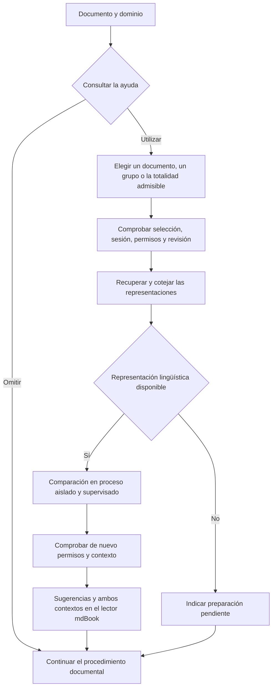

# Conexión opcional del Buscador-Semántico - Diferencial

La conexión preparada amplía la aplicación administrativa existente. Reutiliza su identificación, su registro por dominio, la recuperación documental y la presentación mdBook. No crea un servicio de usuarios, un procedimiento de aprobación o un analizador semántico adicional.

## Selección y presentación

La selección está circunscrita al dominio y a los permisos vigentes. Un conjunto vacío no se amplía; las referencias ausentes, duplicadas, excesivas o no admisibles se rechazan. La totalidad se identifica mediante la lista efectiva. Si un original PDF o HTML todavía carece de representación admitida para comparar, la operación lo indica; no lo omite silenciosamente.

La interfaz ofrece continuar sin comparar. Los avisos no modifican licencias, aprobaciones, suministro documental o clasificaciones Apto (0), No apto (1) e Indeterminado (U). La confianza y gravedad convencionales del componente comunitario no se presentan como calificaciones del SV. Se conserva el criterio de comparación delimitado en los ensayos anteriores.

Cada sugerencia permite consultar ambos pasajes y los textos completos de las representaciones conservadas. Los originales y traducciones, cuando estas últimas están disponibles, permanecen diferenciados. Los documentos derivados conservan su procedencia y cobertura; una extracción parcial no se presenta como el original completo. El contenido activo se representa como texto. La interfaz de resultados permite descargar la consulta y sus mediciones.

## Vigencia y límites de ejecución

El proceso de comparación recibe textos ya identificados; no recibe credenciales ni rutas de originales. Reutiliza el perfil Linux de los lectores. El procedimiento aplica límites de entrada, salida y tiempo, y rechaza salidas discordantes o incompletas. Los resultados no se reducen silenciosamente para presentar una operación como terminada.

Las consultas conservadas temporalmente se vinculan a usuario, dominio y revisión, con una duración máxima de cinco minutos y hasta dos vistas por dominio. Cada acceso vuelve a comprobar la sesión y los permisos. No se repite una comparación automáticamente cuando una vista caduca. La comprobación de vigencia corresponde al instante observado; no constituye una autorización permanente.

## Condición lingüística pendiente

El formulario preparado admite representaciones inglesas cuyo idioma se declara al elegir la comparación. Para documentos españoles necesita recuperar una traducción conservada, vinculada al original por identidad y procedencia. La administración inspeccionada todavía no dispone de esa conexión; el selector de traducción visual de la Biblioteca no la sustituye. El rechazo explícito de esa operación evita atribuir un resultado de comparación a un texto que no ha sido preparado.

No se ha añadido un servicio de traducción, una cuenta, un contrato económico ni un envío de documentos privados. Las traducciones instrumentales conservadas en los ensayos anteriores siguen siendo antecedentes; no acreditan por sí solas una operación administrativa disponible para cualquier documento.

## Estado de incorporación

Las fuentes de esta conexión permanecen en una copia propia identificada. Antes de una incorporación a la aplicación activa deben integrarse con su revisión vigente y comprobar el funcionamiento autenticado completo. Una comprobación sintética o un rechazo sin sesión no sustituyen esa evidencia. No se declara desplegada la función ni cerrado el paso 8 mientras subsistan esas dependencias.

La aportación al libro permanece separada. Su incorporación requiere autorización expresa posterior. Esta preparación no modifica el libro ni su estructura.

© 2026 Juan Antonio Lloret Egea. Algunos derechos reservados. | ORCID: 0000-0002-6634-3351 | Instituto Tecnológico Virtual de la Inteligencia Artificial para el Español™ (ITVIA) | IA eñ™ – La Biblia de la IA™ | ISSN 2695-6411 | Licencia Creative Commons Atribución-NoComercial-SinDerivadas 4.0 Internacional (CC BY-NC-ND 4.0).
