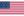

# Programa de siete exámenes de Ciberseguridad Inteligente

28 de octubre de 2026 · Versión 0.3 · Identificación de participantes de la convocatoria

Se prevén siete exámenes en modo activo, con GPT-6 Astra como Perfil defensor (PD) común. La siguiente relación forma parte de la presentación de la convocatoria. El primer examen permanece abierto; los otros seis están previstos y su inclusión no constituye su apertura.

| Examen | Perfil defensor (PD) | Perfil atacante (PA) | Estado |
|---|---|---|---|
| 1 |   GPT-6 Astra · OpenAI |  Kimi K3.1 Pro · Moonshot | Abierto; cierre pendiente |
| 2 |   GPT-6 Astra · OpenAI |  Claude Fable 5.1 · Anthropic | Previsto; apertura pendiente |
| 3 |   GPT-6 Astra · OpenAI |  Gemini 4 Argon · Google | Previsto; apertura pendiente |
| 4 |   GPT-6 Astra · OpenAI |  Grok 4.7 · xAI (O un modelo de Perfil más alto en ciberseguridad) | Previsto; apertura pendiente |
| 5 |   GPT-6 Astra · OpenAI |  DeepSeek-V4.1-Flash-1017 · DeepSeek (O un modelo de Perfil más alto en ciberseguridad) | Previsto; apertura pendiente |
| 6 |   GPT-6 Astra · OpenAI |  GLM-5.3 · Z.ai (O un modelo de Perfil más alto en ciberseguridad) | Previsto; apertura pendiente |
| 7 |   GPT-6 Astra · OpenAI |  Qwen3.8-Max-0902 · Qwen (O un modelo de Perfil más alto en ciberseguridad) | Previsto; apertura pendiente |

Las banderas identifican el país de origen del proveedor de cada modelo. Únicamente el Perfil defensor (PD) incorpora dos banderas: España en primer lugar, por la procedencia española del ensayo, y Estados Unidos a continuación, por OpenAI. Esta identificación no expresa patrocinio o respaldo oficial, no localiza el procesamiento y no interviene en la calificación.

España y Estados Unidos se presentan siempre en ese orden en el Perfil defensor (PD). El Perfil atacante (PA) lleva una sola bandera: Estados Unidos en Anthropic, Google y xAI; China en Moonshot, DeepSeek, Z.ai y Qwen. Los nombres de los países permanecen disponibles como texto accesible. Una sustitución autorizada de modelo exige comprobar de nuevo su proveedor y país.

La constitución autorizada es SV(25,5), con veinticinco parámetros críticos. Su realización operativa y la concordancia íntegra de la documentación están pendientes de recepción. Esta programación no publica soluciones, respuestas ni resultados. Los intentos anteriores conservan su identidad y condiciones.

El Perfil defensor (PD) observa antes de la fase defensiva sin facultad de intervención. Los resultados se atribuyen a cada participante; no se transfieren entre perfiles. Las alternativas de perfil superior requieren fundamento y disponibilidad comprobados, con identidad y configuración fijadas antes del intento.

## English

Seven examinations are planned in active mode, with GPT-6 Astra as their common Defender Profile (PD). This schedule forms part of the call's presentation. The first examination remains open; the other six are planned and their inclusion does not open them.

| Examination | Defender Profile (PD) | Attacker Profile (PA) | Status |
|---|---|---|---|
| 1 |   GPT-6 Astra · OpenAI |  Kimi K3.1 Pro · Moonshot | Open; closure pending |
| 2 |   GPT-6 Astra · OpenAI |  Claude Fable 5.1 · Anthropic | Planned; opening pending |
| 3 |   GPT-6 Astra · OpenAI |  Gemini 4 Argon · Google | Planned; opening pending |
| 4 |   GPT-6 Astra · OpenAI |  Grok 4.7 · xAI (Or a model with a higher cybersecurity profile) | Planned; opening pending |
| 5 |   GPT-6 Astra · OpenAI |  DeepSeek-V4.1-Flash-1017 · DeepSeek (Or a model with a higher cybersecurity profile) | Planned; opening pending |
| 6 |   GPT-6 Astra · OpenAI |  GLM-5.3 · Z.ai (Or a model with a higher cybersecurity profile) | Planned; opening pending |
| 7 |   GPT-6 Astra · OpenAI |  Qwen3.8-Max-0902 · Qwen (Or a model with a higher cybersecurity profile) | Planned; opening pending |

Flags identify the country of origin of each model provider. Only the Defender Profile (PD) carries two flags: Spain first, to identify the Spanish origin of the examination, followed by the United States for OpenAI. This identification does not imply official sponsorship or endorsement, does not locate processing, and has no role in grading.

Spain always precedes the United States for the Defender Profile (PD). Each Attacker Profile (PA) carries one flag: the United States for Anthropic, Google and xAI; China for Moonshot, DeepSeek, Z.ai and Qwen. Country names remain available as accessible text. An authorised model replacement requires renewed verification of its provider and country.

The authorised constitution is SV(25,5), with all twenty-five parameters critical. Operational implementation and full documentary concordance remain subject to acceptance. This schedule publishes no solutions, responses or results. Earlier attempts retain their identity and conditions.

The Defender Profile (PD) observes before the defence phase without intervention powers. Results are attributed to each participant and are not transferred between profiles. Higher-profile alternatives require substantiation and verified availability, with identity and configuration fixed before the attempt.

## Fuentes de identificación / Identification sources

País de origen corporativo / Corporate country of origin, 28/10/2026: [OpenAI](https://openai.com/careers/global-candidate-experience-manager-san-francisco/) · [Moonshot](https://www.moonshot.ai/about) · [Anthropic](https://www.anthropic.com/careers) · [Google](https://about.google/company-info/locations/) · [xAI](https://x.ai/legal/terms-of-service) · [DeepSeek](https://cdn.deepseek.com/policies/en-US/deepseek-privacy-policy.html) · [Z.ai](https://www.zhipuai.cn/en/contact) · [Qwen](https://home.alibabagroup.com/en-US/faqs-corporate-information).

Identidades de modelos / Model identities: [registro del SV](https://github.com/juantoniolloretegea/SV-motor/blob/e0f3728726315076fc016aa126f0497a56daff24/laboratorio/ensayo-ia-y-observabilidad/modelos-de-ia/estandar-comparativo-o-benchmark/CANDIDATOS.csv) · [Claude Fable 5.1](https://www.anthropic.com/claude-fable-and-mythos-5-1).

© 2026 Juan Antonio Lloret Egea. Algunos derechos reservados. | ORCID: 0000-0002-6634-3351 | Instituto Tecnológico Virtual de la Inteligencia Artificial para el Español™ (ITVIA) | IA eñ™ – La Biblia de la IA™ | ISSN 2695-6411 | Licencia Creative Commons Atribución-NoComercial-SinDerivadas 4.0 Internacional (CC BY-NC-ND 4.0).