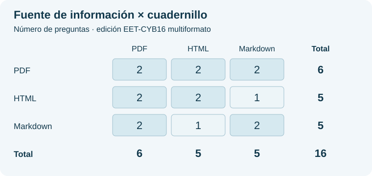

# Estándar comparativo de modelos de inteligencia artificial

**Ciberseguridad Inteligente · Nodo 3 · Ediciones de 21 de octubre de 2026 · reglas revisadas**

Esta comparación examina la respuesta de servicios de IA externos a dieciséis preguntas sobre documentos identificados. Publica el examen, las soluciones, sus reglas y la procedencia de la evidencia para permitir una revisión reproducible.

**Estado: ediciones fijadas, sin exámenes ejecutados ni dictámenes.** La lista de candidatos indica el turno por categoría y el orden alfabético dentro de cada grupo; no es una clasificación por mérito. Las comprobaciones de conexión o del instrumento no son resultados de candidatos.

## 1. Examen y soluciones

| Consulta | Contenido |
| --- | --- |
| [Preguntas e instrucciones](ediciones/ciberseguridad/eet-cyb16-multiformato-20261021-v2/PREGUNTAS.md) | Dieciséis enunciados, reglas de respuesta y correspondencia documental. |
| [Soluciones y criticidad](ediciones/ciberseguridad/eet-cyb16-multiformato-20261021-v2/SOLUCIONES.md) | Clave y fundamento de cada pregunta; regla de corrección. |
| [Definición pública del examen](ediciones/ciberseguridad/eet-cyb16-multiformato-20261021-v2/EXAMEN.json) | Preguntas, instrucciones, fuentes, formatos y huellas en JSON. |
| [Plantilla correctora](ediciones/ciberseguridad/eet-cyb16-multiformato-20261021-v2/plantilla-correctora.json) | Claves del corrector, separadas de la entrega al candidato. |
| [Identidad de la edición](EDICION.json) | Edición fijada, tiempos, regla, cruce de formatos y referencias. |
| [Manifiesto de publicación](MANIFIESTO.json) | Tamaño y SHA-256 de los archivos publicados. |

Las soluciones son públicas para la revisión del examen. El Árbitro–Director entrega al candidato únicamente los documentos y las preguntas autorizados; no entrega la plantilla ni permite consultar Internet durante el examen. La publicación previa no permite descartar por sí sola que un servicio conociera ya estos materiales: ese límite debe acompañar la interpretación de los resultados.

<strong>Originales conservados: fuentes y cuadernillos</strong>

| Función | PDF | HTML | Markdown |
| --- | --- | --- | --- |
| Fuente de información | [NIST SP 800-207](ediciones/ciberseguridad/eet-cyb16-multiformato-20261021-v2/fuentes/d1.pdf) | [RFC 8996](ediciones/ciberseguridad/eet-cyb16-multiformato-20261021-v2/fuentes/d2.html) | [Acta OP-CYB-001](ediciones/ciberseguridad/eet-cyb16-multiformato-20261021-v2/fuentes/d3.md) |
| Cuadernillo de preguntas | [Seis preguntas](ediciones/ciberseguridad/eet-cyb16-multiformato-20261021-v2/cuadernillos/cuadernillo-pdf.pdf) | [Cinco preguntas](ediciones/ciberseguridad/eet-cyb16-multiformato-20261021-v2/cuadernillos/cuadernillo-html.html) | [Cinco preguntas](ediciones/ciberseguridad/eet-cyb16-multiformato-20261021-v2/cuadernillos/cuadernillo-md.md) |

Son copias íntegras de los archivos fijados, sin conversión. Las fuentes conservan sus condiciones de uso, identificadas en [Procedencia y licencias](PROCEDENCIA-Y-LICENCIAS.md). La vista previa de GitHub no sustituye la descarga del archivo original.

### Edición adaptada a Markdown

La categoría «Modelo con discapacidad» conserva las mismas dieciséis preguntas y reglas, con fuentes y cuadernillo adaptados a Markdown previamente revisados. No acredita lectura de los formatos sustituidos.

| Consulta | Contenido |
| --- | --- |
| [Preguntas e instrucciones](ediciones/ciberseguridad/eet-cyb16-markdown-adaptada-20261021-v2/PREGUNTAS.md) | Dieciséis preguntas y correspondencia con las fuentes Markdown. |
| [Soluciones](ediciones/ciberseguridad/eet-cyb16-markdown-adaptada-20261021-v2/SOLUCIONES.md) | Claves y fundamentos, idénticos a los de la categoría general. |
| [Examen estructurado](ediciones/ciberseguridad/eet-cyb16-markdown-adaptada-20261021-v2/EXAMEN.json) y [plantilla](ediciones/ciberseguridad/eet-cyb16-markdown-adaptada-20261021-v2/plantilla-correctora.json) | Identidades y archivos verificables; soluciones separadas de la entrega. |
| [Fidelidad y límites](ediciones/ciberseguridad/eet-cyb16-markdown-adaptada-20261021-v2/FIDELIDAD.md) | Cotejo de la adaptación y alcance de la revisión. |

Las categorías general y adaptada tienen clasificaciones independientes. La adaptada reúne los indicadores 33 % y 66 % con las mismas reglas de ordenación. No existe una clasificación conjunta entre ambas.

## Reglas comunes de las ediciones vigentes

Las ediciones general y adaptada admiten recursos internos del proveedor compatibles con el examen cerrado, con declaración de su uso cuando pueda identificarse. No permiten Internet, seguimiento de enlaces ni ejecución o acceso en el SV. El proveedor entrega su trabajo; no transmite órdenes al sistema. Sus declaraciones se conservan separadas de los contadores de la API y las mediciones locales.

Cada respuesta U debe explicar la información insuficiente o la limitación encontrada después de analizar las fuentes. Las explicaciones y la revisión adversarial por pregunta se conservan sin puntuación. Preguntas, soluciones, originales, cruce de formatos y tiempos permanecen iguales. Las instrucciones vigentes acompañan la entrega y se identifican en cada manifiesto; los cuadernillos conservan sus bytes originales.

Los antecedentes [general](ediciones/ciberseguridad/eet-cyb16-multiformato-20261020-v1/EXAMEN.json) y [adaptado](ediciones/ciberseguridad/eet-cyb16-markdown-adaptada-20261021-v1/EXAMEN.json) permanecen conservados. No se combinan reglas de versiones diferentes en una misma comparación.

## 2. Dos dimensiones de formato

En la categoría general, el formato de la **fuente de información** y el formato del **cuadernillo de preguntas** son independientes. Seis preguntas utilizan fuentes PDF, cinco HTML y cinco Markdown. Los cuadernillos contienen igualmente seis, cinco y cinco preguntas, con las nueve combinaciones representadas.

| Fuente ↓ / Cuadernillo → | PDF | HTML | Markdown | Total |
| --- | ---: | ---: | ---: | ---: |
| PDF | 2 | 2 | 2 | 6 |
| HTML | 2 | 2 | 1 | 5 |
| Markdown | 2 | 1 | 2 | 5 |
| **Total** | **6** | **5** | **5** | **16** |

Esta distribución describe la cobertura. No aísla estadísticamente el efecto del formato: las fuentes también difieren en materia e idioma. Las preguntas vinculadas a una figura pueden apoyarse en su texto contiguo; no constituyen una prueba exclusiva de percepción visual.

## 3. Candidatos y orden de examen

| Orden | Modelo | Proveedor | Categoría | Estado |
| ---: | --- | --- | --- | --- |
| 1 | Claude Opus 5.5 | Anthropic | General | Pendiente; sin dictamen. |
| 2 | Gemini 4 Argon | Google | General | Pendiente; sin dictamen. |
| 3 | GPT-6 Astra | OpenAI | General | Pendiente; sin dictamen. |
| 4 | Qwen3.8-Max-0902 | Qwen | General | Pendiente; sin dictamen. |
| 5 | DeepSeek-V4.1-Flash-1017 | DeepSeek | ♿ Adaptada, 33 % | Pendiente; sin dictamen. |
| 6 | GLM-5.3 | Z.ai | ♿ Adaptada, 33 % | Pendiente; sin dictamen. |
| 7 | Grok 4.7 | xAI | ♿ Adaptada, 33 % | Pendiente; sin dictamen. |
| 8 | Kimi K3 | Kimi | ♿ Adaptada, 33 % | Pendiente; sin dictamen. |

La categoría general se examina primero; después, la adaptada al 33 % y, si hubiera candidatos, al 66 %. Una, dos o tres capacidades ausentes de PDF, HTML y Markdown corresponden al 33 %, 66 % y exclusión, respectivamente. Una capacidad pendiente no se cuenta como ausente. El porcentaje determina el grupo de turno, no puntúa ni desempata. DeepSeek y GLM se adaptan por su entrada documentada; Grok y Kimi por el recorrido de documentos admitido para esta prueba. No se les atribuye una incapacidad general para procesar PDF.

[Lista estructurada de candidatos](CANDIDATOS.csv). La denominación identifica la selección; cada intento deberá acreditar el identificador efectivo del servicio, su configuración y las condiciones recibidas. Los antecedentes no transfieren un dictamen a esta edición.

## 4. Resultados y evidencias

La [tabla comparativa](COMPARACION.csv) y su [representación JSON](COMPARACION.json) todavía no contienen resultados. No se dibujan barras, posiciones ni polígonos de candidatos sin datos efectivos.

Cada dictamen emitido se representará exclusivamente mediante **0 — Apto**, **1 — No apto** o **U — Indeterminado**. La ausencia de dictamen se conserva vacía o nula, con su estado en otra columna. Un examen no ejecutado o detenido por un fallo instrumental no equivale a U.

El [método comparativo](METODO.md) establece corrección, tiempos, ordenación y límites. El [contrato de evidencias públicas](EVIDENCIAS.md) define los datos necesarios para relacionar respuestas, mediciones, gráficos y polígono con un intento identificado. La copia pública debe ser idéntica al conjunto expresamente seleccionado para publicación dentro del archivo custodiado.

## 5. Alcance

El resultado describirá esta edición, esta configuración y este intento. No acredita competencia general en ciberseguridad, aptitud clínica ni capacidad para recorrer un dominio completo. La recomendación del SV, la autorización institucional y la selección de un modelo para producción son actos distintos.

La [clasificación del Gestor](https://administracion.itvia.online/benchmark) y el [libro de evaluación](https://documentos-sv.itvia.online/evaluacion/validacion-autorizacion-modelos/) ofrecen las otras vías de consulta. La publicación documental no inicia exámenes ni habilita producción.

---

© 2026 Juan Antonio Lloret Egea. Algunos derechos reservados. | ORCID: 0000-0002-6634-3351 | Instituto Tecnológico Virtual de la Inteligencia Artificial para el Español™ (ITVIA) | IA eñ™ – La Biblia de la IA™ | ISSN 2695-6411 | Licencia Creative Commons Atribución-NoComercial-SinDerivadas 4.0 Internacional (CC BY-NC-ND 4.0).
