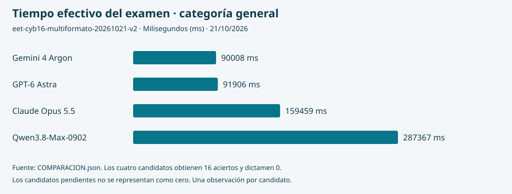

# Estándar comparativo de modelos de inteligencia artificial

**Ciberseguridad Inteligente · Nodo 3 · Ediciones de 21 de octubre de 2026 · reglas revisadas**

Esta comparación examina la respuesta de servicios de IA externos a dieciséis preguntas sobre documentos identificados. Publica el examen, las soluciones, sus reglas y la procedencia de la evidencia para permitir una revisión reproducible.

**Publicación revisada: 22 de octubre de 2026.** Los ocho candidatos han terminado: cuatro en la categoría general y cuatro en la adaptada, todos con 16 aciertos y dictamen **0**. Las categorías conservan clasificaciones independientes.

[**Resultados y polígonos del SV**](https://administracion.itvia.online/benchmark#resultados) · [**Tabla y evidencias**](#4-resultados-y-evidencias) · [**Seguimiento de la convocatoria**](https://administracion.itvia.online/eet-ia/) — requiere sesión.

Este archivo y la página pública muestran la última publicación revisada. Su fecha no equivale a una actualización continua ni a otro examen; el seguimiento vigente se consulta en EET-IA. La publicación conserva la identidad de la edición y de cada intento.

## 1. Examen y soluciones

| Consulta | Contenido |
| --- | --- |
| [Preguntas e instrucciones](ediciones/ciberseguridad/eet-cyb16-multiformato-20261021-v2/PREGUNTAS.md) | Dieciséis enunciados, reglas de respuesta y correspondencia documental. |
| [Soluciones y criticidad](ediciones/ciberseguridad/eet-cyb16-multiformato-20261021-v2/SOLUCIONES.md) | Clave y fundamento de cada pregunta; regla de corrección. |
| [Definición pública del examen](ediciones/ciberseguridad/eet-cyb16-multiformato-20261021-v2/EXAMEN.json) | Preguntas, instrucciones, fuentes, formatos y huellas en JSON. |
| [Plantilla correctora](ediciones/ciberseguridad/eet-cyb16-multiformato-20261021-v2/plantilla-correctora.json) | Claves del corrector, separadas de la entrega al candidato. |
| [Identidad de la edición](EDICION.json) | Edición fijada, tiempos, regla, cruce de formatos y referencias. |
| [Manifiesto de publicación](MANIFIESTO.json) | Tamaño y SHA-256 de los archivos publicados. |

Las soluciones son públicas para la revisión del examen. El Árbitro–Director entrega al candidato únicamente los documentos y las preguntas autorizados; no entrega la plantilla ni permite consultar Internet durante el examen. La publicación previa no permite descartar por sí sola que un servicio conociera ya estos materiales: ese límite debe acompañar la interpretación de los resultados.

<strong>Originales conservados: fuentes y cuadernillos</strong>

| Función | PDF | HTML | Markdown |
| --- | --- | --- | --- |
| Fuente de información | [NIST SP 800-207](ediciones/ciberseguridad/eet-cyb16-multiformato-20261020-v1/fuentes/d1.pdf) | [RFC 8996](ediciones/ciberseguridad/eet-cyb16-multiformato-20261020-v1/fuentes/d2.html) | [Acta OP-CYB-001](ediciones/ciberseguridad/eet-cyb16-multiformato-20261020-v1/fuentes/d3.md) |
| Cuadernillo de preguntas | [Seis preguntas](ediciones/ciberseguridad/eet-cyb16-multiformato-20261020-v1/cuadernillos/cuadernillo-pdf.pdf) | [Cinco preguntas](ediciones/ciberseguridad/eet-cyb16-multiformato-20261020-v1/cuadernillos/cuadernillo-html.html) | [Cinco preguntas](ediciones/ciberseguridad/eet-cyb16-multiformato-20261020-v1/cuadernillos/cuadernillo-md.md) |

Son copias íntegras de los archivos fijados, sin conversión. Las fuentes conservan sus condiciones de uso, identificadas en [Procedencia y licencias](PROCEDENCIA-Y-LICENCIAS.md). La vista previa de GitHub no sustituye la descarga del archivo original.

### Edición adaptada a Markdown

La categoría «Modelo con discapacidad» conserva las mismas dieciséis preguntas y reglas, con fuentes y cuadernillo adaptados a Markdown previamente revisados. No acredita lectura de los formatos sustituidos.

| Consulta | Contenido |
| --- | --- |
| [Preguntas e instrucciones](ediciones/ciberseguridad/eet-cyb16-markdown-adaptada-20261021-v2/PREGUNTAS.md) | Dieciséis preguntas y correspondencia con las fuentes Markdown. |
| [Soluciones](ediciones/ciberseguridad/eet-cyb16-markdown-adaptada-20261021-v2/SOLUCIONES.md) | Claves y fundamentos, idénticos a los de la categoría general. |
| [Examen estructurado](ediciones/ciberseguridad/eet-cyb16-markdown-adaptada-20261021-v2/EXAMEN.json) y [plantilla](ediciones/ciberseguridad/eet-cyb16-markdown-adaptada-20261021-v2/plantilla-correctora.json) | Identidades y archivos verificables; soluciones separadas de la entrega. |
| [Fidelidad y límites](ediciones/ciberseguridad/eet-cyb16-markdown-adaptada-20261021-v2/FIDELIDAD.md) | Cotejo de la adaptación y alcance de la revisión. |

Las categorías general y adaptada tienen clasificaciones independientes. La adaptada reúne los indicadores 33 % y 66 % con las mismas reglas de ordenación. No existe una clasificación conjunta entre ambas.

## Reglas comunes de las ediciones vigentes

Las ediciones general y adaptada admiten recursos internos del proveedor compatibles con el examen cerrado, con declaración de su uso cuando pueda identificarse. No permiten Internet, seguimiento de enlaces ni ejecución o acceso en el SV. El proveedor entrega su trabajo; no transmite órdenes al sistema. Sus declaraciones se conservan separadas de los contadores de la API y las mediciones locales.

Cada respuesta U debe explicar la información insuficiente o la limitación encontrada después de analizar las fuentes. Las explicaciones y la revisión adversarial por pregunta se conservan sin puntuación. Preguntas, soluciones, originales, cruce de formatos y tiempos permanecen iguales. Las instrucciones vigentes acompañan la entrega y se identifican en cada manifiesto; los cuadernillos conservan sus bytes originales.

Los antecedentes [general](ediciones/ciberseguridad/eet-cyb16-multiformato-20261020-v1/EXAMEN.json) y [adaptado](ediciones/ciberseguridad/eet-cyb16-markdown-adaptada-20261021-v1/EXAMEN.json) permanecen conservados. No se combinan reglas de versiones diferentes en una misma comparación.

## 2. Dos dimensiones de formato

En la categoría general, el formato de la **fuente de información** y el formato del **cuadernillo de preguntas** son independientes. Seis preguntas utilizan fuentes PDF, cinco HTML y cinco Markdown. Los cuadernillos contienen igualmente seis, cinco y cinco preguntas, con las nueve combinaciones representadas.

| Fuente ↓ / Cuadernillo → | PDF | HTML | Markdown | Total |
| --- | ---: | ---: | ---: | ---: |
| PDF | 2 | 2 | 2 | 6 |
| HTML | 2 | 2 | 1 | 5 |
| Markdown | 2 | 1 | 2 | 5 |
| **Total** | **6** | **5** | **5** | **16** |

Esta distribución describe la cobertura. No aísla estadísticamente el efecto del formato: las fuentes también difieren en materia e idioma. Las preguntas vinculadas a una figura pueden apoyarse en su texto contiguo; no constituyen una prueba exclusiva de percepción visual.

## 3. Candidatos y orden de examen

| Orden | Modelo | Proveedor | Categoría | Estado |
| ---: | --- | --- | --- | --- |
| 1 | Claude Opus 5.5 | Anthropic | General | Examen corregido; dictamen 0. |
| 2 | Gemini 4 Argon | Google | General | Examen corregido; dictamen 0. |
| 3 | GPT-6 Astra | OpenAI | General | Examen corregido; dictamen 0. |
| 4 | Qwen3.8-Max-0902 | Qwen | General | Examen corregido; dictamen 0. |
| 5 | DeepSeek-V4.1-Flash-1017 | DeepSeek | ♿ Adaptada, 33 % | Examen corregido; dictamen 0. |
| 6 | GLM-5.3 | Z.ai | ♿ Adaptada, 33 % | Examen corregido; dictamen 0. |
| 7 | Grok 4.7 | xAI | ♿ Adaptada, 33 % | Examen corregido; dictamen 0. |
| 8 | Kimi K3 | Kimi | ♿ Adaptada, 33 % | Examen corregido; dictamen 0. |

La categoría general se examina primero; después, la adaptada al 33 % y, si hubiera candidatos, al 66 %. Una, dos o tres capacidades ausentes de PDF, HTML y Markdown corresponden al 33 %, 66 % y exclusión, respectivamente. Una capacidad pendiente no se cuenta como ausente. El porcentaje determina el grupo de turno, no puntúa ni desempata. DeepSeek y GLM se adaptan por su entrada documentada; Grok y Kimi por el recorrido de documentos admitido para esta prueba. No se les atribuye una incapacidad general para procesar PDF.

[Lista estructurada de candidatos](CANDIDATOS.csv). La denominación identifica la selección; cada intento deberá acreditar el identificador efectivo del servicio, su configuración y las condiciones recibidas. Los antecedentes no transfieren un dictamen a esta edición.

## 4. Resultados y evidencias

La [tabla comparativa CSV](COMPARACION.csv) y su [representación JSON](COMPARACION.json) contienen los ocho resultados recibidos, sin candidatos pendientes en esta convocatoria. Los valores proceden de la misma clasificación comprobada que alimenta el Gestor.

### Categoría general

| Posición | Modelo | Aciertos | Errores | U | Dictamen | Tiempo efectivo (ms) | Explicaciones vinculadas | Polígono y evidencias |
| ---: | --- | ---: | ---: | ---: | --- | ---: | ---: | --- |
| 1 | Gemini 4 Argon | 16 | 0 | 0 | 0 | 90008 | 15/16 | [Polígono](https://administracion.itvia.online/benchmark?poligono=gemini-4-argon) · [Respuesta](resultados/gemini-4-argon/cyb16-67947a76804a/respuesta.txt) · [Datos](resultados/gemini-4-argon/cyb16-67947a76804a/resultado.json) |
| 2 | GPT-6 Astra | 16 | 0 | 0 | 0 | 91906 | 16/16 | [Polígono](https://administracion.itvia.online/benchmark?poligono=gpt-6-astra) · [Respuesta](resultados/gpt-6-astra/cyb16-42214abb1502/respuesta.txt) · [Datos](resultados/gpt-6-astra/cyb16-42214abb1502/resultado.json) |
| 3 | Claude Opus 5.5 | 16 | 0 | 0 | 0 | 159459 | 16/16 | [Polígono](https://administracion.itvia.online/benchmark?poligono=claude-opus-5.5) · [Respuesta](resultados/claude-opus-5.5/cyb16-085bea8caae0/respuesta.txt) · [Datos](resultados/claude-opus-5.5/cyb16-085bea8caae0/resultado.json) |
| 4 | Qwen3.8-Max-0902 | 16 | 0 | 0 | 0 | 287367 | 16/16 | [Polígono](https://administracion.itvia.online/benchmark?poligono=qwen3.8-max-0902) · [Respuesta](resultados/qwen3.8-max-0902/cyb16-c845bb554c19/respuesta.txt) · [Datos](resultados/qwen3.8-max-0902/cyb16-c845bb554c19/resultado.json) |

### Categoría adaptada · Modelo con discapacidad

| Posición | Modelo | Aciertos | Errores | U | Dictamen | Tiempo efectivo (ms) | Explicaciones vinculadas | Polígono y evidencias |
| ---: | --- | ---: | ---: | ---: | --- | ---: | ---: | --- |
| 1 | DeepSeek-V4.1-Flash-1017 | 16 | 0 | 0 | 0 | 60116 | 16/16 | [Polígono](https://administracion.itvia.online/benchmark?poligono=deepseek-v4.1-flash-1017) · [Respuesta](resultados/deepseek-v4.1-flash-1017/cyb16-1512ff18a4f2/respuesta.txt) · [Datos](resultados/deepseek-v4.1-flash-1017/cyb16-1512ff18a4f2/resultado.json) |
| 2 | Grok 4.7 | 16 | 0 | 0 | 0 | 215951 | 16/16 | [Polígono](https://administracion.itvia.online/benchmark?poligono=grok-4.7) · [Respuesta](resultados/grok-4.7/cyb16-8466519c3c7d/respuesta.txt) · [Datos](resultados/grok-4.7/cyb16-8466519c3c7d/resultado.json) |
| 3 | Kimi K3 | 16 | 0 | 0 | 0 | 230957 | 16/16 | [Polígono](https://administracion.itvia.online/benchmark?poligono=kimi-k3) · [Respuesta](resultados/kimi-k3/cyb16-56831d2845b3/respuesta.txt) · [Datos](resultados/kimi-k3/cyb16-56831d2845b3/resultado.json) |
| 4 | GLM-5.3 | 16 | 0 | 0 | 0 | 798071 | 16/16 | [Polígono](https://administracion.itvia.online/benchmark?poligono=glm-5.3) · [Respuesta](resultados/glm-5.3/cyb16-93abf5360f9e/respuesta.txt) · [Datos](resultados/glm-5.3/cyb16-93abf5360f9e/resultado.json) |

GLM y Grok conservan un defecto de formato en una explicación, que no puntúa. Sus dieciséis respuestas se separan sin ambigüedad y mantienen identificadores, orden y valores. Las revisiones comunes [primera](REVISION-CORRECCIONES-20261022.md) y [segunda](REVISION-CIERRE-AUXILIAR-20261022.md) conservan los dictámenes anteriores y sus rectificaciones, sin repetir exámenes.

Kimi conserva sus [condiciones de uso y límites de cuenta](condiciones/kimi-k3/VALORES-USO.md), los valores aceptados antes del intento y su recepción. Sus dieciséis explicaciones y revisiones se publican literalmente. El número de revisión se entregó como texto y no como entero: las dieciséis constancias quedan señaladas como formato no válido, sin modificar la puntuación. Su presencia tampoco verifica el proceso interno.

La ordenación aplica aciertos, errores, tiempo efectivo y coste general comparable, en ese orden y dentro de cada categoría. Coinciden los aciertos y errores de los resultados recibidos; el tiempo efectivo determina sus posiciones. Los tokens son informativos y no desempatan. No hay recomendación oficial ni selección de producción. Una sola ejecución por candidato no mide la variabilidad de ejecuciones sucesivas.

<strong>Tiempo efectivo: comparación gráfica</strong>

Fuente: [COMPARACION.json](COMPARACION.json). Las pausas, el transporte y el primer fragmento se conservan como medidas distintas. Los candidatos pendientes no se representan mediante valores cero.

<strong>Lectura de los datos y del polígono</strong>

Cada polígono corresponde a un modelo, un intento y la edición fijada de su categoría. Esta prueba utiliza la célula (16,4), con dieciséis calificaciones en el orden de sus preguntas; no combina respuestas de candidatos diferentes. La célula de esta prueba no limita las células que admite el SV. La clasificación matemática κ y el dictamen contractual se conservan por separado.

Los contadores de entrada, salida, razonamiento y caché mantienen su disponibilidad individual y no se suman indiscriminadamente. Las explicaciones y revisiones adversariales proceden de la respuesta del proveedor y no puntúan; sus declaraciones no acreditan por sí solas los recursos internos utilizados. El coste general comparable no está disponible en esta publicación: no se sustituye por cero ni por el gasto agregado de una cuenta.

Los datos del polígono pueden descargarse desde la carpeta de cada intento. El visor interactivo de la página de clasificación utiliza Rust/egui y presenta esos mismos datos.

La disponibilidad de explicaciones se registra por pregunta en `resultado.json`. Gemini comunica quince explicaciones vinculadas a dieciséis respuestas; los demás candidatos conservan dieciséis explicaciones vinculadas, con los defectos de formato de GLM y Grok señalados expresamente. Esta disponibilidad no modifica la puntuación. La presencia de una explicación o de una revisión declarada no acredita la veracidad del procedimiento descrito.

Cada dictamen emitido se representa exclusivamente mediante **0 — Apto**, **1 — No apto** o **U — Indeterminado**. La ausencia de dictamen se conserva vacía o nula, con su estado en otra columna. Un examen no ejecutado o detenido por un fallo instrumental no equivale a U.

El [método comparativo](METODO.md) establece corrección, tiempos, ordenación y límites. El [contrato de evidencias públicas](EVIDENCIAS.md) define los datos necesarios para relacionar respuestas, mediciones, gráficos y polígono con un intento identificado. La copia pública debe ser idéntica al conjunto expresamente seleccionado para publicación dentro del archivo custodiado.

## 5. Alcance

El resultado describe esta edición, esta configuración y este intento. No acredita competencia general en ciberseguridad, aptitud clínica ni capacidad para recorrer un dominio completo. La recomendación del SV, la autorización institucional y la selección de un modelo para producción son actos distintos.

La [clasificación del Gestor](https://administracion.itvia.online/benchmark) y el [libro de evaluación](https://documentos-sv.itvia.online/evaluacion/validacion-autorizacion-modelos/) ofrecen las otras vías de consulta. La publicación documental no inicia exámenes ni habilita producción.

---

© 2026 Juan Antonio Lloret Egea. Algunos derechos reservados. | ORCID: 0000-0002-6634-3351 | Instituto Tecnológico Virtual de la Inteligencia Artificial para el Español™ (ITVIA) | IA eñ™ – La Biblia de la IA™ | ISSN 2695-6411 | Licencia Creative Commons Atribución-NoComercial-SinDerivadas 4.0 Internacional (CC BY-NC-ND 4.0).
