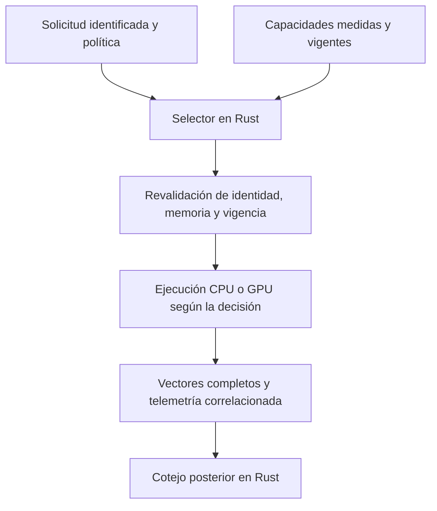

# Qwen3-8B Q4_K_M: ejecución CPU/GPU mediante SV-Aprender y conexión con el Selector

**Ensayo del 14 de octubre de 2026 · Kaggle · CPU Intel Xeon y GPU NVIDIA Tesla T4.**

## Resultado y finalidad

El ensayo acredita que una decisión del **Selector del Árbitro - Director CPU/GPU/TPU/NPU** puede determinar el dispositivo que ejecuta una solicitud delimitada de inferencia de Qwen3-8B. La selección automática eligió la GPU a partir de medidas previas; una segunda solicitud, cuya política exigía CPU, se ejecutó en CPU con cero lanzamientos GPU durante su cálculo. Ambas decisiones se reconstruyeron posteriormente en Rust y sus resultados numéricos cumplieron los criterios fijados.

**SV-Aprender** denomina la variante experimental de Aprender utilizada: revisión comunitaria identificada, instrumentación y guardas adicionales, y control del ensayo en Rust. El cálculo GPU observado está definido en Rust, que genera PTX y utiliza la API del controlador CUDA de NVIDIA para ejecutarlo. No se delegaron esas operaciones matemáticas en cuBLAS o cuBLASLt. El controlador NVIDIA, su compilador PTX y NVML continúan siendo necesarios.

La finalidad es preparar la selección efectiva de dispositivos para motores de IA administrados por el SV. El nodo 1 continúa sin validación general. Esta realización no acredita una instalación productiva del Árbitro-Director, aptitud documental de Qwen ni corrección de sus respuestas en medicina o ciberseguridad. La misma necesidad de selección puede afectar a un motor de traducción administrado por el SV, aunque el modelo consultado pertenezca al nodo 3. El cálculo de una IA externa permanece bajo la administración de su proveedor.

Kaggle proporciona aquí la máquina donde se ejecutan pesos y programa bajo control del ensayo. No se utiliza su servicio gestionado de modelos ni se consume una API de inferencia. El lugar de ejecución no convierte por sí solo este experimento en una evaluación del nodo 2.

## Modelo, motor y fuentes exactas

| Elemento | Identidad conservada |
|---|---|
| Modelo | **Qwen/Qwen3-8B-GGUF**, archivo **Qwen3-8B-Q4_K_M.gguf** |
| Revisión de los pesos | `7c41481f57cb95916b40956ab2f0b139b296d974` |
| Tamaño y SHA-256 | 5 027 783 488 bytes; `d98cdcbd03e17ce47681435b5150e34c1417f50b5c0019dd560e4882c5745785` |
| Motor comunitario | [Aprender, revisión d0a59c1882ddf43656d1067cc6d5c1943aba22d3](https://github.com/paiml/aprender/tree/d0a59c1882ddf43656d1067cc6d5c1943aba22d3) |
| Variante examinada | SV-Aprender; diez archivos instrumentados, definidos en [INSTRUMENTACION.json](codigo/INSTRUMENTACION.json) |
| Selector | [Fuente Rust íntegra](codigo/selector/src/lib.rs); SHA-256 `2b6cd91da365f15ab314ea69ef6eeec1b12826ddf0de01fcca58191ef5afff05` |
| Conexión y ejecución | [conexion.rs](codigo/selector/ensayo-qwen/src/conexion.rs), [supervisor](codigo/selector/ensayo-qwen/src/main.rs) y [observación](codigo/selector/ensayo-qwen/src/observacion.rs) |
| Verificación posterior | [Reconstrucción de decisiones y vectores](codigo/selector/ensayo-qwen/src/bin/verificar_conexion.rs), [integridad](codigo/selector/ensayo-qwen/src/bin/cotejar.rs) y [auditoría GPU](codigo/selector/ensayo-qwen/src/bin/auditar_gpu.rs) |

La carpeta hermana [codigo](codigo) contiene las fuentes propias, las fuentes históricas r1/r2, la copia íntegra de Aprender, las modificaciones instrumentales, las definiciones Rust de las operaciones observadas, las dependencias fijadas y sus licencias. [Reproducción del ensayo](codigo/REPRODUCCION.md) explica su disposición y utilización. El [manifiesto](MANIFIESTO.json) identifica por tamaño y SHA-256 todos los archivos incorporados, salvo el propio manifiesto.

Los pesos se obtuvieron de la [revisión oficial fijada](https://huggingface.co/Qwen/Qwen3-8B-GGUF/tree/7c41481f57cb95916b40956ab2f0b139b296d974). No se redistribuyen en este expediente. Q4_K_M conserva la representación mixta del archivo; no significa que todos sus tensores utilicen idéntico formato de cuantización. Los pesos no se modificaron.

## Entorno y configuración

| Condición | Observación |
|---|---|
| Plataforma | Cuaderno Kaggle, acelerador seleccionado T4 × 2; sin persistencia de sesión |
| CPU | Intel Xeon a 2,00 GHz; cuatro procesadores lógicos visibles; cuatro hilos configurados para el cálculo |
| GPU | Dos Tesla T4 observadas; 16 106 127 360 bytes por tarjeta según NVML; cálculo en la GPU de índice 0 |
| Controlador | NVIDIA 580.178.04; capacidad CUDA 7.5, destino PTX `sm_75` |
| Compilación | Rust 1.98.1, Linux x86-64; dependencias y características en [codigo/DEPENDENCIAS.json](codigo/DEPENDENCIAS.json) |
| Conectividad | Descarga y comprobación previas; Internet desactivado durante la inferencia |
| Perfil GPU | Q4_K MWV; Q6_K HwDp4a; preparación secuencial; HGEMM de preparación y generación desactivado; sin FP8, W4A16 ni variante fusionada de las proyecciones de entrada |
| Observación | CPU del proceso, memoria residente, ambas tarjetas, procesos GPU, potencia, energía, temperatura, ocupación, transferencias y lanzamientos |
| Protección de la ejecución | CuBLAS/cuBLASLt y WGPU rechazados antes de su inicialización; límite de 600 segundos; sin reintentos automáticos |

La GPU utilizada en la conexión se identificó como `GPU-4ff4dc26-54ba-8099-a5f2-f97cbc1d71fb`, coincidente en CUDA y NVML. La segunda tarjeta se observó por separado y no recibió el cálculo del modelo. Los identificadores de r2 pertenecen a su propia sesión y permanecen en sus evidencias.

La capacidad de memoria comunicada por NVML y la comunicada por CUDA no se confunden: en la conexión, CUDA informó 15 636 037 632 bytes de memoria total utilizable; el inventario NVML informó 16 106 127 360. La selección utilizó la disponibilidad observada del dispositivo, con 512 MiB de necesidad adicional y otros 512 MiB de margen, sobre pesos ya preparados.

## Método y criterios previos

Se procesó una secuencia fijada de dieciséis posiciones: nueve tokens de entrada y siete de continuación impuesta. Se conservaron ocho vectores completos de salida por recorrido, con 151 936 valores `f32` cada uno. Es inferencia real del modelo completo sobre una secuencia común; no es generación libre de respuestas ni examen de conocimientos. La secuencia y su identidad se conservan en `ENTRADA.json` de cada archivo original.

Para admitir una comparación se exigieron dimensiones completas, valores finitos, similitud coseno de al menos 0,99, error relativo L2 no superior a 0,05 y coincidencia del índice de puntuación máxima. La paridad adicional realizada por el motor al cargar la GPU mantuvo su umbral original, aproximadamente 0,98; no sustituyó los criterios propios.

La conexión preparó los pesos una vez en CPU y GPU y creó una caché de contexto nueva para cada recorrido. Se realizaron tres pares CPU/GPU en orden alterno, conservando las medidas individuales y sus medianas. Estas capacidades se asociaron al modelo, secuencia, dimensiones, perfil, revisión del adaptador y dispositivo concretos, con una vigencia máxima de 120 segundos.

La revalidación anterior al envío comprueba el contenido, la política, el destino, la memoria y la vigencia de la decisión. Una discordancia impide el envío; no provoca sustitución silenciosa de dispositivo. Diez comprobaciones locales Rust resultaron satisfactorias, incluidos datos incompletos, memoria insuficiente, cambios de destino o revisión y vencimiento de capacidades o decisiones.

## Resultados de las tres ejecuciones

| Ejecución | Resultado observado | Alcance |
|---|---|---|
| r1 | Interrupción con código 71 antes del cálculo GPU; cero lanzamientos; ocho vectores CPU conservados | Se omitió `HGEMM_PREFILL=0` y la preparación intentó inicializar cuBLAS. La guarda impidió continuar. Se conserva como defecto instrumental, no como fallo general del motor. |
| r2 | CPU y GPU completadas; ocho comparaciones conformes y paridad adicional satisfactoria | Contraste del motor, todavía sin selección automática. Corrección delimitada de la omisión anterior. |
| Conexión con el Selector | Tres pares de calibración conformes, selección automática GPU, CPU obligatoria respetada y rechazo sin cálculo de una petición TPU sin adaptador | Conexión experimental comprobada entre decisión y ejecución física. La petición TPU es una prueba lógica negativa, no una ejecución física TPU. |

En r2, el recorrido preparado duró **8,104815 s en CPU** y **1,329293 s en GPU**. La carga CPU duró 5,958 s y la preparación GPU con paridad, 3,247 s. El proceso supervisado completo duró 47,774 s. La relación temporal observada, aproximadamente 6,10, corresponde únicamente a esa operación, configuración e instrumentación.

### Calibración de la conexión

| Medida del servicio preparado | CPU | GPU |
|---|---:|---:|
| Primera | 8,051926 s | 1,241477 s |
| Segunda | 8,088335 s | 1,137948 s |
| Tercera | 8,072493 s | 1,279833 s |
| Mediana empleada por el Selector | **8,072493 s** | **1,241477 s** |

### Solicitudes decididas por el Selector

| Solicitud | Decisión | Servicio medido | Desde admisión hasta conservación | Lanzamientos GPU durante la solicitud |
|---|---|---:|---:|---:|
| CPU y GPU permitidas | GPU, menor tiempo estimado entre capacidades comprobadas | **1,162573 s** | **1,173871 s** | **12 144** |
| Política que exige CPU | CPU; GPU excluida por esa condición | **8,059810 s** | **8,070833 s** | **0** |

El tiempo de servicio incluye creación de caché, cálculo, transferencias, recuperación, observación y conservación de los vectores, con el modelo preparado. El segundo tiempo incorpora además admisión, decisión, revalidación y sus registros. La comparación numérica posterior queda fuera de ambas medidas. La preparación inicial duró **9,285501 s**, incluidos **6,017329 s** de carga CPU. El proceso supervisado completo duró **76,551 s**; comprende también identidad, preparación, calibración, comprobaciones y finalización. La descarga previa duró **384,842 s** y no forma parte de esos tiempos de inferencia.

La solicitud CPU acredita cumplimiento de una política explícita; no demuestra que CPU fuese más rápida. La selección automática tampoco constituye optimalidad universal: las medidas corresponden a la misma secuencia, sesión, memoria y ausencia de concurrencia. No se probó migración de un contexto de conversación residente ni ejecución con pesos inicialmente ausentes del dispositivo.

## Concordancia y evidencia de ejecución GPU

En r2 y en la conexión, el coseno mínimo fue **0,9997464874**, el error relativo L2 máximo **0,0232668768** y coincidieron los máximos de las ocho salidas. La verificación posterior de la conexión recalculó **56 comparaciones** frente a la primera referencia CPU, incluidas repeticiones de calibración y solicitudes. Son comparaciones de la misma carga; no equivalen a 56 casos científicos independientes. Se conservaron **66 vectores completos**, incluidos los dos de paridad inicial.

La conexión registró **49 335 lanzamientos GPU**: 759 de paridad, 36 432 de las tres calibraciones GPU y 12 144 de la solicitud seleccionada. Cada posición GPU realizó 759 lanzamientos. Las calibraciones CPU y la solicitud CPU no produjeron lanzamientos CUDA durante sus fases de cálculo.

Los lanzamientos se relacionaron con doce funciones y con los programas PTX conservados: proyecciones Q4_K y Q6_K, cuantización Q8, normalización RMS, normalización por cabeza, RoPE, atención por bloques y reducción, SwiGLU, suma residual y escritura de la caché de atención. La [relación de fuentes Rust](codigo/OPERACIONES-GPU.json) permite localizar sus definiciones. No hubo errores de correspondencia, retornos fallidos ni activación de los recorridos prohibidos.

La prueba conserva nombres y correspondencia de funciones, PTX, dimensiones de lanzamiento, flujo de ejecución, códigos de retorno y transferencias. Se observaron en total **4 673 149 568 bytes CPU → GPU** y **39 503 360 bytes GPU → CPU**, desglosados por fase en la auditoría. El mapa de bibliotecas cargadas contiene el controlador CUDA, su compilador PTX y NVML; no contiene cuBLAS ni cuDNN. Esto acredita el recorrido observado, sin inspeccionar el código máquina final del controlador ni afirmar que todo su funcionamiento interno esté escrito en Rust.

## Telemetría, integridad y límites

La conexión conserva **52 356 registros de traza**, **281 muestras periódicas**, cero errores básicos de medición y **153 muestras con el proceso propio identificado en GPU**. El intervalo máximo registrado fue **293 ms**, frente a un objetivo de 250 ms. La separación CPU/GPU se comprueba mediante fases, tiempo acumulado de CPU, eventos del flujo CUDA, lanzamientos y presencia del proceso; una tarjeta ocupada, por sí sola, no se acepta como prueba suficiente.

Durante la solicitud CPU, el proceso acumuló **29,950 s de CPU**; durante la solicitud GPU, **1,190 s de CPU**. El tiempo acumulado puede superar el tiempo de reloj por ejecución de varios hilos. La CPU sigue realizando preparación, representaciones de tokens, control, transferencias y observación durante el recorrido GPU. Los eventos CUDA miden intervalos del flujo, con sus posibles esperas; no se interpretan como suma exclusiva de instrucciones de cálculo.

El máximo muestreado de memoria residente del proceso fue **12 267 368 448 bytes**. La potencia, energía, ocupación y memoria de tarjeta se conservan como medidas globales del dispositivo: no se atribuyen íntegramente a la solicitud. No se declara medición exclusiva de energía del proceso.

El contraste es breve y controlado. Incluye repetición de carga y obligación de utilizar el dispositivo decidido, pero **no es una prueba de saturación prolongada, concurrencia, agotamiento de memoria ni estabilidad durante horas**. El alcance de una prueba de estrés adicional debe definirse y ejecutarse antes de atribuirle esos resultados. La sesión Kaggle quedó detenida tras recuperar y cotejar el archivo de la conexión.

## Evidencias conservadas

| Archivo íntegro | Bytes | SHA-256 |
|---|---:|---|
| [r1](evidencias/r1/qwen-cpu-gpu-20261014.tar.gz) | 4 450 749 | `4de9c85e693b5bd16608f995aa6a42bfe15acc27b1cc223c73b9a55b32771f64` |
| [r2](evidencias/r2/qwen-cpu-gpu-20261014-r2.tar.gz) | 10 053 841 | `269437f33bc6b9aac8458205c441aa906acd6f5444abe40abe970ce90c9044fe` |
| [Conexión](evidencias/conexion/sv-aprender-conexion-20261014.tar.gz) | 36 619 399 | `c3a5ff86df708eedc7bbfba62c3085ee8e53368b47b095eeacfb7410397d221d` |

Los archivos originales contienen resultados, vectores, programas PTX, trazas, telemetría, inventario y manifiesto. Los cotejos posteriores comprobaron **61 archivos en r1, 87 en r2 y 140 en la conexión**, además de un manifiesto en cada archivo. Se conservan los [cotejos r1](evidencias/r1/COTEJO-RESULTADOS.json), [r2](evidencias/r2/COTEJO-RESULTADOS-R2.json), [integridad de la conexión](evidencias/conexion/COTEJO.json), [reconstrucción del Selector](evidencias/conexion/VERIFICACION.json) y [auditoría GPU](evidencias/conexion/AUDITORIA-GPU.json).

El ejecutable de la conexión mide 6 824 104 bytes y tiene SHA-256 `4b8685fce79cd4bfb466e7cf8474d9180fde4b3b40863d6b97621bee9434f7de`. Las identidades de los tres ejecutables y sus fuentes están relacionadas en [EJECUTABLES.json](codigo/EJECUTABLES.json). La conservación documental no sustituye una revisión científica independiente.

## Continuación de la investigación

La comprobación física aquí documentada se limita a CPU y NVIDIA T4. Google Cloud CPU/TPU y AMD CPU/GPU/NPU conservan sus pruebas y estados propios; este resultado no los anticipa. La selección futura debe comprobar compatibilidad, disponibilidad y rendimiento del recorrido completo para cada operación, sin preferencia automática por un tipo de acelerador ni reparto parcial silencioso.

Una síntesis general sobre gestión de dispositivos podrá elaborarse cuando se hayan completado las pruebas correspondientes. Qwen3-8B permanecerá identificado como modelo utilizado en este ensayo. El núcleo del SV, su semántica y su representación intermedia no se modificaron.

© 2026 Juan Antonio Lloret Egea. Algunos derechos reservados. | ORCID: 0000-0002-6634-3351 | Instituto Tecnológico Virtual de la Inteligencia Artificial para el Español™ (ITVIA) | IA eñ™ – La Biblia de la IA™ | ISSN 2695-6411 | Licencia Creative Commons Atribución-NoComercial-SinDerivadas 4.0 Internacional (CC BY-NC-ND 4.0).
