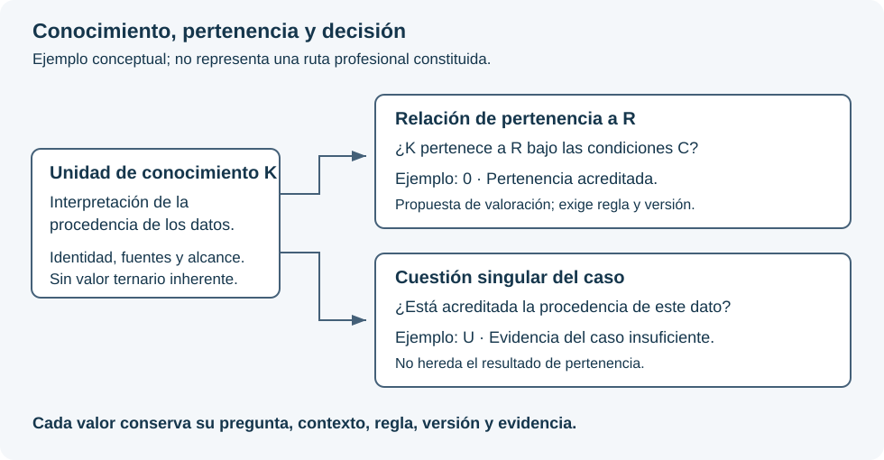

# Parámetros, rutas y trazabilidad: necesidades del sistema conjunto

**Versión 0.1 · 12 de octubre de 2026 · Especificación en evaluación.**

Este documento recoge las necesidades de representación y ejecución que vinculan la gestión documental, los Universos y el Lenguaje de Computación SV. No constituye nuevas rutas profesionales, sintaxis, tipos de la representación intermedia ni capacidades de ejecución recibidas. La propuesta de valoración ternaria de pertenencia a rutas se distingue expresamente de los requisitos ya establecidos.

## 1. Identidad, función y alcance del parámetro

El parámetro es una unidad de significado delimitada dentro de un Universo. La analogía con un átomo expresa su separación semántica respecto de otras unidades; no demuestra por sí sola atomicidad ni asigna una posición celular. El nombre no basta: cada definición identifica objeto, dominio, alcance, fuentes, versión y condiciones de aplicación.

Se distinguen tres objetos:

| Objeto | Qué representa | Valoración |
| --- | --- | --- |
| Parámetro de conocimiento | Una unidad delimitada de conceptos o datos generales necesarios para el Universo. | No recibe por sí mismo una valoración ternaria del caso ni una calificación de verdad de su contenido. |
| Relación entre un parámetro y una ruta | La pertenencia de ese parámetro a una ruta identificada, con alcance y condiciones expresos. | Se propone una valoración ternaria de esa relación, separada del contenido de conocimiento. |
| Parámetro singular de decisión | Una cuestión constituida para una valoración concreta que fundamenta el consejo al experto. | Recibe 0, 1 o U conforme a su contrato, observaciones y contexto. |

Las dos valoraciones pueden utilizar la misma terna sin significar lo mismo. No se copiará el resultado de pertenencia a una ruta al resultado decisional, ni a la inversa. Que una definición se reutilice en distintos casos tampoco transmite los valores de un caso a otro.

Cada parámetro conserva un único Universo propietario. Las relaciones transversales remiten a su identidad y versión; no crean otro propietario ni heredan permisos documentales, valores de casos o conclusiones. Un cambio de propietario debe designar el sustituto en la misma decisión válida. Un Universo constituido conserva al menos un parámetro asignado; un borrador incompleto no se presenta como constituido. La propiedad del parámetro y la de sus fuentes documentales son relaciones diferentes: un documento puede sustentar varios parámetros sin convertirse en su propietario.

## 2. Atomicidad y secuencia de constitución

La [adenda de reconciliación de la secuencia](https://github.com/juantoniolloretegea/SVperitus-dataset/blob/9939d600b3c3ffc3f4237f229ca0670de8f3693d/dominios/inmunologia/cambio-rumbo/adenda-reconciliacion-secuencia-constitutiva-y-puertas-inmunologia-2026-09-02-v0.1.md) distingue la consecuencia candidata necesaria para probar atomicidad de la consecuencia operacional que tendrá efectos en una ruta. La secuencia material pertinente es:

1. Delimitar la operación y las preguntas semánticas.
2. Establecer observables y consecuencias candidatas de error, omisión, fusión o inversión.
3. Adjudicar la atomicidad mediante esas distinciones, sin imponer una dimensión informática.
4. Constituir la propiedad y las referencias de los parámetros adoptados.
5. Constituir las consecuencias operacionales, composiciones y rutas.

Una consecuencia candidata no habilita un veto ni un consejo. Una pregunta todavía no adjudicada no se presenta como parámetro constituido. El [manifiesto terminal posterior](https://github.com/juantoniolloretegea/SVperitus-dataset/blob/9939d600b3c3ffc3f4237f229ca0670de8f3693d/dominios/inmunologia/cambio-rumbo/manifiesto-terminal-alcance-cobertura-y-terminacion-OP-IMM-001-Q0-v0-2026-09-03.md) conserva esa secuencia y fija la finitud del corte; la congelación provisional descrita en la adenda no se reproduce como estado actual. La suficiencia de aquel corte no acredita la constitución de toda la especialidad.

La distinción actual entre conocimiento y decisión no reclasifica retrospectivamente todos los parámetros de inventarios anteriores. Su correspondencia deberá justificarse mediante función y alcance. Tampoco se extrapola a todas las unidades de conocimiento la prueba operacional de atomicidad de una operación particular sin justificar su aplicabilidad.

## 3. Propuesta: valorar la pertenencia a una ruta

La evaluación corresponde a una relación identificada por **parámetro, versión del parámetro, ruta, versión de la ruta, condiciones de aplicación y contexto**. No es un atributo ternario permanente del conocimiento.

Para que pueda ejecutarse, deben constituirse previamente la proposición evaluada, la interpretación de cada resultado, los datos necesarios, las causas legítimas de U y el efecto sobre la ejecución. La IA puede intervenir en la evaluación únicamente dentro de esa autorización; no crea ni modifica por sí misma la relación ni su regla.

Ejemplo conceptual, sin finalidad profesional: la unidad de conocimiento K explica cómo interpretar la procedencia de un dato. La ruta R requiere comprobar esa procedencia. Se declara la proposición «K pertenece a R bajo las condiciones C». En este ejemplo, **0** expresa conformidad con esa pertenencia; **1**, no conformidad; **U**, imposibilidad de resolverla con la información admitida. Esta convención ilustra una regla que tendría que aprobarse para la ruta; no añade una correspondencia universal al núcleo del SV.

La valoración no afirma si el contenido de K es verdadero. Tampoco responde a la cuestión singular «¿queda acreditada la procedencia del dato de este caso?». K puede pertenecer a R y esa cuestión singular permanecer en U. Ambas salidas deben verse con su pregunta y evidencia respectivas.

El esquema es conceptual y no acredita una ruta constituida ni una capacidad implementada.

**Pertenencia, activación y obligatoriedad se registran por separado.** Un resultado de no pertenencia a R no elimina obligaciones de otra ruta aplicable. La incertidumbre sobre una dependencia obligatoria no habilita a omitirla: debe producir el tratamiento previsto —bloqueo, abstención o revisión competente—. Una ruta todavía no definida conserva ese estado documental; no se transforma por defecto en un valor U de una evaluación que nunca se ejecutó.

## 4. Células, valores y representación

Los [pilares del Lenguaje](https://github.com/juantoniolloretegea/SV-lenguaje-de-computacion/blob/f10aac725676997adc3840a1bd1a41e1579589ea/docs/calidad/PILARES_Y_RESTRICCIONES_DE_DISENO_DEL_LENGUAJE_DE_COMPUTACION_SV_2026_09_05.md) y el [documento de paridad](https://github.com/juantoniolloretegea/SV-lenguaje-de-computacion/blob/f10aac725676997adc3840a1bd1a41e1579589ea/docs/calidad/tuberias-ia/paridad-imagen-celula-matematica/CELULA_IMAGEN_Y_AGENTES_EN_EL_SV_P1_P3_BIS_2026_09_13_V2.md) gobiernan el encaje celular. Deben distinguirse la familia matemática, las dimensiones admitidas por una versión y la dimensión fija de una instancia.

Un inventario de 27 parámetros no autoriza automáticamente tres células de nueve ni una de 36 con posiciones de relleno. Una posición debe corresponder a un parámetro constituido. U conserva indeterminación en una posición válida; no rellena un hueco, un error técnico o una definición inexistente.

La propuesta de pertenencia no decide si esa valoración requiere una célula propia, una relación externa o una ampliación de representación. Esta decisión exige demostrar qué preserva el contrato vigente y qué información perdería. No se cambia la célula por analogía con un grafo.

Un código CIE-11, o la clasificación pertinente de otro dominio, identifica un concepto de referencia; no determina por sí solo diagnóstico, parámetros, ruta ni resultado. La correspondencia con el SV necesita definición, versión y fundamento propios.

El frame gráfico deberá corresponder a la misma instancia, revisión, posiciones y valores que su estado matemático. Egui presenta esa correspondencia; no decide pertenencias, reglas o consecuencias. El mapa de dependencias y el polígono decisional son vistas diferentes y enlazables.

## 5. Visualización requerida

Se requieren tres vistas relacionadas:

- **Composición:** documentos y objetos, selecciones, Universos propietarios y relacionados, parámetros y dependencias declaradas.
- **Rutas:** recorrido previsto y condiciones; rutas críticas sólo cuando su definición y consecuencias estén constituidas. La criticidad no determinada se muestra como tal, nunca como ausencia de riesgo.
- **Actuación:** recorrido efectivamente registrado, elementos suministrados, consultas registradas, referencias de la respuesta, comprobaciones y decisión posterior del experto.

La selección de un elemento debe mostrar de qué depende, qué depende de él, versiones, alcance, responsable de la decisión y evidencia. Debe permitir ampliar desde una visión general hasta un pasaje exacto, filtrar por Universo y ruta, distinguir referencias compartidas sin duplicarlas y comparar el recorrido previsto con el registrado. Una dependencia crítica omitida debe resultar visible con su causa y tratamiento, no desaparecer del dibujo.

La documentación de Microsoft Project sobre [relaciones entre tareas](https://support.microsoft.com/es-es/project/highlight-how-tasks-link-to-other-tasks) ofrece una referencia de interacción: seleccionar un elemento y destacar sus antecedentes y sucesores. Su [ruta crítica](https://support.microsoft.com/es-es/project/manage-your-project-s-critical-path) se vincula al calendario del proyecto. El SV necesita fundamentar la obligatoriedad por consecuencias de omisión; no adopta de esa analogía duraciones, holguras ni un algoritmo clínico.

Las ayudas explicarán «qué significa», «de dónde procede» y «qué permite concluir» cada valor. El color se acompañará de texto o símbolos. La terna decisional no compartirá una leyenda ambigua con pertenencia, estado documental o fallos técnicos. La visualización respetará los permisos de cada recurso, incluidos títulos y metadatos reservados.

## 6. Evidencia de una actuación

La reconstrucción exige conservar, con identidad y versiones:

| Elemento | Evidencia necesaria |
| --- | --- |
| Fuente | Documento u objeto, edición, huella, procedencia, licencia y selección exacta. |
| Representación | Original o derivado, transformación, cobertura, correspondencia y cotejo. |
| Organización del conocimiento | Universo propietario y relaciones, parámetros, definiciones y prioridades vigentes. |
| Ruta | Definición, condiciones, dependencias, obligatoriedad, activación y tratamiento de omisiones. |
| Evaluación | Pregunta precisa, clase de valoración, contexto, entradas, regla y versión, resultado y causas de U. |
| Entrega | Autorización vigente, destinatario, contenido efectivamente remitido, límites y recepción observable. |
| Respuesta y revisión | Salida conservada, referencias declaradas, comprobación de soporte y decisión del experto con su fundamento. |

El registro distinguirá **preparado**, **suministrado**, **consultado mediante una operación observable**, **citado por el modelo** y **contrastado con la fuente**. Ninguno implica automáticamente el siguiente. No se certificará lectura cognitiva ni razonamiento interno no observables; una explicación del modelo es una salida conservada, no prueba independiente de su proceso.

El Calificador de actividades documentales asignará determinísticamente la actividad registrada, conforme a reglas Rust versionadas. Conservará quién actuó, con qué función, cuándo, sobre qué revisión y con qué resultado. El historial de cada documento será una consulta filtrada del registro y enlazará las actuaciones relacionadas sin exponer datos ajenos.

Cambios, revocaciones y sustituciones producen nuevos hechos, no borran antecedentes. Una revocación impide nuevas entregas afectadas; no altera la evidencia de una entrega anterior ni permite retirar datos ya recibidos de la memoria del destinatario. Las reglas de conservación y acceso histórico deben quedar expresas.

La auditabilidad permite examinar responsabilidades y decisiones. No asigna por sí sola responsabilidad jurídica, ni exonera automáticamente a quien diseñó, configuró, suministró o utilizó el sistema. Deben identificarse las funciones profesionales, documentales y técnicas que efectivamente intervinieron. La reproducibilidad formal tampoco demuestra la corrección científica de las entradas.

## 7. Necesidades para el Lenguaje y condiciones de aceptación

Estas condiciones constituyen un programa de verificación pendiente, no resultados de pruebas ejecutadas:

| Necesidad | Comprobación exigida antes de declararla disponible |
| --- | --- |
| Separación de significados | Rechazar la sustitución de una valoración de pertenencia por una decisional aunque ambas contengan 0, 1 o U. |
| Identidad y propiedad | Rechazar propietario ausente o múltiple; permitir una transferencia completa y trazada; no vaciar un Universo constituido. |
| Compartición | Conservar identidad de referencia y versiones, sin copiar estados de casos ni ampliar acceso. |
| Selección documental | Resolver cada página o pasaje contra la edición exacta; rechazar selecciones sin correspondencia tras una transformación. |
| Dependencias | Aplicar una ruta constituida; impedir que la ausencia o indeterminación de una dependencia obligatoria se trate como permiso para omitirla. |
| Estado y figura | Detectar discordancia de instancia, revisión, posición o valor entre registro matemático y frame. |
| Revocación e historial | Denegar nuevas entregas revocadas conservando el soporte histórico de las anteriores. |
| Frontera entre nodos | Preservar las mismas identidades, alcance, permisos y evidencia en los nodos 1, 2 y 3; rechazar información obligatoria perdida en la adaptación. |

Cada necesidad seguirá este recorrido: definición del requisito, contraste con los contratos vigentes, ejemplo verificable de pérdida o ambigüedad, identificación del componente competente, decisión versionada, realización en Rust y prueba de aceptación. Una necesidad no demuestra por sí sola que haya que modificar el núcleo; una limitación probada tampoco debe ocultarse para evitar su revisión.

Se preserva la secuencia del dominio: las necesidades conceptuales aquí registradas no sustituyen el expediente de requisitos demostrados que corresponda a su fase competente. No se declaran constituidas rutas, células ni algoritmos de decisión por publicarlas.

La gestión documental y de usuarios conserva sus reglas de autorización. La IA consume el material y las definiciones habilitadas; no cambia propietarios, prioridades, permisos, parámetros ni rutas. La conexión de un nodo por Internet no autoriza navegación documental libre.

## 8. Referencias de encaje y documentación pública

- [Evaluación documental de rutas, conocimiento y trazabilidad](https://github.com/juantoniolloretegea/SV-lenguaje-de-computacion/blob/f10aac725676997adc3840a1bd1a41e1579589ea/docs/calidad/tuberias-ia/frame-significado-humano-trazabilidad-y-fidelidad/ACTA_EVALUACION_Y_RECEPCION_DOCUMENTAL_RUTAS_CONOCIMIENTO_SV_2026_09_14.md), especialmente sus apartados 4.1–4.5.
- [Transición secuencial desde OP-IMM-001](https://github.com/juantoniolloretegea/SV-lenguaje-de-computacion/blob/f10aac725676997adc3840a1bd1a41e1579589ea/docs/dominios/inmunologia/ACTA_DE_CONFORMIDAD_DE_TRANSICION_SECUENCIAL_DESDE_OP-IMM-001_AL_LENGUAJE_SV_2026_09_03.md).
- [Dominios y universos: parámetros, rutas y evidencia](https://documentos-sv.itvia.online/dominios/universos/parametros-rutas.html).
- [Manual del Lenguaje: requisitos de integración](https://documentos-sv.itvia.online/dominios/lenguaje-de-computacion/manual/parametros-rutas.html).

Las referencias fijadas a revisiones identifican los antecedentes utilizados. La distinción y la propuesta de este documento no se atribuyen retrospectivamente como formulaciones literales de esos antecedentes.

---

© 2026 Juan Antonio Lloret Egea. Algunos derechos reservados. | ORCID: 0000-0002-6634-3351 | Instituto Tecnológico Virtual de la Inteligencia Artificial para el Español™ (ITVIA) | IA eñ™ – La Biblia de la IA™ | ISSN 2695-6411 | Licencia Creative Commons Atribución-NoComercial-SinDerivadas 4.0 Internacional (CC BY-NC-ND 4.0).
