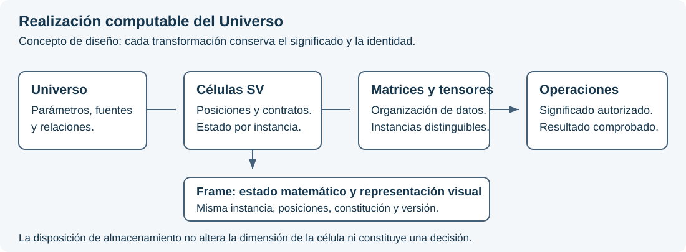
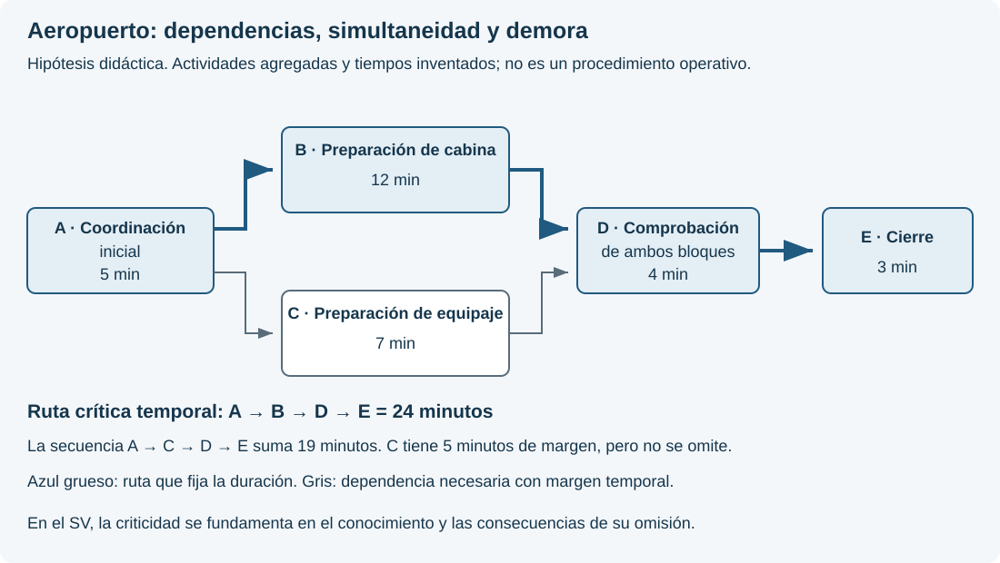
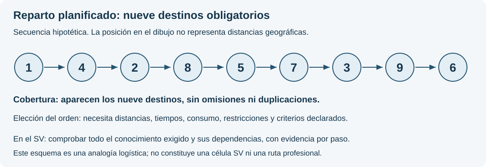

# Parámetros, rutas y trazabilidad: necesidades del sistema conjunto

**Versión 0.4 · 13 de octubre de 2026 · Conceptos de diseño y requisitos de integración.**

Este documento recoge las necesidades de representación y ejecución que vinculan la gestión documental, los Universos y el Lenguaje de Computación SV. No constituye nuevas rutas profesionales, sintaxis, tipos de la representación intermedia ni capacidades de ejecución recibidas. La propuesta de valoración ternaria de pertenencia a rutas se distingue expresamente de los requisitos ya establecidos.

## 1. Identidad, función y alcance del parámetro

El parámetro es una unidad de significado delimitada dentro de un Universo. La analogía con un átomo expresa su separación semántica respecto de otras unidades; no demuestra por sí sola atomicidad ni asigna una posición celular. El nombre no basta: cada definición identifica objeto, dominio, alcance, fuentes, versión y condiciones de aplicación.

Se distinguen tres objetos:

| Objeto | Qué representa | Valoración |
| --- | --- | --- |
| Parámetro de conocimiento | Una unidad delimitada de conceptos o datos generales necesarios para el Universo. | No recibe por sí mismo una valoración ternaria del caso ni una calificación de verdad de su contenido. |
| Relación entre un parámetro y una ruta | La pertenencia de ese parámetro a una ruta identificada, con alcance y condiciones expresos. | Se propone una valoración ternaria de esa relación, separada del contenido de conocimiento. |
| Parámetro singular de decisión | Una cuestión constituida para una valoración concreta que fundamenta el consejo al experto. | Recibe 0, 1 o U conforme a su contrato, observaciones y contexto. |

Las dos valoraciones pueden utilizar la misma terna sin significar lo mismo. No se copiará el resultado de pertenencia a una ruta al resultado decisional, ni a la inversa. Que una definición se reutilice en distintos casos tampoco transmite los valores de un caso a otro.

Cada parámetro conserva un único Universo propietario. Las relaciones transversales remiten a su identidad y versión; no crean otro propietario ni heredan permisos documentales, valores de casos o conclusiones. Un cambio de propietario debe designar el sustituto en la misma decisión válida. Un Universo constituido conserva al menos un parámetro asignado; un borrador incompleto no se presenta como constituido. La propiedad del parámetro y la de sus fuentes documentales son relaciones diferentes: un documento puede sustentar varios parámetros sin convertirse en su propietario.

## 2. Atomicidad y secuencia de constitución

La [adenda de reconciliación de la secuencia](https://github.com/juantoniolloretegea/SVperitus-dataset/blob/9939d600b3c3ffc3f4237f229ca0670de8f3693d/dominios/inmunologia/cambio-rumbo/adenda-reconciliacion-secuencia-constitutiva-y-puertas-inmunologia-2026-09-02-v0.1.md) distingue la consecuencia candidata necesaria para probar atomicidad de la consecuencia operacional que tendrá efectos en una ruta. La secuencia material pertinente es:

1. Delimitar la operación y las preguntas semánticas.
2. Establecer observables y consecuencias candidatas de error, omisión, fusión o inversión.
3. Adjudicar la atomicidad mediante esas distinciones, sin imponer una dimensión informática.
4. Constituir la propiedad y las referencias de los parámetros adoptados.
5. Constituir las consecuencias operacionales, composiciones y rutas.

Una consecuencia candidata no habilita un veto ni un consejo. Una pregunta todavía no adjudicada no se presenta como parámetro constituido. El [manifiesto terminal posterior](https://github.com/juantoniolloretegea/SVperitus-dataset/blob/9939d600b3c3ffc3f4237f229ca0670de8f3693d/dominios/inmunologia/cambio-rumbo/manifiesto-terminal-alcance-cobertura-y-terminacion-OP-IMM-001-Q0-v0-2026-09-03.md) conserva esa secuencia y fija la finitud del corte; la congelación provisional descrita en la adenda no se reproduce como estado actual. La suficiencia de aquel corte no acredita la constitución de toda la especialidad.

La distinción actual entre conocimiento y decisión no reclasifica retrospectivamente todos los parámetros de inventarios anteriores. Su correspondencia deberá justificarse mediante función y alcance. Tampoco se extrapola a todas las unidades de conocimiento la prueba operacional de atomicidad de una operación particular sin justificar su aplicabilidad.

## 3. Propuesta: valorar la pertenencia a una ruta

La evaluación corresponde a una relación identificada por **parámetro, versión del parámetro, ruta, versión de la ruta, condiciones de aplicación y contexto**. No es un atributo ternario permanente del conocimiento.

Para que pueda ejecutarse, deben constituirse previamente la proposición evaluada, la interpretación de cada resultado, los datos necesarios, las causas legítimas de U y el efecto sobre la ejecución. La IA puede intervenir en la evaluación únicamente dentro de esa autorización; no crea ni modifica por sí misma la relación ni su regla.

Ejemplo conceptual, sin finalidad profesional: la unidad de conocimiento K explica cómo interpretar la procedencia de un dato. La ruta R requiere comprobar esa procedencia. Se declara la proposición «K pertenece a R bajo las condiciones C». En este ejemplo, **0** expresa conformidad con esa pertenencia; **1**, no conformidad; **U**, imposibilidad de resolverla con la información admitida. Esta convención ilustra una regla que tendría que aprobarse para la ruta; no añade una correspondencia universal al núcleo del SV.

La valoración no afirma si el contenido de K es verdadero. Tampoco responde a la cuestión singular «¿queda acreditada la procedencia del dato de este caso?». K puede pertenecer a R y esa cuestión singular permanecer en U. Ambas salidas deben verse con su pregunta y evidencia respectivas.

El esquema es conceptual y no acredita una ruta constituida ni una capacidad implementada.

**Pertenencia, activación y obligatoriedad se registran por separado.** Un resultado de no pertenencia a R no elimina obligaciones de otra ruta aplicable. La incertidumbre sobre una dependencia obligatoria no habilita a omitirla: debe producir el tratamiento previsto —bloqueo, abstención o revisión competente—. Una ruta todavía no definida conserva ese estado documental; no se transforma por defecto en un valor U de una evaluación que nunca se ejecutó.

## 4. Células, valores y representación

Los [pilares del Lenguaje](https://github.com/juantoniolloretegea/SV-lenguaje-de-computacion/blob/f10aac725676997adc3840a1bd1a41e1579589ea/docs/calidad/PILARES_Y_RESTRICCIONES_DE_DISENO_DEL_LENGUAJE_DE_COMPUTACION_SV_2026_09_05.md) y el [documento de paridad](https://github.com/juantoniolloretegea/SV-lenguaje-de-computacion/blob/f10aac725676997adc3840a1bd1a41e1579589ea/docs/calidad/tuberias-ia/paridad-imagen-celula-matematica/CELULA_IMAGEN_Y_AGENTES_EN_EL_SV_P1_P3_BIS_2026_09_13_V2.md) gobiernan el encaje celular. Deben distinguirse la familia matemática, las dimensiones admitidas por una versión y la dimensión fija de una instancia.

Un inventario de 27 parámetros no autoriza automáticamente tres células de nueve ni una de 36 con posiciones de relleno. Una posición debe corresponder a un parámetro constituido. U conserva indeterminación en una posición válida; no rellena un hueco, un error técnico o una definición inexistente.

### Correspondencia celular pendiente y selección documental

Los inventarios documentales actuales OP-IMM-001 y OP-CYB-001 conservan, respectivamente, 27 y 32 referencias de parámetros. **Ninguno tiene todavía una correspondencia aprobada con una célula oficial del SV.** Esa correspondencia se determinará tras completar y revisar su dominio, con los reajustes que procedan. La ficha debe expresar esta restricción y evitar cualquier apariencia de constitución celular definitiva.

El catálogo de selección documental incluye las células (9,3), (16,4), (25,5), (36,6) y (49,7), junto con una opción expresa: **Pendiente de asignar célula del SV**. Esta última permite conservar un inventario sin forzar su dimensión. El sistema debe rechazar denominaciones ajenas al catálogo y atribuciones incompatibles con la restricción vigente; no basta con advertir al usuario después de guardar.

La coincidencia del número de parámetros con una dimensión admitida es necesaria, pero no suficiente. Deben acreditarse además identidad, orden, significado de las posiciones, contrato y versión de la constitución. Elegir una referencia documental no habilita su ejecución ni modifica el núcleo, la semántica o la representación intermedia. Una tipología futura requiere incorporación expresa y documentada; no puede deducirse de un campo de texto libre.

El [par SV(36,6) y SV(9,3) publicado](https://www.itvia.online/pub/de-svcustos-el-marco-de-intrusion-hasta-svperitus-celulas-sv-en-par-n--36--9--45/release/1) mantiene dos células independientes y compone sus resultados en paralelo. Las 45 posiciones del conjunto no constituyen una célula de dimensión 45. Un puente entre células y una composición paralela son relaciones diferentes, sujetas a contratos propios. La regla de composición del ejemplo publicado no se transfiere por analogía a todos los Universos.

### Contratos de valoración y representación

La propuesta de pertenencia no decide si esa valoración requiere una célula propia, una relación externa o una ampliación de representación. Esta decisión exige demostrar qué preserva el contrato vigente y qué información perdería. No se cambia la célula por analogía con un grafo.

Un código CIE-11, o la clasificación pertinente de otro dominio, identifica un concepto de referencia; no determina por sí solo diagnóstico, parámetros, ruta ni resultado. La correspondencia con el SV necesita definición, versión y fundamento propios.

El frame gráfico deberá corresponder a la misma instancia, revisión, posiciones y valores que su estado matemático. Egui presenta esa correspondencia; no decide pertenencias, reglas o consecuencias. El mapa de dependencias y el polígono decisional son vistas diferentes y enlazables.

### Realización celular de un Universo

El Universo constituido debe disponer de una realización computable mediante células SV. La cadena de diseño relaciona **Universo y parámetros → células constituidas → organización matricial → representación tensorial → operaciones autorizadas**. Cada transformación conserva las identidades y el significado; no convierte esos niveles en objetos semánticamente intercambiables.

La correspondencia entre parámetros y posiciones, las dimensiones y las relaciones celulares deben constituirse expresamente. La presencia de un concepto de conocimiento no autoriza a asignarle automáticamente 0, 1 o U para completar un estado. Su estructura y su eventual valoración conservan contratos diferenciados. Las referencias compartidas tampoco duplican por sí mismas un estado.

La organización de cálculo preserva cada célula y su vínculo con el frame. Cambiar la disposición de almacenamiento no permite reordenar posiciones, fusionar instancias ni transformar la prioridad documental en orden celular. Esta es la condición para estudiar la aceleración conservando el objeto del SV.

### Vector, frame y representación tensorial

El documento de paridad, apartado 2.2, expresa el vínculo contractual como **Frame_C = (frmat, frvis)**: estado matemático y representación visual de la misma instancia bajo un contrato C. No basta con disponer de un vector válido y una imagen legible si proceden de revisiones o constituciones distintas. La imagen puede materializarse cuando proceda; conservar el vínculo no obliga a mantener todos sus píxeles en memoria.

Una célula exacta es un vector plano, ordenado y posicional de estados de Σ = {0, 1, U}. Es un producto cartesiano finito, no un espacio vectorial sobre un cuerpo. La atomización proporciona unidades semánticas; constituir y valorar sus posiciones proporciona el estado celular. Un parámetro de conocimiento sin valoración no se convierte en un estado ternario por almacenarlo en un array.

Se plantea estudiar una representación tensorial computacional —datos ordenados en uno o varios ejes— para ejecutar por lotes operaciones compatibles. Por ejemplo, varias células de la misma dimensión y contrato podrían almacenarse con un eje de instancia y otro de posición. Ese almacenamiento no crea una nueva célula, no fusiona instancias y no autoriza sumas, productos matriciales, promedios o composiciones que el contrato del SV no haya definido. La codificación de U no será una aproximación numérica que pueda perderse en una conversión.

### Ejemplo: los 19.683 estados de SV(9,3)

SV(9,3) admite **3⁹ = 19.683 vectores de estado posibles**, cada uno de nueve posiciones. Una enumeración completa podría ocupar una tabla de 19.683 filas y nueve columnas. La tabla representa el espacio de estados; no convierte la célula en una matriz de 3 × 3 ni cambia su dimensión. Tampoco es necesario materializar todos los estados para evaluar uno. Para dimensiones mayores, el crecimiento de 3ⁿ exige justificar el almacenamiento y los recursos.

Un ejemplo de representación tensorial auxiliar consiste en separar tres indicadores: presencia de 0, presencia de 1 y presencia de U. Para cada instancia y posición, exactamente uno de los tres indicadores vale uno. **Ese uno es una marca de presencia, no el estado semántico 1 del SV.**

En un lote de m células compatibles de n posiciones, esos indicadores pueden organizarse en tres matrices de m × n. Multiplicar cada matriz por una columna de n unos permite contar, por instancia, N₀, N₁ y Nᵤ. Es una operación matricial con significado explícito: cuenta estados; no multiplica decisiones ni promedia U. Debe conservarse el vector original porque los recuentos no preservan el orden de las posiciones.

Por ejemplo, el estado ordenado (0, 0, U, 1, 0, U, 0, 1, 0) produce N₀ = 5, N₁ = 2 y Nᵤ = 2. La suma es nueve. El cálculo conserva U como categoría y no como cero, valor medio o ausencia. Otro orden con esos mismos recuentos seguiría siendo otro vector: por eso deben conservarse las posiciones y su frame.

La terminología general de vectores, matrices, tensores y producto matricial se apoya en Goodfellow, Bengio y Courville, *Deep Learning* (MIT Press, 2016), [capítulo 2, apartados 2.1 y 2.2](https://www.deeplearningbook.org/contents/linear_algebra.html). El ejemplo de indicadores es una aplicación explicativa propia; esa bibliografía no define ni valida la semántica del SV.

La evaluación posterior aplica exclusivamente la regla constituida. Cualquier otra multiplicación, relación entre matrices o composición de células necesita justificar entradas, operación y significado de la salida. Codificar U mediante un número no autoriza a tratarla como una magnitud ordinaria.

Rust debe custodiar dimensiones, identidades, tipos de valoración, contratos y correspondencia con los frames antes y después de cualquier ejecución acelerada. El cálculo paralelo es una posible realización de operaciones ya definidas, no una fuente de autoridad semántica. El soporte concreto de una GPU o TPU depende de su entorno de ejecución, representación admitida y operaciones disponibles; no se obtiene automáticamente por escribir Rust ni por contratar un modelo que utilice esos dispositivos.

La documentación de [wgpu sobre cómputo](https://wgpu.rs/doc/wgpu/struct.ComputePipeline.html) acredita la existencia de una interfaz de ejecución GPU utilizable desde Rust, no una integración recibida en el SV. La [arquitectura TPU de Google](https://docs.cloud.google.com/tpu/docs/system-architecture-tpu-vm) describe aceleración especializada de operaciones matriciales; no convierte cualquier relación o recorrido en una multiplicación de matrices. Los [límites de la aritmética en coma flotante](https://docs.nvidia.com/cuda/floating-point/index.html) justifican comprobar explícitamente la conservación del resultado al cambiar orden de ejecución o dispositivo.

Antes de adoptar esta vía se exige comparar una realización de referencia y la candidata acelerada: mismas entradas admitidas, posiciones, estados ternarios y resultados; rechazo equivalente de entradas inválidas; trazabilidad de transformaciones; y tiempos completos, incluidas preparación, transferencia, sincronización y recuperación. Una carga pequeña puede no compensar esos costes. No se declara una ganancia de rendimiento sin medirla ni se selecciona ahora una biblioteca, un dispositivo o un algoritmo.

Los tensores internos de un LLM pertenecen a su propia ejecución. Entregarle un texto con un vector del SV no acredita que haya ejecutado el contrato de ese vector en sus aceleradores. La prueba deberá identificar qué operación realiza el SV, qué recibe el modelo y qué resultado vuelve a comprobarse. El determinismo exigido a los controles no convierte automáticamente la inferencia del LLM en determinista.

## 5. Visualización requerida

Se requieren tres vistas relacionadas:

- **Composición:** documentos y objetos, selecciones, Universos propietarios y relacionados, parámetros y dependencias declaradas.
- **Rutas:** recorrido previsto y condiciones; rutas críticas sólo cuando su definición y consecuencias estén constituidas. La criticidad no determinada se muestra como tal, nunca como ausencia de riesgo.
- **Actuación:** recorrido efectivamente registrado, elementos suministrados, consultas registradas, referencias de la respuesta, comprobaciones y decisión posterior del experto.

La selección de un elemento debe mostrar de qué depende, qué depende de él, versiones, alcance, responsable de la decisión y evidencia. Debe permitir ampliar desde una visión general hasta un pasaje exacto, filtrar por Universo y ruta, distinguir referencias compartidas sin duplicarlas y comparar el recorrido previsto con el registrado. Una dependencia crítica omitida debe resultar visible con su causa y tratamiento, no desaparecer del dibujo.

La documentación de Microsoft Project sobre [relaciones entre tareas](https://support.microsoft.com/es-es/project/highlight-how-tasks-link-to-other-tasks) ofrece una referencia de interacción: seleccionar un elemento y destacar sus antecedentes y sucesores. Su [ruta crítica](https://support.microsoft.com/es-es/project/manage-your-project-s-critical-path) se vincula al calendario del proyecto. El SV necesita fundamentar la obligatoriedad por consecuencias de omisión; no adopta de esa analogía duraciones, holguras ni un algoritmo clínico.

Las ayudas explicarán «qué significa», «de dónde procede» y «qué permite concluir» cada valor. El color se acompañará de texto o símbolos. La terna decisional no compartirá una leyenda ambigua con pertenencia, estado documental o fallos técnicos. La visualización respetará los permisos de cada recurso, incluidos títulos y metadatos reservados.

### Ejemplo: cinco elementos y una ruta crítica

Sean A, B, C, D y E cinco elementos de conocimiento delimitados. Cada uno puede representar un Universo completo o una parte identificada de éste; la leyenda de la ruta debe declarar el alcance de cada elemento y sus documentos y parámetros asociados.

En este ejemplo se establecen dos reglas: los cinco elementos son obligatorios y cada uno requiere el cumplimiento del anterior. La ruta crítica es **A → B → C → D → E**. Es la única secuencia que satisface ambas reglas; su unicidad procede de estas condiciones expresas, no de una propiedad general de cualquier conjunto de cinco elementos.

| Recorrido propuesto | Comprobación frente a las reglas del ejemplo |
|---|---|
| A → B → C → D → E | Conserva los cinco elementos y respeta todas las dependencias. |
| A → B → D → E | Omite C, que es obligatorio. |
| A → C → B → D → E | Contiene todos los elementos, pero sitúa C antes de su requisito B. |
| A → B → C → E → D | Adelanta E respecto de su requisito D. |

Cinco elementos distintos admiten 5! = 120 permutaciones si no se fija ninguna posición. Si A debe ser el inicio y E el final, quedan 3! = 6 órdenes de los tres elementos intermedios. Esas posibilidades combinatorias no son autorizaciones: las dependencias del ejemplo sólo admiten una. Los recorridos que omiten elementos son variaciones adicionales y también deben confrontarse con las obligaciones declaradas.

**Ruta exigida y recorrido acreditado son objetos distintos.** Si únicamente constan cumplidos A y B, dibujar la ruta completa no permite dar por cumplido C. El acceso al siguiente paso dependiente debe conservar la condición pendiente y su evidencia. Esto tampoco impide consultar otras fuentes ya autorizadas que no dependan de ese paso.

Al seleccionar un elemento, la visualización deberá mostrar su Universo, los parámetros implicados, la edición documental, las páginas o pasajes utilizados, las condiciones de acceso y la evidencia de la actuación. Una figura no sustituye esos registros. Las flechas expresan dependencias de conocimiento; no duraciones ni costes. Los estados de seguimiento de este ejemplo no son valores de la terna decisional.

El diseño no atribuye todavía consecuencias profesionales concretas a una omisión ni establece el algoritmo que constituirá las rutas. Esa definición requiere reglas, fuentes y validación propias del dominio. La representación permite explicar y comprobar una ruta una vez constituida; no la inventa.

### Analogía: la coordinación de una escala aeroportuaria

En la gestión aeroportuaria, la preparación de una salida reúne actividades dependientes, algunas simultáneas. EUROCONTROL describe el seguimiento de la escala y la preparación de la salida mediante hitos que permiten actualizar previsiones y avisos. Esta referencia aporta una analogía de coordinación y seguimiento; no prescribe las rutas del SV. [EUROCONTROL: especificación A-CDM, edición 1.0](https://www.eurocontrol.int/publication/eurocontrol-specification-airport-collaborative-decision-making-cdm).

Supóngase la siguiente planificación simplificada. Las actividades y sus duraciones son **hipotéticas**; agrupan operaciones únicamente para explicar el diagrama y no representan un procedimiento de aeropuerto.

| Elemento | Bloque del ejemplo | Duración supuesta | Requisito previo |
|---|---|---|---|
| A | Coordinación inicial de la escala | 5 minutos | Inicio |
| B | Preparación de cabina | 12 minutos | A terminado |
| C | Preparación de equipaje | 7 minutos | A terminado |
| D | Comprobación conjunta de ambos bloques | 4 minutos | B y C terminados |
| E | Cierre del proceso considerado | 3 minutos | D terminado |

B y C pueden desarrollarse simultáneamente. Bajo estas hipótesis, la duración resulta **5 + máximo(12, 7) + 4 + 3 = 24 minutos**. La ruta A → B → D → E fija la terminación y es la única ruta crítica temporal de este ejemplo. La secuencia A → C → D → E suma 19 minutos: C dispone de cinco minutos de margen, pero **continúa siendo obligatoria**. Elegir la secuencia más corta y prescindir de B incumpliría el requisito de D. Una demora de tres minutos en B llevaría la terminación a 27 minutos; si el coste adicional supuesto fuera de 100 unidades monetarias por minuto de demora final, añadiría 300 unidades. Son cifras didácticas, no estimaciones de un aeropuerto.

Microsoft Project representa este tipo de dependencias y distingue las tareas con margen de las que condicionan la fecha de terminación. Ese significado temporal explica la analogía y debe conservarse al citar la aplicación. [Microsoft: administración de la ruta crítica](https://support.microsoft.com/es-es/project/manage-your-project-s-critical-path).

En el SV se conserva la idea de **dependencias explícitas, condiciones de avance y seguimiento comprobable**, mientras que la criticidad se fundamenta en el conocimiento requerido y las consecuencias de omitirlo. Un parámetro no se vuelve prescindible porque su consulta sea breve ni porque ocupe pocos documentos. Del mismo modo, una dependencia no desaparece por pertenecer a un Universo compartido. El cálculo temporal anterior no es el algoritmo de rutas del SV; permite comprender gráficamente por qué cada obligación debe estar definida y acreditada.

### Analogía: un reparto con nueve destinos

Un repartidor debe atender nueve destinos. Omitir uno incumple el encargo aunque reduzca el tiempo o el combustible. Visitar los nueve, por otra parte, no determina automáticamente el orden: hacen falta distancias, tiempos de viaje, consumo, punto de partida y llegada, y las restricciones que correspondan. Esta clase de problema se estudia en planificación de recorridos; una formulación básica es el problema del viajante, documentado en [Google OR-Tools](https://developers.google.com/optimization/routing/tsp).

La secuencia **1 → 4 → 2 → 8 → 5 → 7 → 3 → 9 → 6** del diagrama sólo ilustra cobertura completa. No se afirma que ahorre más combustible ni tiempo: no se han proporcionado datos que permitan calcularlo. Ambos criterios pueden favorecer recorridos diferentes y necesitan una regla de comparación declarada. Con nueve destinos distintos hay 9! = 362.880 órdenes posibles antes de imponer restricciones o identificar recorridos equivalentes.

El ejemplo explica por qué la planificación no debe confiarse a una secuencia aparentemente razonable. En el SV, una propuesta debe someterse a comprobaciones de cobertura, dependencias, permisos y evidencia. Una respuesta convincente de un LLM no acredita por sí misma que se haya consumido todo el conocimiento exigido. Se conserva exclusivamente la denominación **ruta crítica** para el concepto del SV; las analogías logísticas no fijan su algoritmo ni convierten el número de destinos en una dimensión celular.

### Matrices, restricciones y aceleración

La investigación operativa ofrece antecedentes útiles. Un problema de transporte puede expresar cantidades mediante una matriz X y costes unitarios mediante otra matriz C; el coste total se escribe como la suma de Cᵢⱼ·Xᵢⱼ, sometida a restricciones de oferta, demanda y capacidad. Su formulación lineal admite métodos como el símplex. Ordenar visitas añade restricciones diferentes: una asignación de cantidades no constituye por sí sola un recorrido que visite todos los destinos. Véanse los ejemplos oficiales de [flujo de coste mínimo](https://developers.google.com/optimization/flow/mincostflow) y [programación lineal](https://developers.google.com/optimization/lp/lp_example).

El objetivo de diseño del SV es llevar las operaciones computables a representaciones vectoriales, matriciales y tensoriales que permitan aprovechar la aceleración disponible, bajo control de Rust. Cada matriz debe declarar qué significan sus filas, columnas, valores y operaciones. **La forma numérica conserva el significado; no lo sustituye.** Las restricciones, autorizaciones y evidencias deben acompañar la representación.

Una representación tensorial puede facilitar cálculos en paralelo; no convierte automáticamente la búsqueda de una ruta en una multiplicación de matrices ni elimina su dificultad combinatoria. La elección del algoritmo, su equivalencia con las reglas del SV y su rendimiento completo requieren comprobación. La aceleración es un objetivo verificable, no una velocidad insuperable acreditada por emplear Rust, GPU o tensores.

## 6. Evidencia de una actuación

La reconstrucción exige conservar, con identidad y versiones:

| Elemento | Evidencia necesaria |
| --- | --- |
| Fuente | Documento u objeto, edición, huella, procedencia, licencia y selección exacta. |
| Representación | Original o derivado, transformación, cobertura, correspondencia y cotejo. |
| Organización del conocimiento | Universo propietario y relaciones, parámetros, definiciones y prioridades vigentes. |
| Ruta | Definición, condiciones, dependencias, obligatoriedad, activación y tratamiento de omisiones. |
| Evaluación | Pregunta precisa, clase de valoración, contexto, entradas, regla y versión, resultado y causas de U. |
| Entrega | Autorización vigente, destinatario, contenido efectivamente remitido, límites y recepción observable. |
| Respuesta y revisión | Salida conservada, referencias declaradas, comprobación de soporte y decisión del experto con su fundamento. |

El registro distinguirá **preparado**, **suministrado**, **consultado mediante una operación observable**, **citado por el modelo** y **contrastado con la fuente**. Ninguno implica automáticamente el siguiente. No se certificará lectura cognitiva ni razonamiento interno no observables; una explicación del modelo es una salida conservada, no prueba independiente de su proceso.

El Calificador de actividades documentales asignará determinísticamente la actividad registrada, conforme a reglas Rust versionadas. Conservará quién actuó, con qué función, cuándo, sobre qué revisión y con qué resultado. El historial de cada documento será una consulta filtrada del registro y enlazará las actuaciones relacionadas sin exponer datos ajenos.

Cambios, revocaciones y sustituciones producen nuevos hechos, no borran antecedentes. Una revocación impide nuevas entregas afectadas; no altera la evidencia de una entrega anterior ni permite retirar datos ya recibidos de la memoria del destinatario. Las reglas de conservación y acceso histórico deben quedar expresas.

La auditabilidad permite examinar responsabilidades y decisiones. No asigna por sí sola responsabilidad jurídica, ni exonera automáticamente a quien diseñó, configuró, suministró o utilizó el sistema. Deben identificarse las funciones profesionales, documentales y técnicas que efectivamente intervinieron. La reproducibilidad formal tampoco demuestra la corrección científica de las entradas.

## 7. Necesidades para el Lenguaje y condiciones de aceptación

Estas condiciones constituyen un programa de verificación pendiente, no resultados de pruebas ejecutadas:

| Necesidad | Comprobación exigida antes de declararla disponible |
| --- | --- |
| Separación de significados | Rechazar la sustitución de una valoración de pertenencia por una decisional aunque ambas contengan 0, 1 o U. |
| Identidad y propiedad | Rechazar propietario ausente o múltiple; permitir una transferencia completa y trazada; no vaciar un Universo constituido. |
| Compartición | Conservar identidad de referencia y versiones, sin copiar estados de casos ni ampliar acceso. |
| Selección documental | Resolver cada página o pasaje contra la edición exacta; rechazar selecciones sin correspondencia tras una transformación. |
| Dependencias | Aplicar una ruta constituida; impedir que la ausencia o indeterminación de una dependencia obligatoria se trate como permiso para omitirla. |
| Estado y figura | Detectar discordancia de instancia, revisión, posición o valor entre registro matemático y frame. |
| Ejecución acelerada | Conservar resultados y rechazos de la referencia, identidad por instancia y trazabilidad; medir el recorrido completo antes de afirmar una mejora. |
| Revocación e historial | Denegar nuevas entregas revocadas conservando el soporte histórico de las anteriores. |
| Frontera entre nodos | Preservar las mismas identidades, alcance, permisos y evidencia en los nodos 1, 2 y 3; rechazar información obligatoria perdida en la adaptación. |

Cada necesidad seguirá este recorrido: definición del requisito, contraste con los contratos vigentes, ejemplo verificable de pérdida o ambigüedad, identificación del componente competente, decisión versionada, realización en Rust y prueba de aceptación. Una necesidad no demuestra por sí sola que haya que modificar el núcleo; una limitación probada tampoco debe ocultarse para evitar su revisión.

Se preserva la secuencia del dominio: las necesidades conceptuales aquí registradas no sustituyen el expediente de requisitos demostrados que corresponda a su fase competente. No se declaran constituidas rutas, células ni algoritmos de decisión por publicarlas.

La gestión documental y de usuarios conserva sus reglas de autorización. La IA consume el material y las definiciones habilitadas; no cambia propietarios, prioridades, permisos, parámetros ni rutas. La conexión de un nodo por Internet no autoriza navegación documental libre.

## 8. Referencias de encaje y documentación pública

- [Evaluación documental de rutas, conocimiento y trazabilidad](https://github.com/juantoniolloretegea/SV-lenguaje-de-computacion/blob/f10aac725676997adc3840a1bd1a41e1579589ea/docs/calidad/tuberias-ia/frame-significado-humano-trazabilidad-y-fidelidad/ACTA_EVALUACION_Y_RECEPCION_DOCUMENTAL_RUTAS_CONOCIMIENTO_SV_2026_09_14.md), especialmente sus apartados 4.1–4.5.
- [Transición secuencial desde OP-IMM-001](https://github.com/juantoniolloretegea/SV-lenguaje-de-computacion/blob/f10aac725676997adc3840a1bd1a41e1579589ea/docs/dominios/inmunologia/ACTA_DE_CONFORMIDAD_DE_TRANSICION_SECUENCIAL_DESDE_OP-IMM-001_AL_LENGUAJE_SV_2026_09_03.md).
- [Dominios y universos: parámetros, rutas y evidencia](https://documentos-sv.itvia.online/dominios/universos/parametros-rutas.html).
- [Manual del Lenguaje: requisitos de integración](https://documentos-sv.itvia.online/dominios/lenguaje-de-computacion/manual/parametros-rutas.html).

Las referencias fijadas a revisiones identifican los antecedentes utilizados. La distinción y la propuesta de este documento no se atribuyen retrospectivamente como formulaciones literales de esos antecedentes.

---

© 2026 Juan Antonio Lloret Egea. Algunos derechos reservados. | ORCID: 0000-0002-6634-3351 | Instituto Tecnológico Virtual de la Inteligencia Artificial para el Español™ (ITVIA) | IA eñ™ – La Biblia de la IA™ | ISSN 2695-6411 | Licencia Creative Commons Atribución-NoComercial-SinDerivadas 4.0 Internacional (CC BY-NC-ND 4.0).
